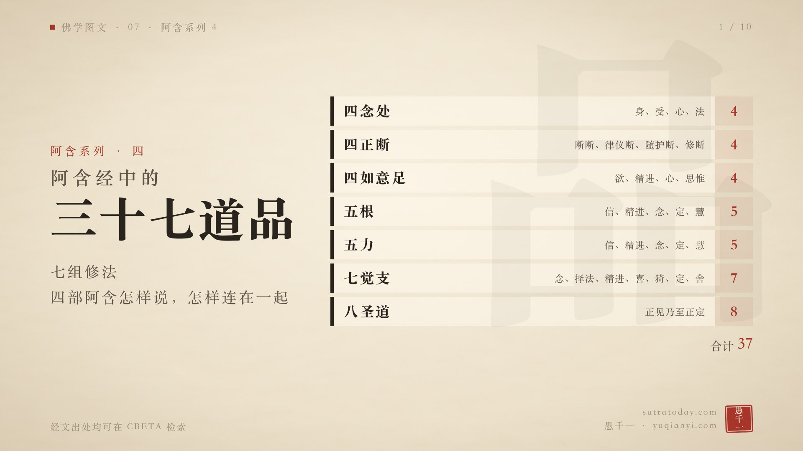
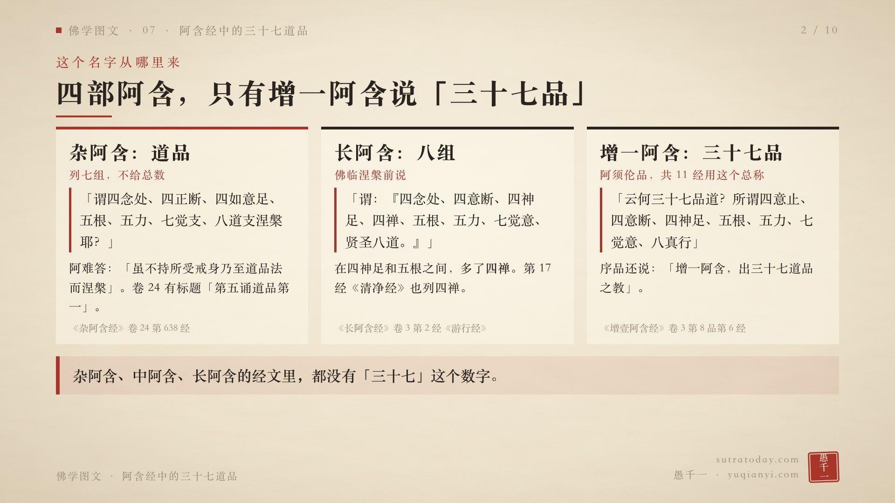
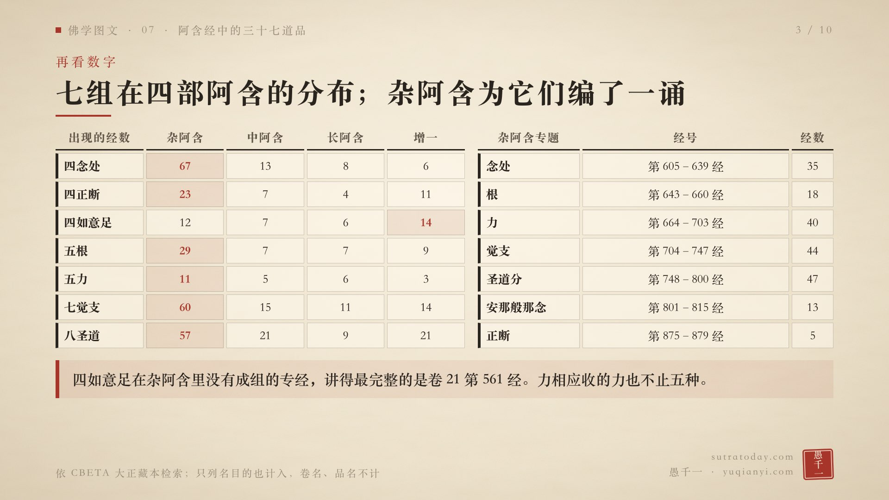
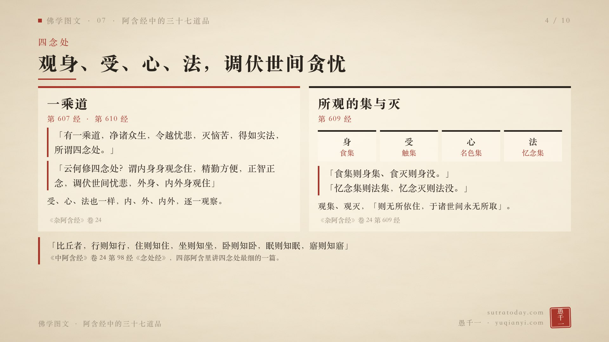
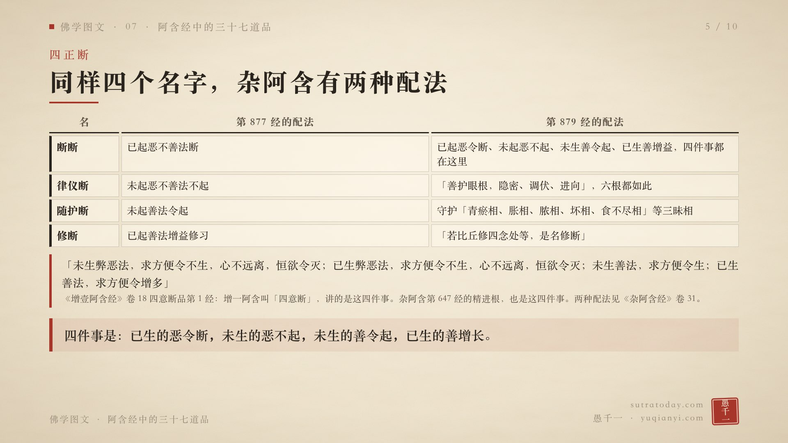
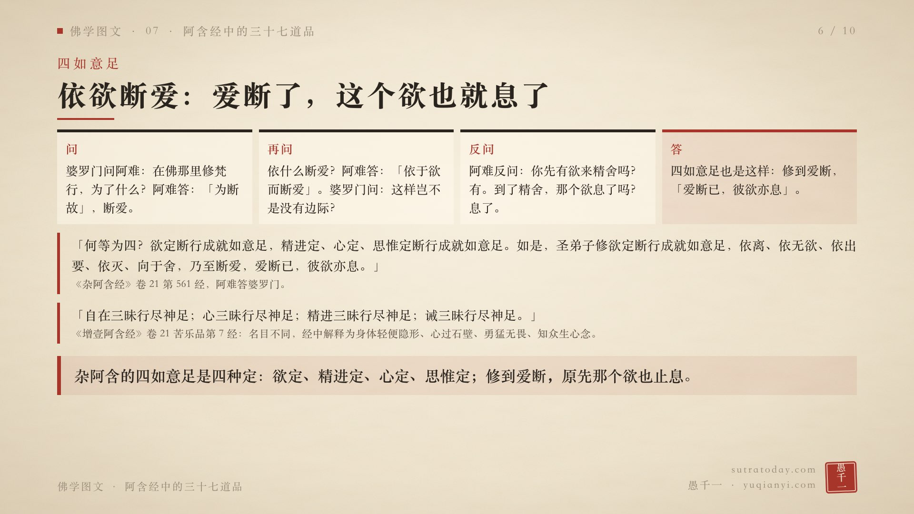
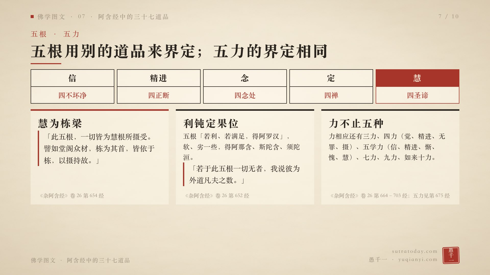
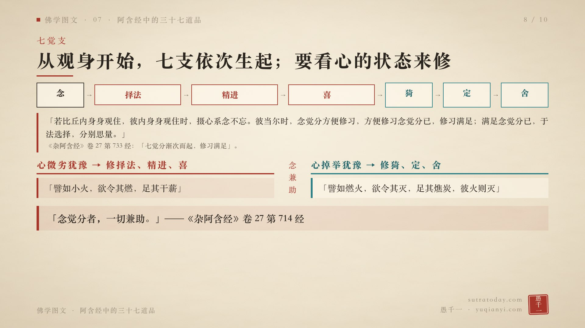
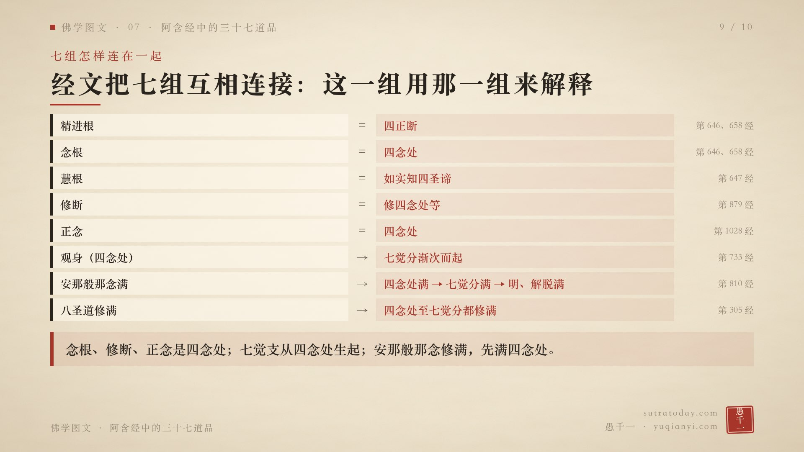
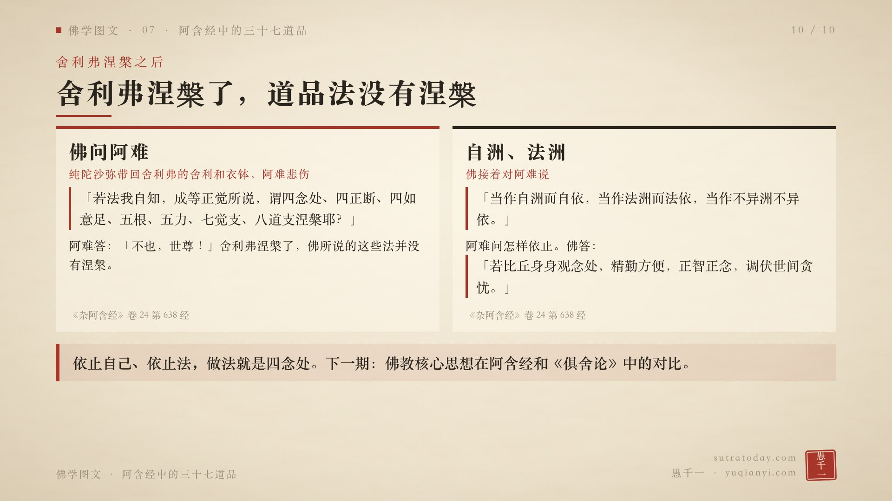

这是「佛学图文」第七期，也是阿含系列的第四期：阿含经中的三十七道品。

三十七道品是七组修法：四念处、四正断、四如意足、五根、五力、七觉支、八圣道。四加四加四加五加五加七加八，一共三十七。

八圣道上一期讲过了，这一期讲其余六组，以及七组之间的连接。还是只看四部阿含原文，杂阿含优先，不引论典。《俱舍论》把三十七法归成十种实体、分配到各个修行阶位的说法，放到下一期对比。

先看名字。四部阿含里，只有增一阿含说「三十七品」。

《杂阿含经》的经文里没有「三十七」这个数字，用的总称是「道品」。卷二十四第六三八经，佛问阿难：「若法我自知，成等正觉所说，谓四念处、四正断、四如意足、五根、五力、七觉支、八道支涅槃耶？」阿难回答时说「虽不持所受戒身乃至道品法而涅槃」。卷二十四开头还有一个标题：「第五诵道品第一」。

《长阿含经》卷三《游行经》，佛临涅槃前说，自己以此法成最正觉：「谓：『四念处、四意断、四神足、四禅、五根、五力、七觉意、贤圣八道。』」在四神足和五根之间，多了四禅，一共八组。第十七经《清净经》也列了四禅。中阿含的经文里，也没有「三十七」。

《增壹阿含经》卷三阿须伦品第六经说：「云何三十七品道？所谓四意止、四意断、四神足、五根、五力、七觉意、八真行。」增一阿含一共有 11 经用这个总称，序品还说：「增一阿含，出三十七道品之教。」

再看数字。

在 CBETA 大正藏本里检索各组名目，四念处：杂阿含 67 经，中阿含 13 经，长阿含 8 经，增一阿含 6 经。七觉支：杂阿含 60 经，中阿含 15 经，长阿含 11 经，增一阿含 14 经。四如意足是个例外，增一阿含的 14 经比杂阿含的 12 经多。

杂阿含为这些修法编了一诵，分成几个专题：念处第六〇五到六三九经，根第六四三到六六〇经，力第六六四到七〇三经，觉支第七〇四到七四七经，圣道分第七四八到八〇〇经，安那般那念第八〇一到八一五经，正断第八七五到八七九经。

四如意足在大正藏本杂阿含里没有成组的专经，讲得最完整的是卷二十一第五六一经。

四念处。

《杂阿含经》卷二十四第六〇七经：「有一乘道，净诸众生，令越忧悲，灭恼苦，得如实法，所谓四念处。何等为四？身身观念处，受、心、法法观念处。」

怎样修？第六一〇经：「云何修四念处？谓内身身观念住，精勤方便，正智正念，调伏世间忧悲，外身、内外身观住，精勤方便，正念正知，调伏世间忧悲。」受、心、法也一样，内、外、内外，逐一观察。

第六〇九经讲所观的集和灭：「食集则身集、食灭则身没」；「触集则受集，触灭则受没」；「名色集则心集，名色灭则心没」；「忆念集则法集，忆念灭则法没」。身依食，受依触，心依名色，法依忆念。这样观集、观灭，「则无所依住，于诸世间永无所取」。

讲四念处最细的，是《中阿含经》卷二十四第九十八经《念处经》。身念处下面列了多种观法，第一种是：「比丘者，行则知行，住则知住，坐则知坐，卧则知卧，眠则知眠，寤则知寤。」

四正断。杂阿含把它们叫断断、律仪断、随护断、修断。这四个名字配什么内容，《杂阿含经》卷三十一有两种说法。

第八七七经的配法：已起的恶不善法令断，叫断断；未起的恶不善法不起，叫律仪断；未起的善法令起，叫随护断；已起的善法增益修习，叫修断。

第八七九经的配法不同：上面这四件事，都归在「断断」里。律仪断，是「善护眼根，隐密、调伏、进向」，耳鼻舌身意也一样。随护断，是守护「青瘀相、胀相、脓相、坏相、食不尽相」这些三昧相。修断，是「若比丘修四念处等，是名修断」。

增一阿含叫「四意断」。卷十八四意断品第一经说的是那四件事：「未生弊恶法，求方便令不生……已生弊恶法，求方便令不生……未生善法，求方便令生；已生善法，求方便令增多。」杂阿含第六四七经解释精进根，用的也是这四件事。

四如意足。

《杂阿含经》卷二十一第五六一经，是阿难和一位婆罗门的对话。

婆罗门问：你们在沙门瞿昙那里修梵行，为了什么？阿难说：「为断故。」断什么？断爱。依什么断爱？阿难说：「依于欲而断爱。」

婆罗门说：那岂不是没有边际了？用欲去断欲，断不完。

阿难反问：你来精舍之前，有想来的欲吗？有。到了精舍，那个欲息了吗？息了。

阿难说，四如意足也是这样：「欲定断行成就如意足，精进定、心定、思惟定断行成就如意足。如是，圣弟子修欲定断行成就如意足，依离、依无欲、依出要、依灭、向于舍，乃至断爱，爱断已，彼欲亦息。」

增一阿含卷二十一苦乐品第七经，名目和解释都不一样：「自在三昧行尽神足；心三昧行尽神足；精进三昧行尽神足；诫三昧行尽神足。」经中解释成身体轻便隐形、心遍十方穿过石壁、勇猛无畏、知众生心念等。

五根和五力。

《杂阿含经》卷二十六第六四六经：「信根者，当知是四不坏净；精进根者，当知是四正断；念根者，当知是四念处；定根者，当知是四禅；慧根者，当知是四圣谛。」五根是用别的修法来界定的。第六七五经讲五力，界定和五根相同。四部阿含里，检索不到说明根和力有什么区别的经文。

五根之中，慧为首。第六五四经：「此五根，一切皆为慧根所摄受。譬如堂阁众材，栋为其首，皆依于栋，以摄持故。」

根的利钝，决定证到哪一果。第六五二经说，五根「若利、若满足，得阿罗汉」，软、劣一些，得阿那含、斯陀含、须陀洹；「若于此五根一切无者，我说彼为外道凡夫之数」。

杂阿含的力相应，收的力不止五种。还有三力；四力，是觉力、精进力、无罪力、摄力；五学力，是信、精进、惭、愧、慧；七力、九力，一直到如来十力。

七觉支：念、择法、精进、喜、猗、定、舍。猗，就是轻安。

《杂阿含经》卷二十七第七三三经，一位比丘问什么是觉分。佛说：「所谓觉分者，谓七道品法。」它们是依次生起的：「若比丘内身身观住，彼内身身观住时，摄心系念不忘。彼当尔时，念觉分方便修习，方便修习念觉分已，修习满足；满足念觉分已，于法选择，分别思量。」观身时系念不忘，是念觉分；念满足了，对法加以选择、思量，是择法觉分；依次到舍觉分。

什么时候修哪一支？卷二十七第七一四经说，要看心的状态。

心微劣、犹豫的时候，修择法、精进、喜觉分：「譬如小火，欲令其燃，足其干薪。」这时修猗、定、舍，就像小火上加燋炭，火就灭了。

心掉举、犹豫的时候，修猗、定、舍觉分：「譬如燃火，欲令其灭，足其燋炭，彼火则灭。」这时修择法、精进、喜，就像大火上加干柴，火更旺。

那念觉分呢？经的最后一句：「念觉分者，一切兼助。」

七组之间，经文是互相连接的。

精进根是四正断，念根是四念处（第六四六、六五八经）；慧根是如实知四圣谛（第六四七经）；修断是修四念处等（第八七九经）；正念，佛也用四念处来解释（第一〇二八经）。

七觉分从观身，也就是四念处，依次生起（第七三三经）。

第八一〇经说，安那般那念多修习，「能令四念处满足；四念处满足已，七觉分满足；七觉分满足已，明、解脱满足」。

第三〇五经说：「八圣道修习满足已，四念处修习满足，四正勤、四如意足、五根、五力、七觉分修习满足。」

这些连接里，四念处出现得最多：念根、修断、正念是它，七觉支从它生起，安那般那念修满，先满的也是它。

最后，回到第六三八经，把故事讲完。

舍利弗病重涅槃，弟子纯陀沙弥带着舍利和衣钵，到王舍城见阿难。阿难告诉佛：我全身都没了力气，四方都辨不清，话也说不出来，因为和上舍利弗涅槃了。

佛问阿难：舍利弗是把戒身、定身、慧身、解脱身、解脱知见身带走涅槃了吗？阿难说没有。佛又问：「若法我自知，成等正觉所说，谓四念处、四正断、四如意足、五根、五力、七觉支、八道支涅槃耶？」阿难说：「不也，世尊！」

舍利弗涅槃了，这些法并没有涅槃。

佛接着告诉阿难：如来不久也要过去。「当作自洲而自依，当作法洲而法依，当作不异洲不异依。」以自己为洲渚，以法为洲渚，不依别的。

阿难问：怎样才是以自己为依、以法为依？佛说：「若比丘身身观念处，精勤方便，正智正念，调伏世间贪忧。」外身、内外身，受、心、法，也都这样。

依止自己、依止法，做法就是四念处。

阿含经的四圣谛、十二因缘、八正道、三十七道品，到这里讲完了。下一期，把这些说法和《俱舍论》做对比。

文中经文均可在 CBETA 检索。

愿以此功德，普及于一切；我等与众生，皆共成佛道。
