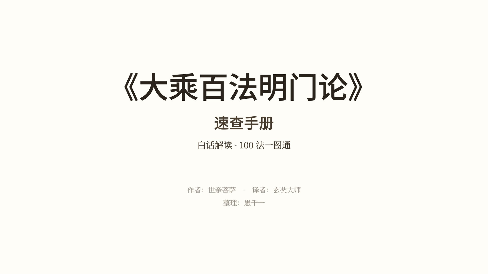

前些时候我录了《百法》五讲视频，现在把它整理成图文，一讲一篇，方便没法看视频的朋友慢慢读。今天是第一讲：五位百法。

《大乘百法明门论》由世亲菩萨造、玄奘大师译，简称《百法》。它把世间与出世间的一切现象归纳为一百个法，分成五大类，叫「五位百法」。

这一讲把这一百个法逐个过一遍，讲每一法的基本含义。这是入门唯识、也是入门大乘佛教的基础课。

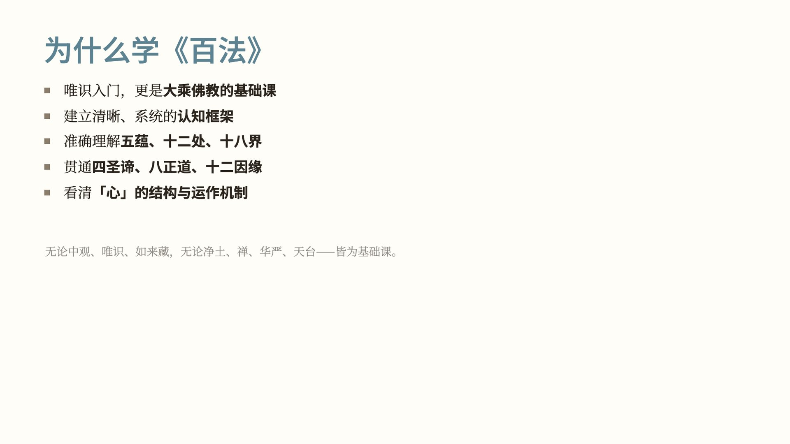

也许有人会问：《百法》和今天的学习、修行有什么关系？

学百法，可以：

- 建立一套有条理、成系统的认知框架；
- 准确理解五蕴、十二处、十八界这些佛法常用的术语；
- 贯通四圣谛、八正道、十二因缘，并落实到修行之中；
- 看清楚我们这颗「心」是怎么运作的。

所以，无论学的是中观、唯识、如来藏，还是净土、禅宗、华严、天台，百法都是绕不开的基础课。

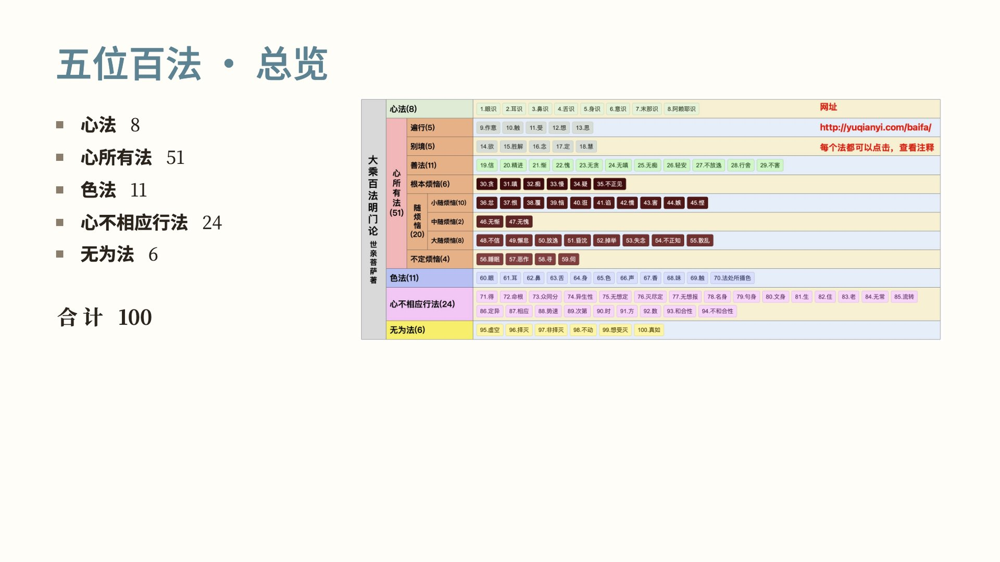

先看《百法》的总框架。一切法分为五大类：

| 类别 | 数目 | 说明 |
|---|---|---|
| 心法 | 8 | 又叫八识，精神作用的主体 |
| 心所有法 | 51 | 伴随心王而起的种种心理功能 |
| 色法 | 11 | 物质层面的法 |
| 心不相应行法 | 24 | 既非心、也非色，是一类抽象的法相 |
| 无为法 | 6 | 不由因缘造作而生 |

8 + 51 + 11 + 24 + 6，正好一百，这就是「百法」名字的由来。

上图右边是整部《百法》的目录全景图。在我的公众号「愚千一」里搜「百法」，可以找到原图下载。

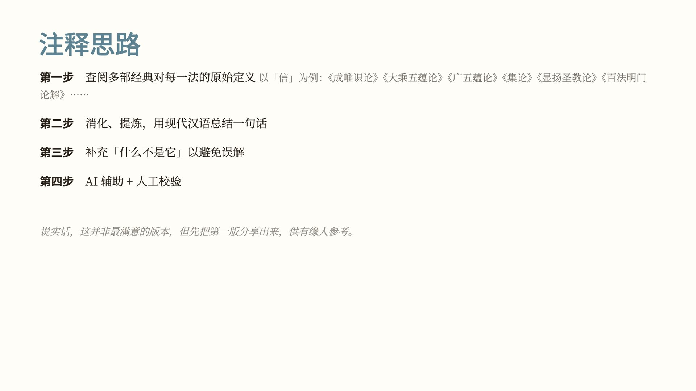

进入正文之前，先交代一下我的注释方法。

1. 查阅经论。每一个法，都到《成唯识论》《大乘五蕴论》《大乘广五蕴论》《大乘阿毗达磨集论》《显扬圣教论》《百法明门论解》等不同经论里，找它的原始定义。
2. 把几家的定义消化、提炼，用现代汉语凝缩成一句话。
3. 补充「什么不是它」，避免因为名词相近而误解。
4. 借助 AI 加快整理，但每一条都经过人工校对。

说实话，这还不是我最满意的版本，先把第一版分享出来，供有缘人参考。

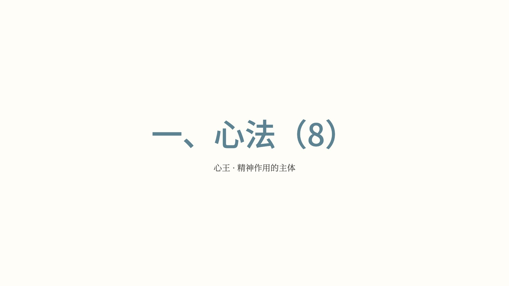

第一大类：心法，共 8 个。

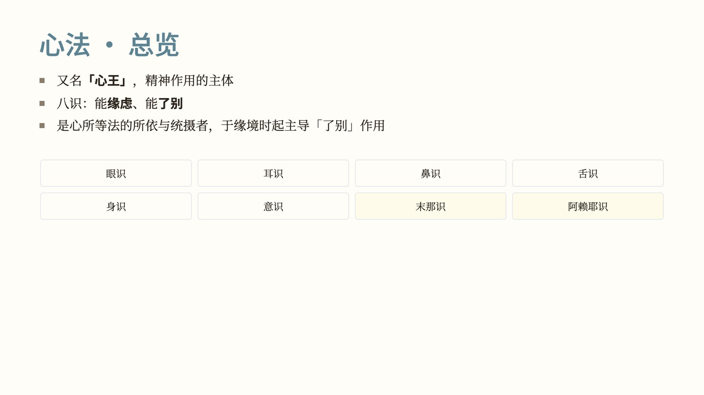

心法又叫「心王」，是精神作用的主体。

为什么叫「王」？因为在诸法之中，它是能认识、能了别的主体：一切认识、分别、执持、相续，都依靠这八识运转。

心王一共八个：前五个对应五感，是眼识、耳识、鼻识、舌识、身识；第六个是意识；第七、第八是末那识和阿赖耶识，这两个比较深，下面单独讲。

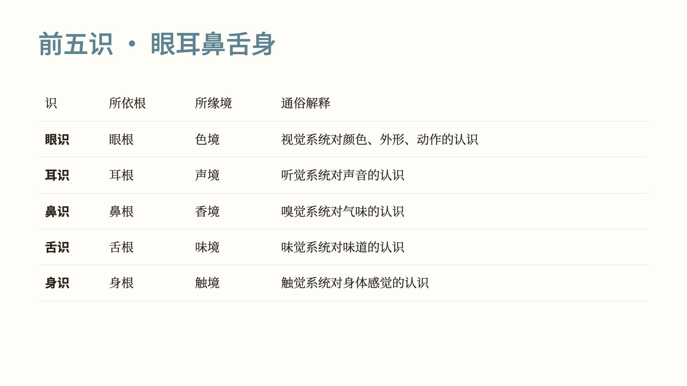

前五识对应五感：

| 识 | 所依根 | 所缘境 |
|---|---|---|
| 眼识 | 眼根 | 色境：颜色、外形、动作 |
| 耳识 | 耳根 | 声境：声音 |
| 鼻识 | 鼻根 | 香境：气味 |
| 舌识 | 舌根 | 味境：味道 |
| 身识 | 身根 | 触境：身体的感觉 |

可以简单理解为视觉、听觉、嗅觉、味觉、触觉这五种最基本的感官认识能力。

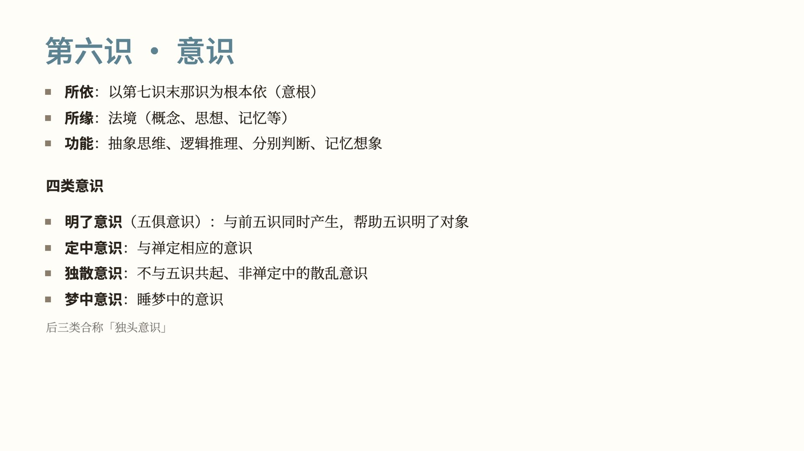

第六识叫意识。

和前五识不同，意识不依靠肉体感官，而是以第七识末那识为根本依，缘的是「法境」，也就是概念、思想、记忆这一类抽象对象。抽象思维、逻辑推理、分别判断、记忆想象，都是意识的作用。

唯识把意识分成四类：

- **明了意识**，又叫五俱意识，和前五识同时生起，帮助五识认清对象。
- **定中意识**，禅定中的意识活动。
- **独散意识**，既不和五识一起，也不在禅定中，是平常散乱的意识。
- **梦中意识**，睡梦中比较模糊的独散意识。

后三类合起来叫「独头意识」。

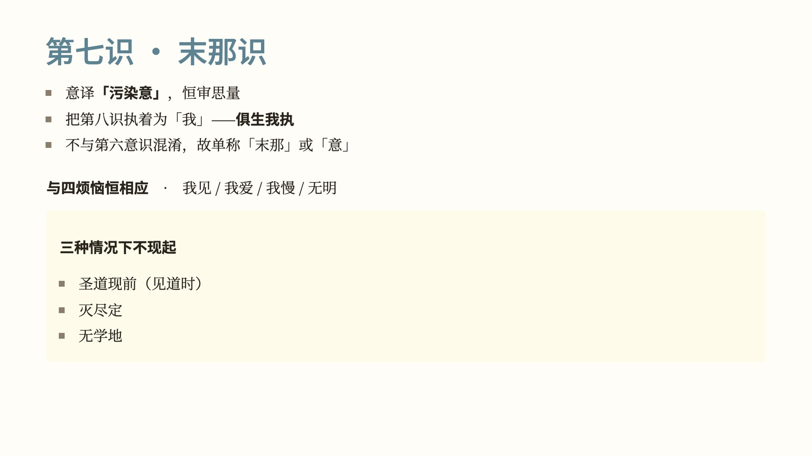

第七识，末那识。

「末那」是音译，意思是「意」；因为它恒与烦恼相应，又叫「染污意」。它的特点是恒常、不间断地把第八识当成「我」来执着，这就是与生俱来的「俱生我执」。

因为第六识已经叫「意识」，为了不混淆，第七识就用音译，叫「末那」，或者单称「意」。

末那识始终和四种烦恼相伴：我见、我爱、我慢、我痴。无论当下起的是善心、恶心，还是不善不恶的心，末那识都在背后执取「我」。

只有三种情况下它会停下来：圣道现前的时候（见道时）、入灭尽定的时候，以及阿罗汉、缘觉、佛的无学位。

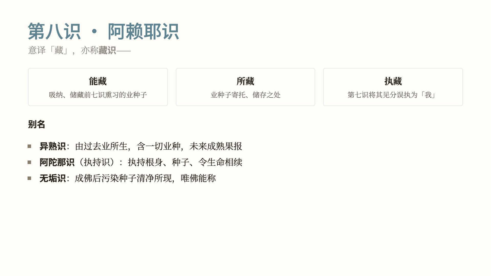

第八识，阿赖耶识，意译为「藏」，所以又叫「藏识」。这个「藏」有三层意思：

- **能藏**：能摄持、储藏前七识熏习而成的一切业种子。
- **所藏**：它是这些种子存放的地方。
- **执藏**：它被第七识误认为「我」，紧紧抓住不放。

因为有「执藏」这一层，从凡夫一直到第七地菩萨，都还用「阿赖耶识」这个名字。

它还有几个别名：

- **异熟识**：由过去的业所招感，含藏一切业种子，将来成熟为果报。
- **阿陀那识**，意译「执持识」：执持根身和种子，让生命相续不断。
- **无垢识**：成佛之后，染污的种子都已清净，就叫「无垢识」。只有佛的第八识才称无垢。

讲完心王八识，进入第二大类：心所有法，共 51 个。

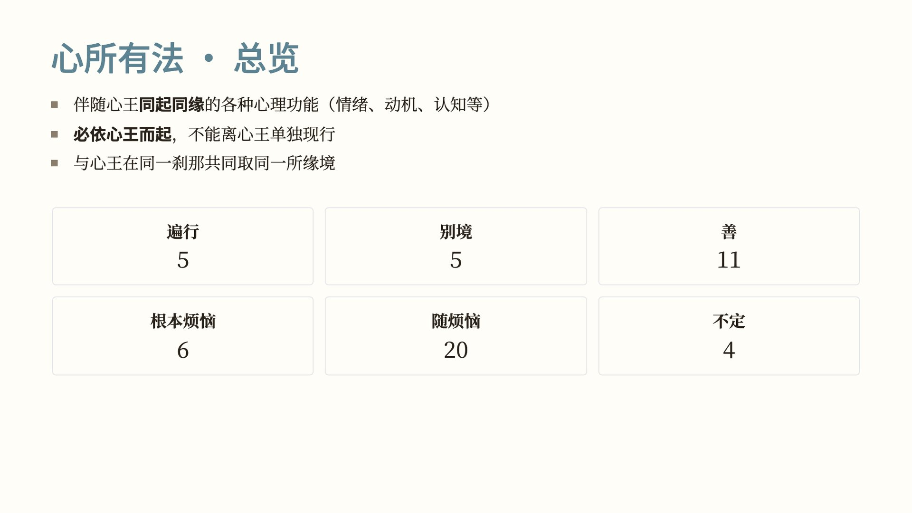

心所有法，简称「心所」。它和心王是什么关系？

心所是伴随心王同起、同缘的心理功能，包括情绪、动机、认知等。心王只负责「了别」对象；注意、感受、取像、造作、善恶染净这些具体功能，由心所负责。

有两点要记住：

1. 心所必须依靠心王才能生起，不能单独现行；
2. 心所与心王在同一刹那，共同缘取同一个所缘境。

51 个心所分成六类：遍行 5、别境 5、善 11、根本烦恼 6、随烦恼 20、不定 4。下面一类一类看。

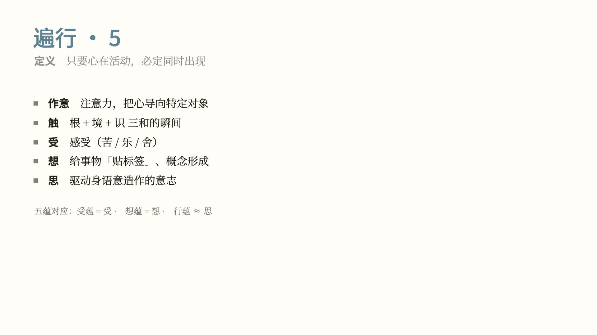

第一类叫「遍行」，只有 5 个：作意、触、受、想、思。

为什么叫「遍行」？因为它们在任何时刻、任何境界，无论善恶，都会同时出现。只要有心识在活动，这 5 个心所一定全部在场。

- **作意**：注意力，把心导向特定对象，好比打开一个监控开关。
- **触**：根、境、识三者和合相遇的那一刹那，也就是「撞见」的那一瞬。
- **受**：感受，分苦受、乐受、舍受三类。
- **想**：给事物贴标签、命名的过程。这里的「想」不是想象，而是认知、取像。
- **思**：驱动身、语、意去造作的意志活动。

五蕴里的受蕴、想蕴、行蕴，对应的就是这里的受、想、思三个心所。

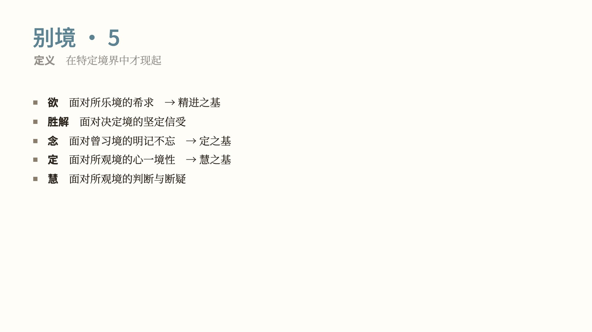

第二类叫「别境」，也是 5 个：欲、胜解、念、定、慧。

和遍行不同，别境心所只在特定的境界中才生起。

- **欲**：面对喜欢、想要的对象，生起希求的心。它是精进的所依。
- **胜解**：面对已经确定的对象，生起坚定不移的认可，比如「火是热的」「冰是冷的」。犹豫不决时，就没有胜解。
- **念**：面对曾经熟悉、串习过的对象，明记不忘。它是定的所依。
- **定**：对所观的对象，心专注不散，也就是心一境性。它是慧的所依；见道、开悟、证果，都是在定的基础上实现的。
- **慧**：对所观的对象，能判断、能抉择、能断疑。

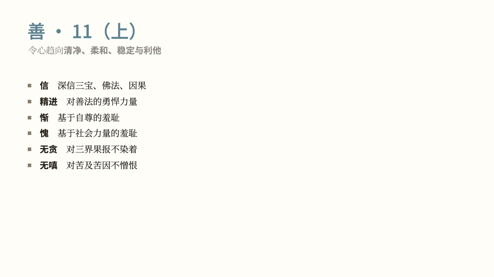

第三类是「善」心所，共 11 个。它们让心趋向清净、柔和、安稳、利他。先看前 6 个：

- **信**：对佛、法、僧深信不疑，尤其是对因果、四圣谛这些根本法义。
- **精进**：对善法勇猛地努力。努力赚钱、努力作恶，都不算精进。
- **惭**：出于内心对自己向上的期许，作恶时生起羞耻感。这是一道向内的防线。
- **愧**：顾及社会道德、舆论、法律，作恶时觉得难堪。这是一道向外的防线。
- **无贪**：对三界中种种果报和资具，不染着、不执取。
- **无嗔**：面对苦和苦因，不生憎恨。

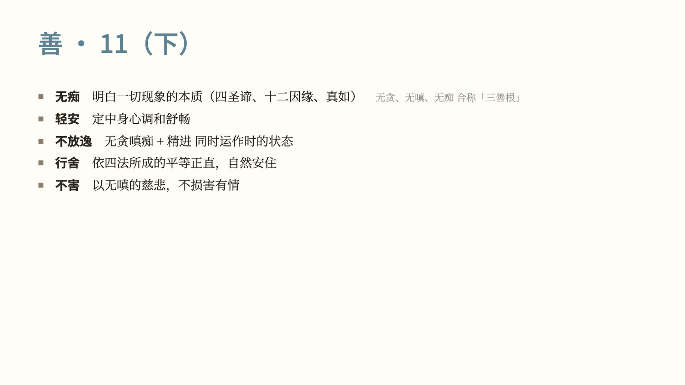

接着是后 5 个善心所：

- **无痴**：明白一切现象的真实道理，主要是四圣谛、十二因缘、真如。无贪、无嗔、无痴合起来叫「三善根」，是一切善法的根基。
- **轻安**：定中身心调和、轻松安稳的心理，能对治昏沉。
- **不放逸**：没有独立的体性，是无贪、无嗔、无痴加上精进，这四个心所同时运作时呈现的状态。
- **行舍**：也依这四个心所，让内心平等、正直，不用刻意用力就能自然安住的宁静。
- **不害**：以无嗔为体的慈悲心，不损害任何有情。

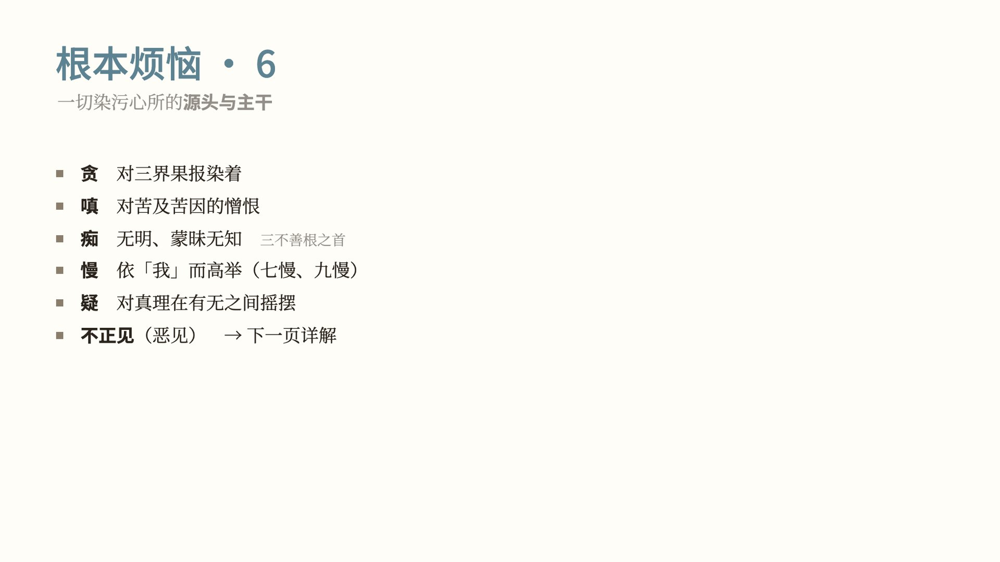

下面进入烦恼。

根本烦恼共 6 个。它们是一切染污心所的源头和主干，能直接生起、滋长后面种种支流烦恼。

- **贪**：对三界果报，以及财、色、名、食、睡这些资具的染着执取。
- **嗔**：面对苦和苦因时，内心生起的憎恨与暴戾。
- **痴**：又叫无明，对因果、真理、三宝功德的蒙昧无知，是三不善根之首。
- **慢**：依于对「我」的执着，拿自己和别人比较，令心高举。细分有「七慢」「九慢」。
- **疑**：对佛法真理在「有」与「无」之间犹豫摇摆，使一切善法生不起来。

第六个是不正见，又叫恶见，下面单独讲。

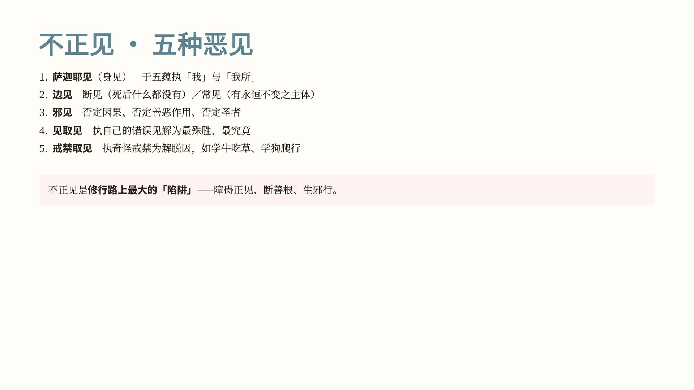

不正见，又叫恶见，是修行路上最大的陷阱。它分五种：

1. **萨迦耶见**，又叫身见：把五蕴聚合的身心执为真实的「我」和「我所」。
2. **边见**，又分两种：断见，认为人死后什么都没有了；常见，认为有一个永恒不变的灵魂或神我，在生死之间流转。
3. **邪见**：否定因果，否定善恶的作用，否定圣者，比如不承认有阿罗汉、佛菩萨。
4. **见取见**：把自己的错误见解，包括身见、边见、邪见，执为最高、最殊胜、最究竟的真理。
5. **戒禁取见**：受持一些奇怪的戒律或禁忌，比如学牛吃草、学狗爬行、崇拜某些自在天神，以为这样就能解脱、能升天。古印度外道里这一类很多。

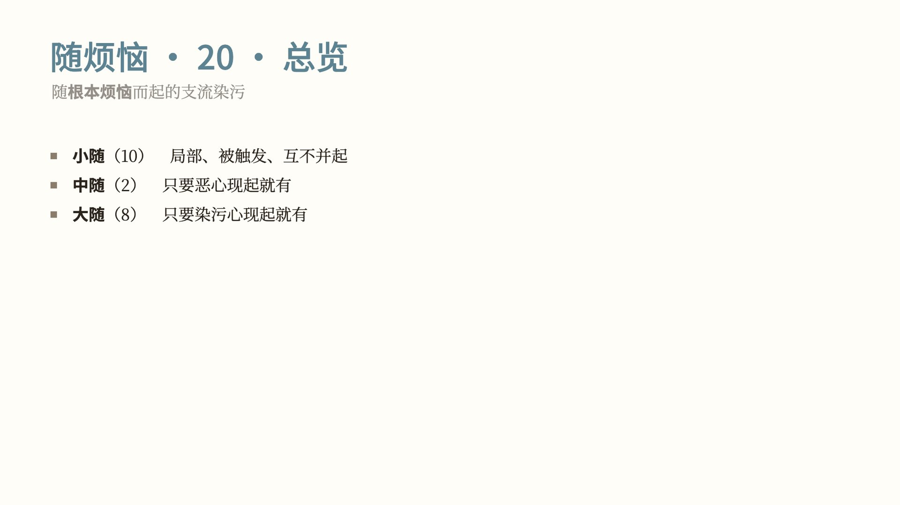

随烦恼共 20 个。「随」是说它们随根本烦恼而起：根本烦恼是源头，随烦恼是由它派生出来的具体表现。

按范围大小和现起的情况，随烦恼分三组：

| 组别 | 数目 | 现起的情况 |
|---|---|---|
| 小随 | 10 | 只在局部、特定场合被触发；一个现起时，其他小随不会同时出现 |
| 中随 | 2 | 只要恶心现起，一定出现 |
| 大随 | 8 | 只要染污心现起，一定出现 |

下面一组一组看。

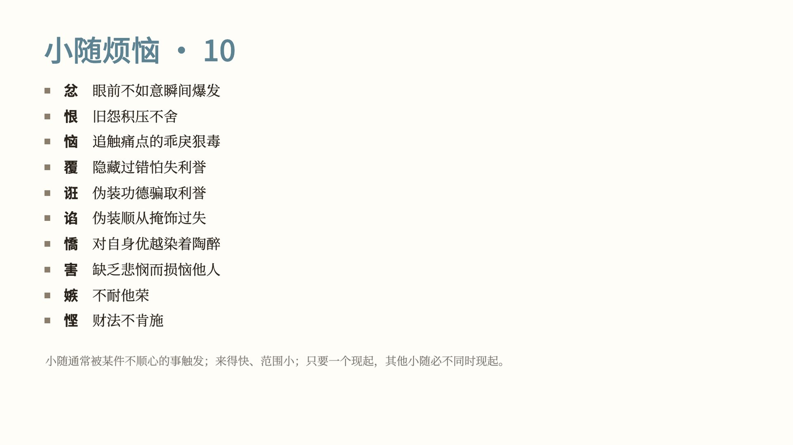

小随烦恼 10 个，通常由某件不顺心的事触发，来得快、范围小。这是相对中随、大随而说的。

- **忿**：眼前不如意时，瞬间爆发的恼怒。
- **恨**：把旧怨积在心里，不肯放下。
- **恼**：在忿和恨的基础上，被人触到旧事时表现出的乖戾狠毒，常常口出恶言。
- **覆**：做错事后，怕失去利益和名誉，把过错藏起来。
- **诳**：为了名利，装出自己并没有的功德。
- **谄**：假装顺从、假装恭敬，来掩饰过失。
- **憍**：对自己拥有的优越条件深深贪爱、陶醉、傲慢。
- **害**：没有慈悲，损恼他人。
- **嫉**：不能容忍别人的成就和荣耀。
- **悭**：对自己的财物或知识吝啬，不肯施舍。

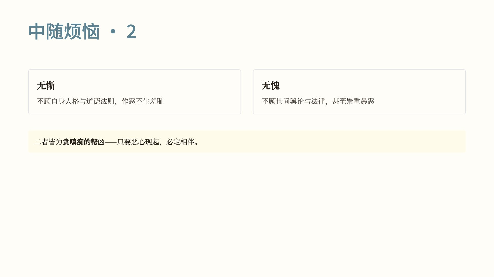

中随烦恼只有 2 个：无惭与无愧，正好是前面善心所里「惭」和「愧」的反面。

- **无惭**：作恶时不顾及自己的人格和道德法则，内心不生羞耻。
- **无愧**：作恶时不顾及世间舆论、法律、他人的评价，甚至崇尚暴恶。

这两个是一切恶事的帮手：只要恶心现起，无惭和无愧就一定相伴。

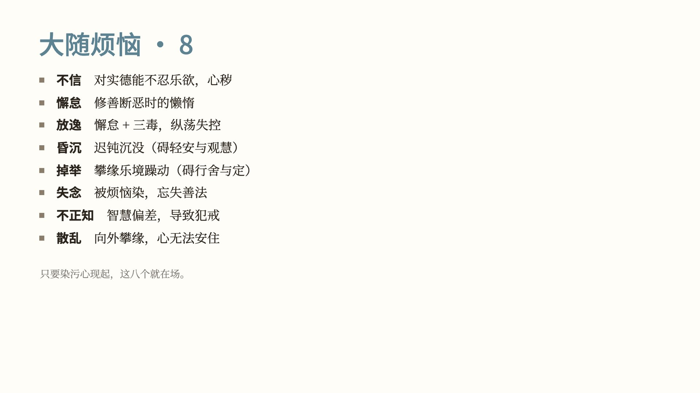

大随烦恼 8 个。只要染污心现起，这八个都在场。

- **不信**：对实有的真理、功德、能力不肯认可，也不欢喜追求，令心污浊。
- **懈怠**：在修善断恶的时候懒惰，不肯策励自己。
- **放逸**：懈怠加上贪、嗔、痴，使心任性放荡、失去约束。
- **昏沉**：心迟钝、麻木、往下沉，障碍轻安，也障碍观慧。
- **掉举**：心攀缘过去的快乐境界，躁动不安，障碍行舍，也障碍定。
- **失念**：被烦恼染污后，忘失善法，忘失修行的所缘。
- **不正知**：智慧出了偏差，错误理解当前该守的行为准则，因而犯戒。
- **散乱**：心向外四处攀缘，动荡不安。

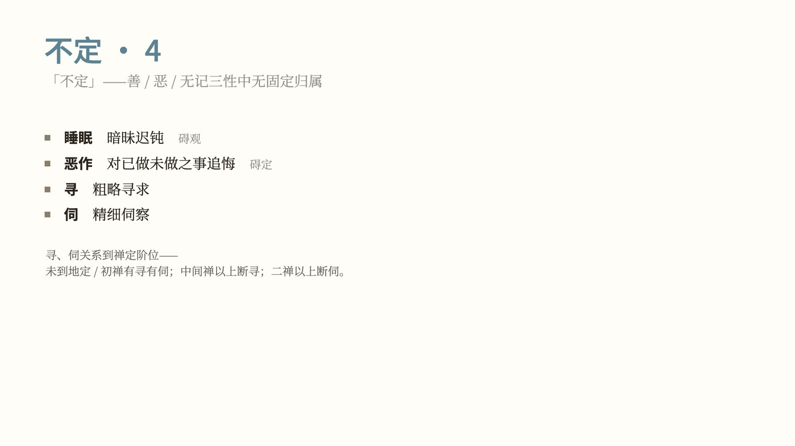

最后一类心所叫「不定」，4 个。

「不定」是说它们在善、恶、无记三性中没有固定的归属：与善心相应就助善，与染心相应就助染。

- **睡眠**：由愚痴或疲劳，心昏暗迟钝，障碍智慧的观察。
- **恶作**：对过去做过或没做的事追悔。在道德上，它可能成为改过向善的动力；但在禅定中，它让心起波动，反而障碍止观。
- **寻**：心在意识的概念中粗略地寻找目标，是认识的初步阶段。
- **伺**：在已经找到的概念上细致深入地观察推敲，是认识的进一步阶段。

寻和伺关系到禅定的阶位：未到地定、初禅是有寻有伺；到中间禅，寻已断；二禅以上，伺也断了。

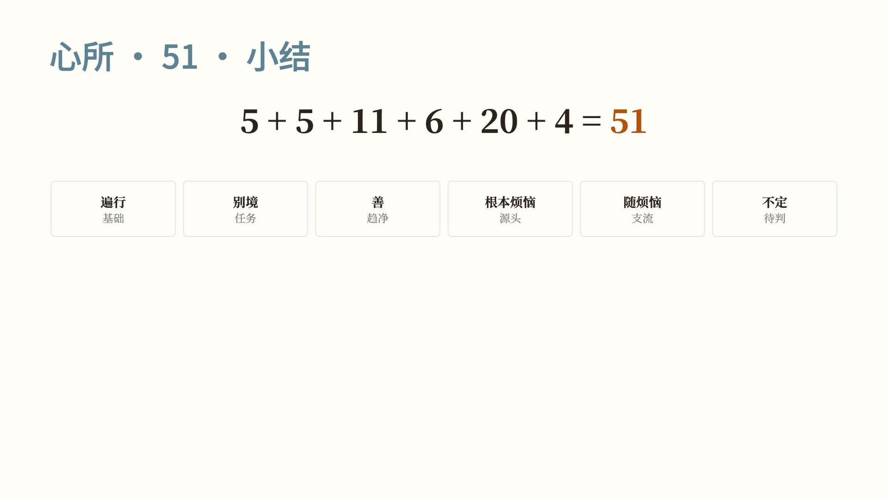

回顾一下心所 51 法：

| 类别 | 数目 | 作用 |
|---|---|---|
| 遍行 | 5 | 心活动的基础 |
| 别境 | 5 | 随不同对象而起 |
| 善 | 11 | 令心趋向清净 |
| 根本烦恼 | 6 | 染污的源头 |
| 随烦恼 | 20 | 染污的支流 |
| 不定 | 4 | 善恶不定，随所相应的心而定 |

5 + 5 + 11 + 6 + 20 + 4 = 51，这就是 51 个心所有法。

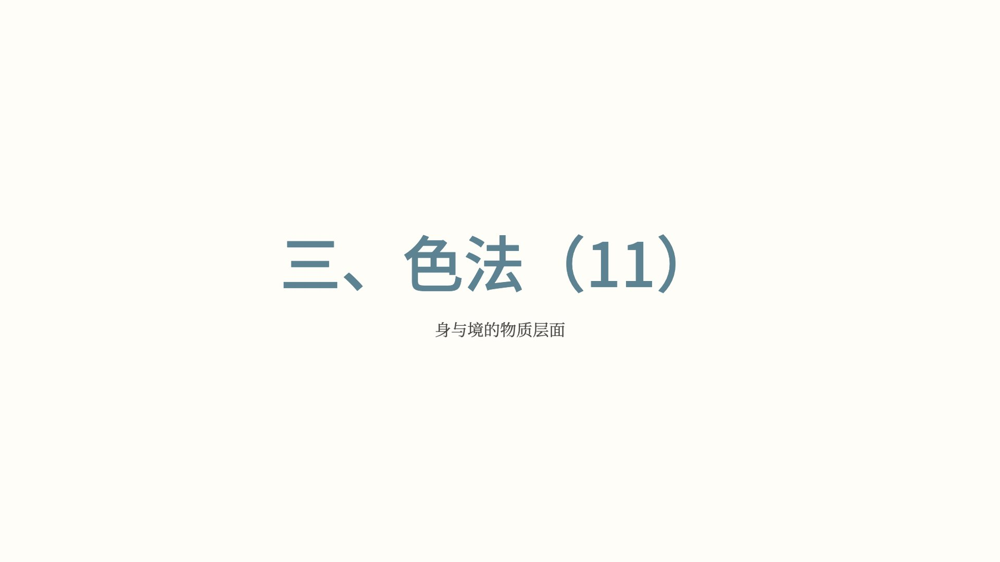

心法、心所讲完了，下面是物质层面：色法，共 11 个。

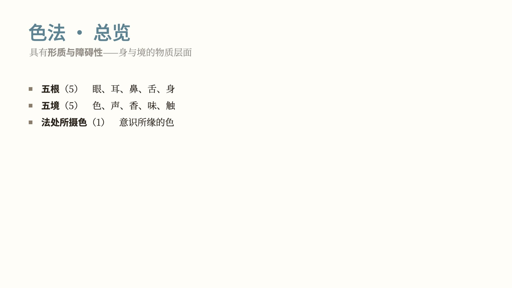

色法 11 个，是身体与外境的物质层面，有形质，有障碍性。分三部分：

- **五根**：眼、耳、鼻、舌、身，对应五种感官。
- **五境**：色、声、香、味、触，是五根各自对应的认识对象。
- **法处所摄色**：意识所缘的特殊色法。

5 + 5 + 1 = 11。

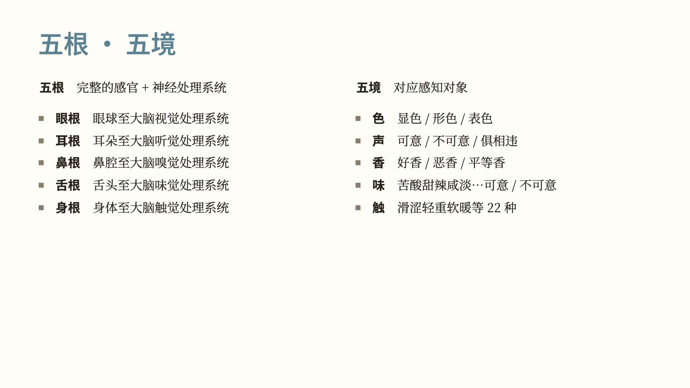

先看五根和五境。

五根不只是肉体的眼睛、耳朵，而是完整的感官加上对应的神经处理系统。眼根，从眼球一直到大脑的视觉处理区；耳根，从耳朵到大脑的听觉处理区；鼻根、舌根、身根，依此类推。

五境是五根对应的认识对象：

- **色境**：分显色（青黄赤白）、形色（长短方圆）、表色（行住坐卧等动作）。
- **声境**：分可意声、不可意声、俱相违声（既不悦耳也不讨厌）。
- **香境**：分好香、恶香、平等香。
- **味境**：苦、酸、甜、辣、咸、淡等基本味道。
- **触境**：滑、涩、轻、重、软、暖等，共 22 种。

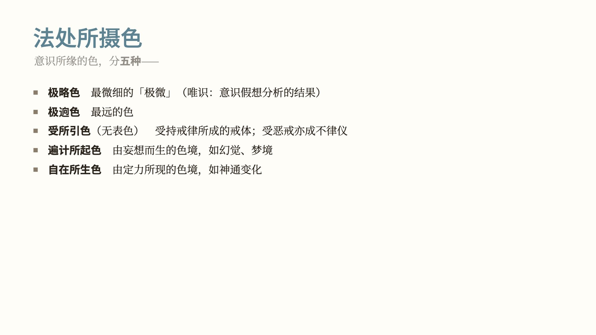

法处所摄色，是意识所缘的特殊色法，分五种：

- **极略色**：把物质分析到最小单位「极微」所得的概念。说一切有部认为极微真实存在；唯识认为它是意识假想分析的结果。
- **极逈色**：最远的色。这一种比较抽象，初学可以先略过。
- **受所引色**，又叫无表色：通过领受戒律所形成的、无形的色法，比如受持佛教戒律所成的「戒体」。反过来，受持外道的恶戒，也会引生不善的无表色，叫「不律仪」。
- **遍计所起色**：由妄想所生的色境，比如幻觉、梦境。
- **自在所生色**：由定力所现的色境，比如神通变化中的种种景象。

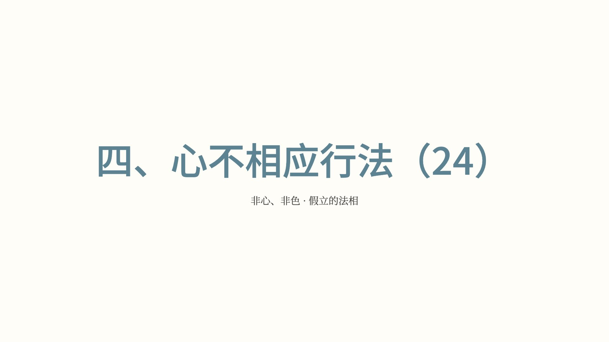

第四大类：心不相应行法，简称「不相应行法」，共 24 个。

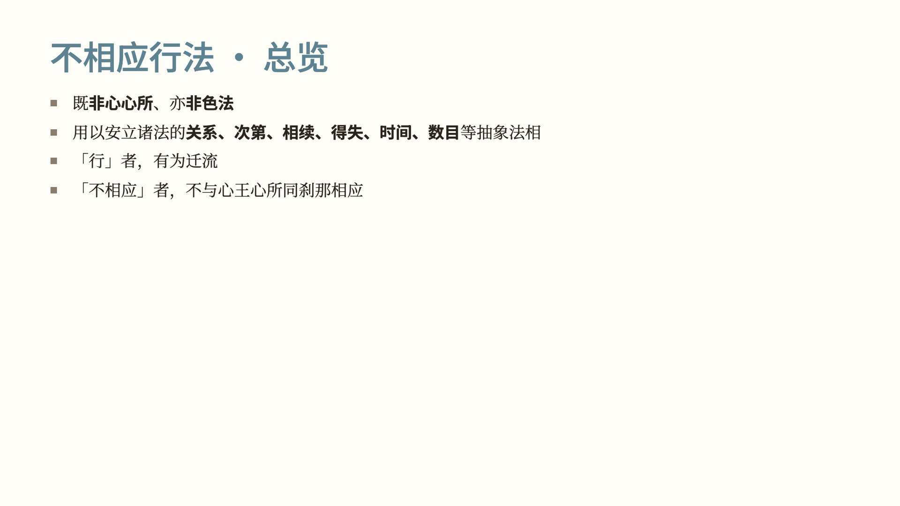

不相应行法 24 个，性质比较特别：它们既不是心、心所，也不是色法，而是依心、心所与色法假立出来的法相。

名字怎么理解？「行」是有为迁流，也就是因缘和合而生灭；「不相应」是不与心王、心所在同一刹那相应。

这 24 法用来安立诸法之间的种种关系：次第、相续、得失、时间、数目这一类抽象的法相。

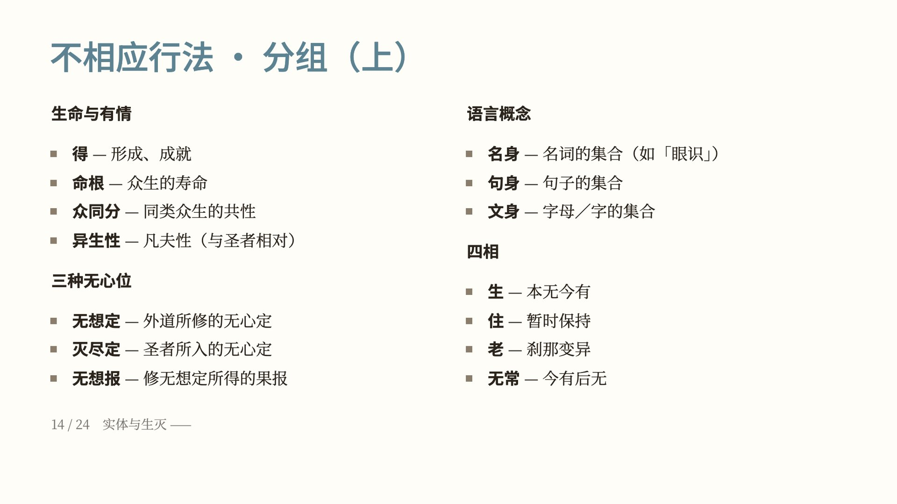

不相应行法的前 14 个，多和「有情与生灭」有关。

**生命与有情，4 个：**

- **得**：事物的形成、成就；任何获得都有它的因和缘。
- **命根**：众生这一期生命的寿命。
- **众同分**：同类众生身心的共同性，比如人和人之间的相似。
- **异生性**：就是凡夫性。凡夫执种种异见，受种种生死；圣者证无漏智，称为同生。

**三种无心位，3 个：**

- **无想定**：外道认为「想」是生死的根源，灭想而入此定，属四禅广果天。
- **灭尽定**：圣者所入的无心定，三果以上才能入。
- **无想报**：修无想定所得的果报，生在无想天，五百劫中前六识不起。

**语言概念，3 个：**

- **名身**：两个以上名词的集合，比如「眼识」「色法」。
- **句身**：两个以上句子的集合。
- **文身**：两个以上字的集合，相当于字母。

**四相，4 个：**

- **生**：本无今有，事物的出现。
- **住**：诸行生起之后，暂时保持相似相续。
- **老**：刹那刹那地衰减变异。
- **无常**：今有后无，事物的消失。

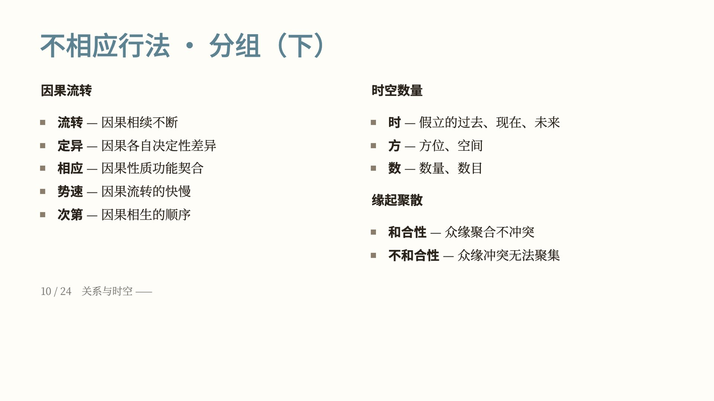

不相应行法的后 10 个，多和「关系与时空」有关。

**因果流转，5 个：**

- **流转**：诸行在因果作用下，前灭后生，像水流一样相续不断。
- **定异**：因果之间各有决定的差别，不会混淆。比如善因善果、恶因恶果，彼此有别。
- **相应**：因和果在性质、功能上相互契合。
- **势速**：因果流转中的快慢、迅疾，也就是物理学里说的「速度」。
- **次第**：因果相生有一定的顺序：业力强的先生，弱的后生，不会同时生起。

**时空数量，3 个：**

- **时**：依诸行因果相续假立的过去、现在、未来。时间不是独立的实体。
- **方**：方位、空间，由物质现象的因果相续而有东南西北上下的差别。
- **数**：数量、数目，用来对离散的事物计数和排序。

**缘起聚散，2 个：**

- **和合性**：众缘聚集、共同成就某一事物的状态。
- **不和合性**：众缘互相违背、聚不起来的离散状态。

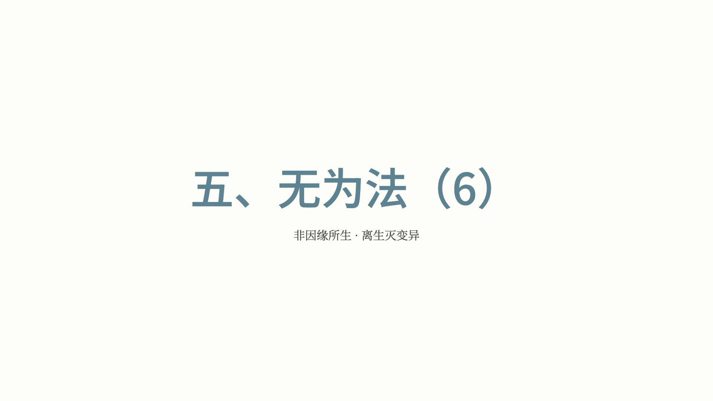

最后一大类：无为法，共 6 个。

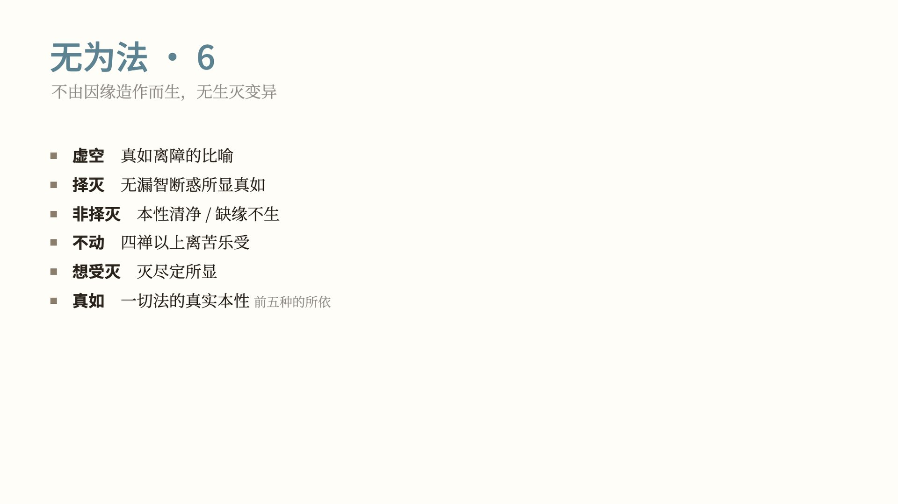

无为法 6 个，是百法中最特殊的一类：不由因缘造作而生，没有生灭变异。

- **虚空**：比喻真如离一切障碍、豁达虚通、恒常不变。
- **择灭**：以无漏智慧拣择真理、断灭烦恼之后所显的真如，也就是涅槃。
- **非择灭**：分两种：一是诸法本性清净所显的寂灭；二是因为缺少助缘而不生起，由此所显的真如。
- **不动**：色界第四禅以上，苦受、乐受都已不起，离开动转所显的真如。
- **想受灭**：灭尽定中，想心所和受心所的作用都止息，由此所显的真如。
- **真如**：一切事物的真实本性。「真」是真实，「如」是始终如常。真如是前五种无为的所依，前五种是真如在不同情况下的显现。

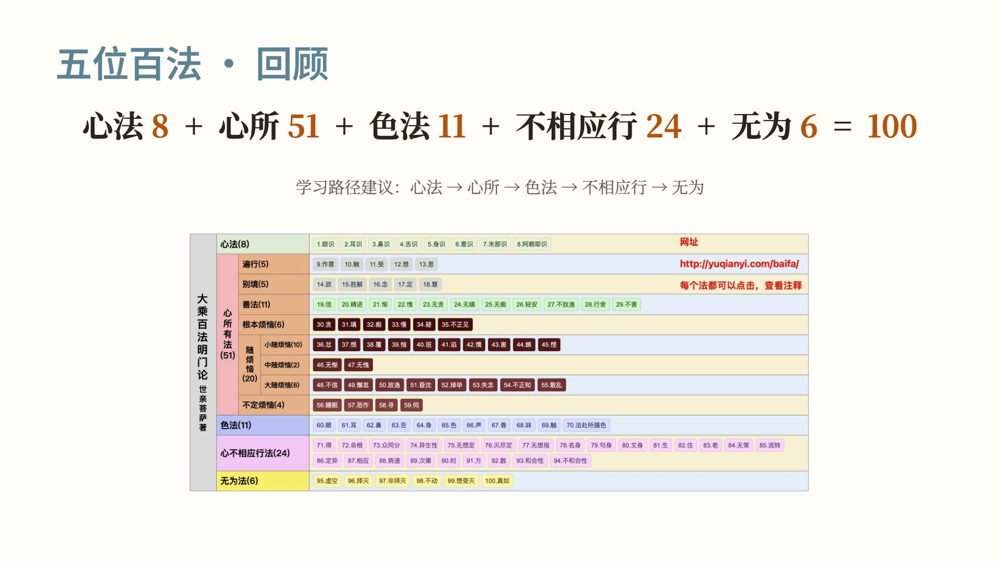

最后回顾一下：心法 8 + 心所 51 + 色法 11 + 不相应行 24 + 无为法 6，正好一百法。

学习的顺序建议是：心法 → 心所 → 色法 → 不相应行 → 无为，由浅入深，由实到虚。

这就是《百法》的整体地图。

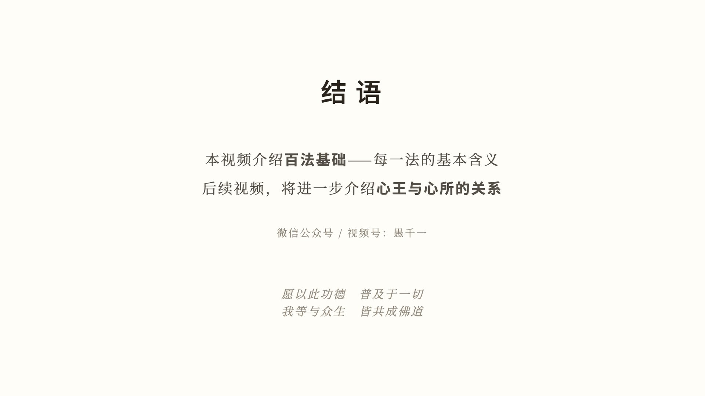

第一讲到这里。这一讲介绍的是百法的基础，也就是每一法的基本含义。

讲了这么多概念，还有一个问题没有回答：心王和心所究竟怎样配合工作？哪些心所只和哪些心王相应？这是下一讲的内容：心王与心所。

《百法》五讲的安排是：第一讲五位百法，把一百个法逐个过一遍；第二讲心王与心所；第三讲百法与五蕴、十二处、十八界；第四讲百法与三十七道品；第五讲百法与见道、证果成阿罗汉。

我的微信公众号、视频号都叫「愚千一」，视频版可以在那里看。

愿以此功德，普及于一切；我等与众生，皆共成佛道。

---

**参考**

- 世亲菩萨造、玄奘译《大乘百法明门论》，《大正藏》第 31 册 No. 1614
- 窥基《大乘百法明门论解》，《大正藏》第 44 册 No. 1836
- 护法等菩萨造、玄奘译《成唯识论》，《大正藏》第 31 册 No. 1585
- 世亲菩萨造、玄奘译《大乘五蕴论》，《大正藏》第 31 册 No. 1612
- 安慧菩萨造、地婆诃罗译《大乘广五蕴论》，《大正藏》第 31 册 No. 1613
- 无著菩萨造、玄奘译《大乘阿毗达磨集论》，《大正藏》第 31 册 No. 1605
- 无著菩萨造、玄奘译《显扬圣教论》，《大正藏》第 31 册 No. 1602

—— 整理：愚千一
