这是《大乘百法明门论》（下面简称《百法》）系列的第二讲，由同名视频整理成文字。

上一讲讲了《百法》怎样把世间和出世间的一切现象归纳为一百个法。这一讲要回答的问题是：心王和心所之间，是怎样的相应关系。

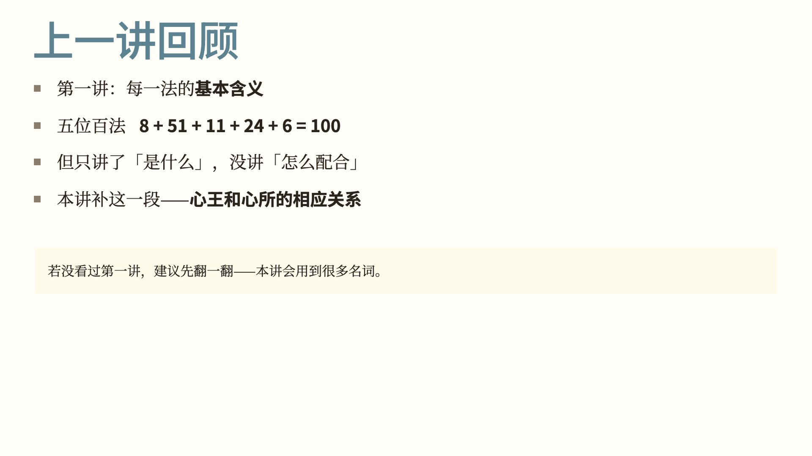

先回顾第一讲。第一讲用 35 页讲完了五位百法：心法 8 个、心所 51 个、色法 11 个、心不相应行 24 个、无为法 6 个，合起来一百。

那一讲只回答了「每一法是什么」，没有回答「这些法之间怎么搭配起作用」。这一讲补的就是这一段：八识和 51 心所之间的相应关系。

这一讲会用到第一讲的很多名词，没读过第一讲的，可以先翻一翻。

这一讲回答四个问题：

1. 心王和心所之间，是怎样的搭档关系？
2. 哪些心所和哪个识相应？为什么？
3. 凡夫八识各自的「性格」是什么？
4. 成佛后，这套关系会发生什么变化？

第一部分讲心王，也就是八识本身。

心王是「能了别」的主体，也就是我们认识世界、产生分别的最根本的能力。

心王共有八个：前五个是眼识、耳识、鼻识、舌识、身识，对应五种感官；第六个是意识；第七、第八是末那识和阿赖耶识。

八个识各自的功能，第一讲讲过。这一讲要看的是八个识各自的「性格」。为此先介绍一个新概念：三性。

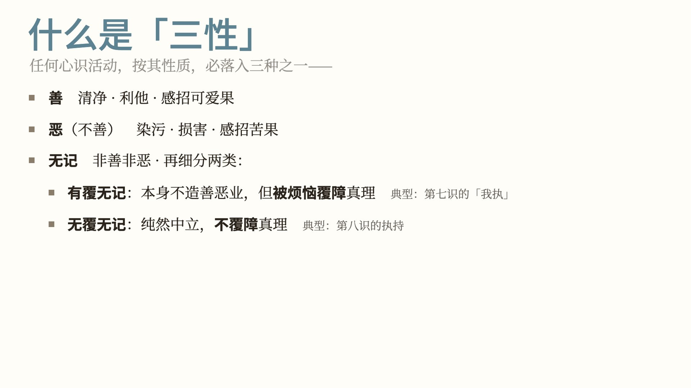

三性，是把任何心识活动按性质归为三类：

- **善**：清净、利他，感招可爱的果报。
- **恶**（也叫不善）：染污、损害，感招苦果。
- **无记**：非善非恶。

无记还要再分两类：

- **有覆无记**：本身不直接造善业恶业，但被烦恼覆障，遮蔽真理。第七识是典型。
- **无覆无记**：纯然中立，不覆障真理。第八识是典型。

判断每一个识、每一个心所的「性格」，用的都是这个三性框架。

下面一个识一个识地看。

前五识（眼、耳、鼻、舌、身）通三性，善、恶、无记都可以有；其中的无记都是无覆无记。

要注意的是，前五识本身只是「现量取性境」，并不分别善恶。它属于哪一性，是随着同时生起的第六识，也就是五俱意识而转的：意识起信，五识就同为善；意识起贪、瞋，五识就同为恶；意识中性地看，五识也是无覆无记。

依据是《八识规矩颂》前五识颂的第一句：「性境现量通三性」。

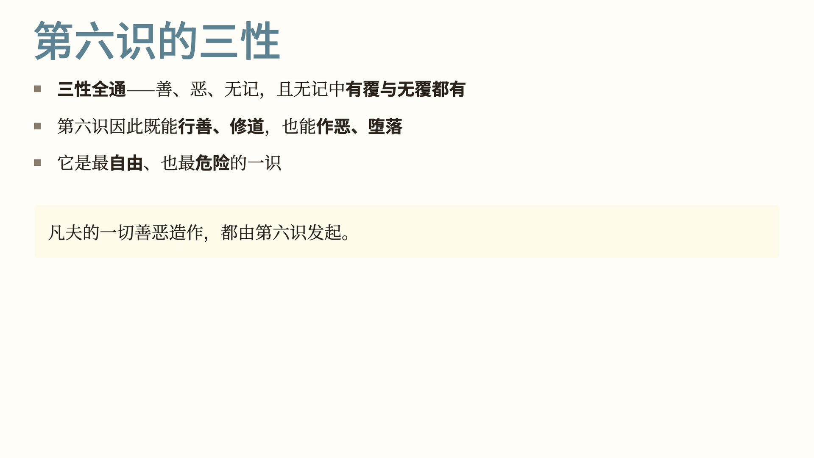

第六识，也就是意识，三性全通：善、恶、无记都有，无记里的有覆、无覆两种也都有。

所以第六识既能行善修道，也能作恶堕落，是八识里最自由、也最危险的一个。凡夫的一切善恶造作，都由第六识发起。

第七识，也就是末那识，三性里只有一种：有覆无记。

「有覆」，是说它恒常把第八识执为「我」，因此覆障真理。「无记」，是说它本身只是这个执着，不直接造善业恶业。

但在凡夫位，它是一切染污的根本：它日夜不停地在背后执「我」，凡夫的一切烦恼都从这里来。

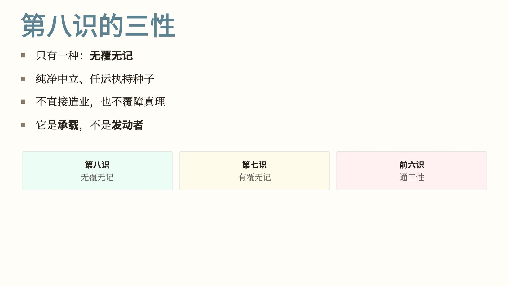

第八识，也就是阿赖耶识，也只有一种：无覆无记。

它中立无染，任运执持种子；既不直接造业，也不覆障真理。它承载一切，但不发动什么。

凡夫八识的三性归属，合起来是：前五识和第六识通三性；第七识是有覆无记；第八识是无覆无记。

讲完八识的「性格」，进入第二部分：简单回顾 51 心所和它们的三性归属，并解释什么叫「相应」。

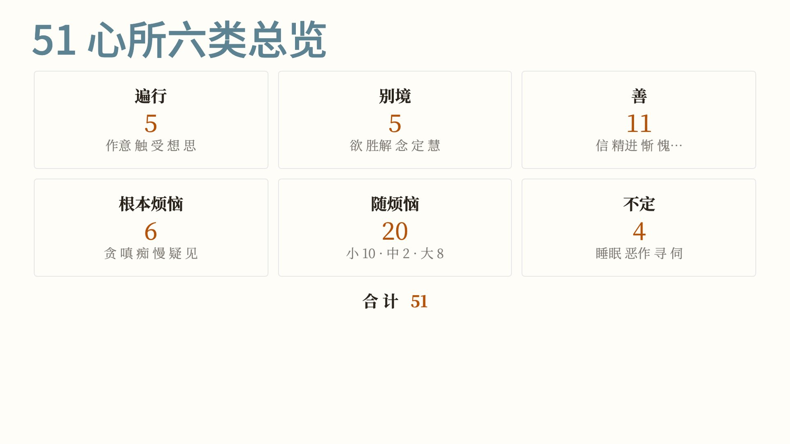

51 个心所分六类：遍行 5 个、别境 5 个、善 11 个、根本烦恼 6 个、随烦恼 20 个、不定 4 个，合起来 51 个。

每一类的具体内容，第一讲已经讲过，这里不再展开。

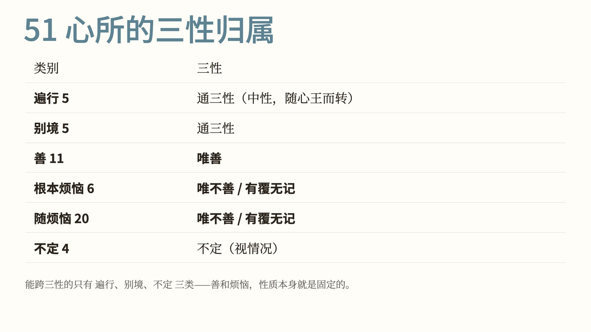

这六类各自的三性如下：

| 类别 | 数目 | 三性 |
|---|---|---|
| 遍行 | 5 | 通三性，本身中性，随心王而转 |
| 别境 | 5 | 通三性 |
| 善 | 11 | 唯善 |
| 根本烦恼 | 6 | 唯不善或有覆无记，属染污 |
| 随烦恼 | 20 | 唯不善或有覆无记，属染污 |
| 不定 | 4 | 三性不定，看与什么心相应 |

能跨三性的，只有遍行、别境、不定这三类。善心所和烦恼心所的性质是固定的。

接下来解释「相应」这个概念。

唯识里说的相应，不是「协调一致」那种泛泛的意思，而是一个有四层含义的专门术语：

- **同一刹那**：在同一个时间点一起生起。
- **同一所依**：依止同一个识。
- **同一所缘**：缘同一个对象。
- **同一事**：完成同一件事。

凡是能和某个识在同一刹那共起、共缘、共事的心所，就叫与这个识「相应」。

有了这个定义，就可以一个识一个识地看：它和哪些心所相应。

先看前五识。和前五识相应的心所，共 34 个。

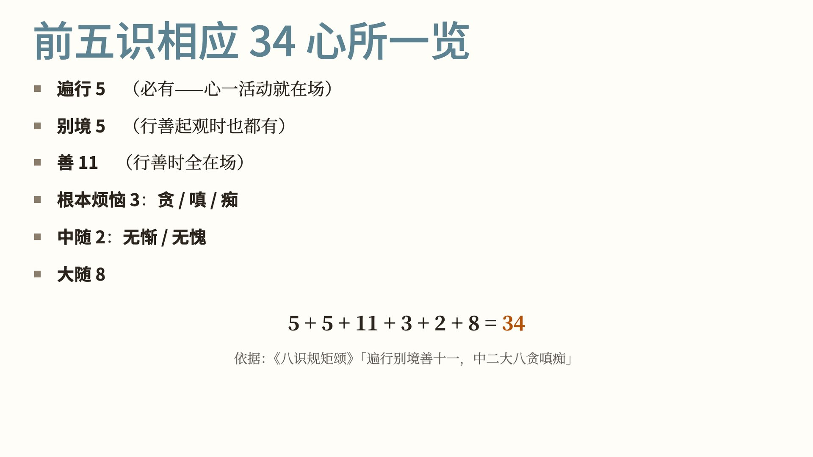

这 34 个是：

- 遍行 5 个：必有，心一活动就在。
- 别境 5 个：行善、起观时都有。
- 善 11 个：行善时全都在。
- 根本烦恼 3 个：贪、瞋、痴。
- 中随烦恼 2 个：无惭、无愧。
- 大随烦恼 8 个。

5 + 5 + 11 + 3 + 2 + 8 = 34。

依据是《八识规矩颂》前五识颂：「遍行别境善十一，中二大八贪瞋痴」，这两句直接列出了这 34 个相应心所。

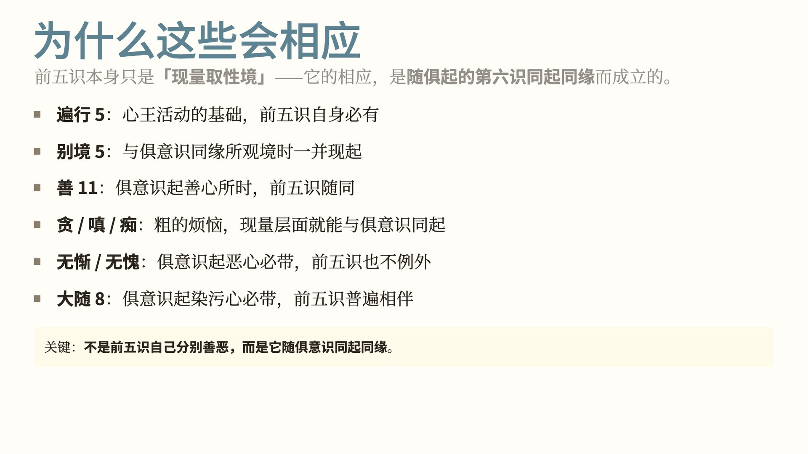

为什么是这 34 个？

要记住的一点是：前五识本身只是「现量取性境」，它和这些心所相应，是因为随着同时生起的第六识同起、同缘而成立的。逐类看：

- 遍行 5 个是心王活动的基础，前五识自己必有。
- 别境 5 个，是和俱起的意识一同缘所观的境时一起现起。
- 善 11 个，是俱起的意识生起善心所时，前五识随同生起。
- 贪、瞋、痴是粗重的烦恼，在现量层面就能和俱起的意识一同生起。
- 无惭、无愧，是俱起的意识起恶心时必定带着的，前五识也不例外。
- 大随烦恼 8 个，是俱起的意识起染污心时必定带着的，前五识普遍跟着有。

所以，不是前五识自己分别善恶，而是它随着俱起的意识同起同缘。

51 减去 34，还有 17 个心所和前五识不相应：

- 根本烦恼里的慢、疑、不正见 3 个：都要「分别推度」才能生起。
- 小随烦恼 10 个（忿、恨、覆、诳、谄等）：都依分别心而起。
- 不定 4 个（睡眠、恶作、寻、伺）：都是第六识层面的活动。

理由在于前五识唯是现量、没有分别、任运而起。《成唯识论》卷六讲根本烦恼与诸识相应时说：「五识唯三，谓贪瞋痴，无分别故，由称量等起慢等故。」慢要比较高下，要靠称量才起，前五识没有分别，所以只有贪、瞋、痴三种。

凡是要「分别推度」才能生起的心所，前五识都没有。

讲完前五识，来看这一讲的主角：第六识。

第六识是唯一与 51 个心所全部相应的识。

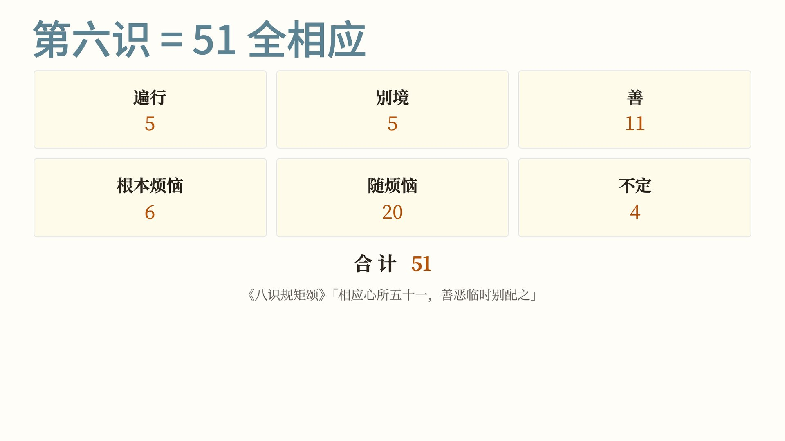

51 个心所，第六识全部相应：

遍行 5 + 别境 5 + 善 11 + 根本烦恼 6 + 随烦恼 20 + 不定 4 = 51。

依据是《八识规矩颂》第六识颂：「相应心所五十一，善恶临时别配之」。意思是，第六识时而善、时而恶、时而无记，看当下和它相应的是哪些心所。

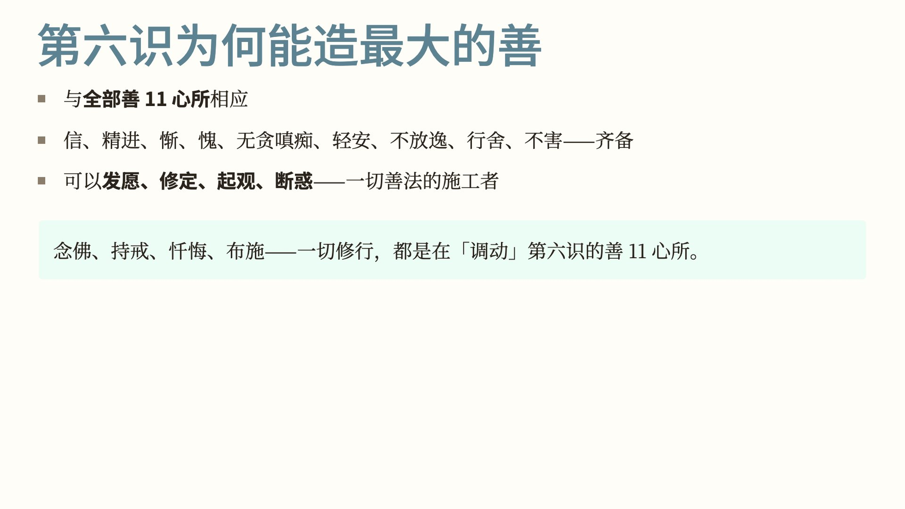

第六识的特殊之处，分三个角度来看。先看善。

第六识与全部 11 个善心所相应：信、精进、惭、愧、无贪、无瞋、无痴、轻安、不放逸、行舍、不害，一个不少。

所以发愿、修定、起观、断惑，一切善法都由第六识主导。平时说的念佛、持戒、忏悔，调动的都是第六识的善心所。

再看反面。

第六识与全部 26 个烦恼相应：根本烦恼 6 个，加随烦恼 20 个。

而且慢、疑、不正见这些要靠思维推度的烦恼，只在第六识里生起，前五识没有，第七识也没有。

所以最重的恶业，比如谋财害命、设局欺骗、谤法毁僧，都是第六识造出来的。

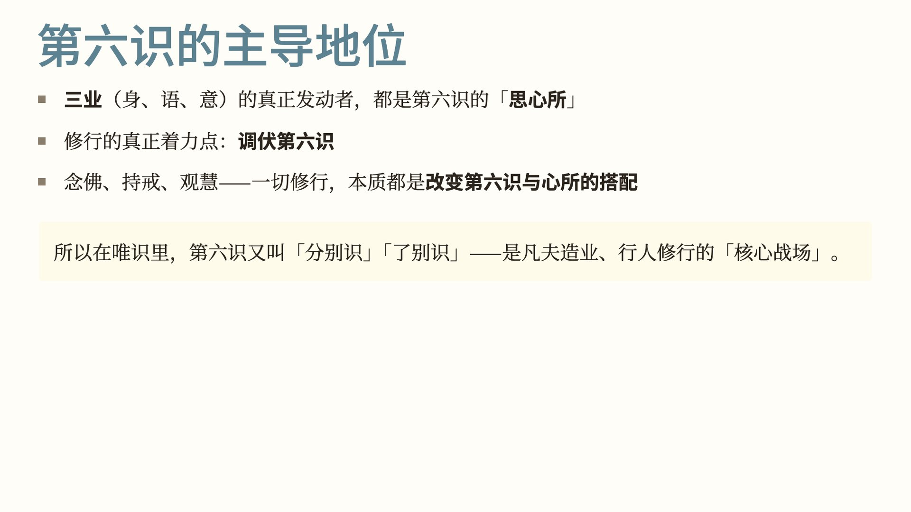

第三个角度：三业由谁发动。

身、语、意三业，真正的发动者都是第六识里的「思」心所。

所以修行用功的地方，就是调伏第六识。念佛、持戒、观慧，各种修行，做的都是改变第六识与心所的搭配：让它少和烦恼相应，多和善心所相应。

唯识里，第六识也叫「分别识」。凡夫造业靠它，修行也靠它。

接下来看第七识。和第七识相应的心所共 18 个，都围绕「我执」。

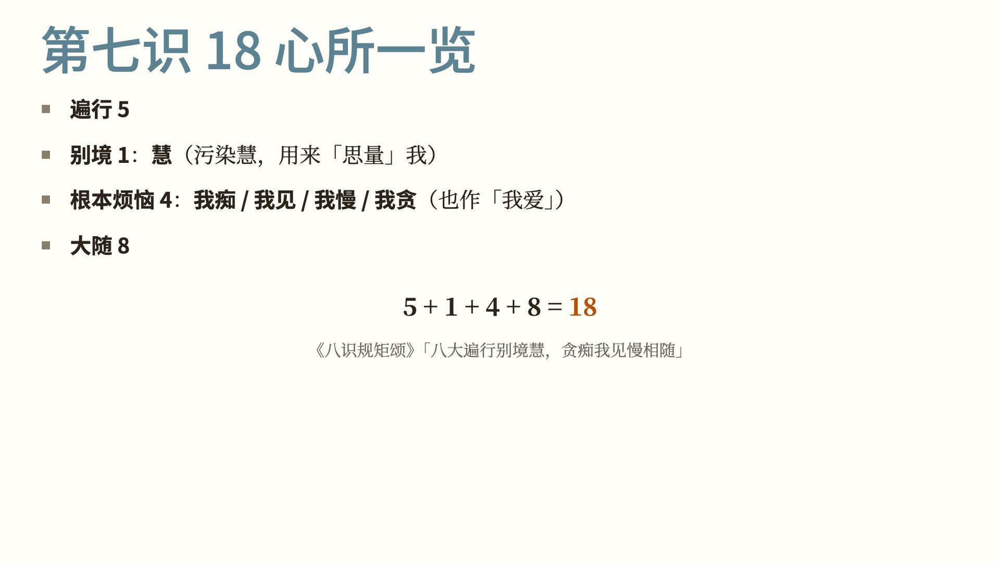

这 18 个是：

- 遍行 5 个：心王活动的基础。
- 别境里只有 1 个：慧。但这是染污的慧，专门用来「思量」那个被执着的我。
- 根本烦恼 4 个：我痴、我见、我慢、我贪（也作「我爱」），都是围绕「我」打转的根本染污。
- 大随烦恼 8 个：一切染污心都带着的。

5 + 1 + 4 + 8 = 18。

依据是《八识规矩颂》第七识颂：「八大遍行别境慧，贪痴我见慢相随」。

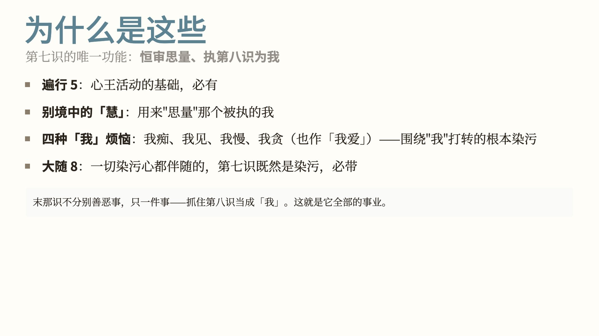

为什么是这 18 个？因为第七识唯一的作用，就是恒审思量、执第八识为我。

- 它需要遍行 5 个，作为心王活动的基础。
- 它需要「慧」来思量；这个慧不是清净慧，而是用来执「我」的染污慧。
- 它需要四种「我」烦恼：我痴、我见、我慢、我贪（论书中常说「我爱」），围着「我」打转。
- 大随烦恼 8 个是一切染污心都带着的，第七识既然是染污的，也必定带着。

末那识不分别善事恶事，只做一件事：抓住第八识，当成「我」。

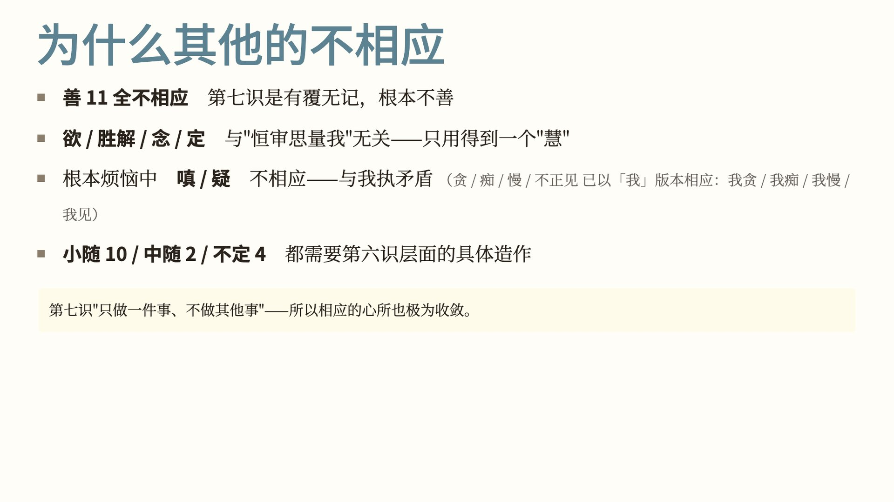

其余 33 个心所，为什么和第七识不相应？

- 善 11 个全不相应：第七识是有覆无记，不是善。
- 别境里的欲、胜解、念、定 4 个不相应：第七识只用得到「慧」，其余四个和「恒审思量我」无关。
- 根本烦恼 6 个里，瞋和疑不相应：第七识抱着「我」不放，不会瞋恨自己所执的「我」，也不会怀疑「我」的存在，这两个和我执相矛盾。其余 4 个根本烦恼（贪、痴、慢、不正见），已经以「我」的形式相应，就是我贪、我痴、我慢、我见。
- 小随烦恼 10 个、中随烦恼 2 个、不定 4 个：都需要第六识层面的具体造作，第七识做不了。

第七识只做一件事，所以相应的心所也少，只有 18 个。

最后看第八识。和第八识相应的心所只有 5 个：它任运而行，默默承载。

和第八识相应的心所，只有作意、触、受、想、思这五个遍行，没有善心所，也没有烦恼心所。

依据是《八识规矩颂》第八识颂的第一句：「性唯无覆五遍行」。

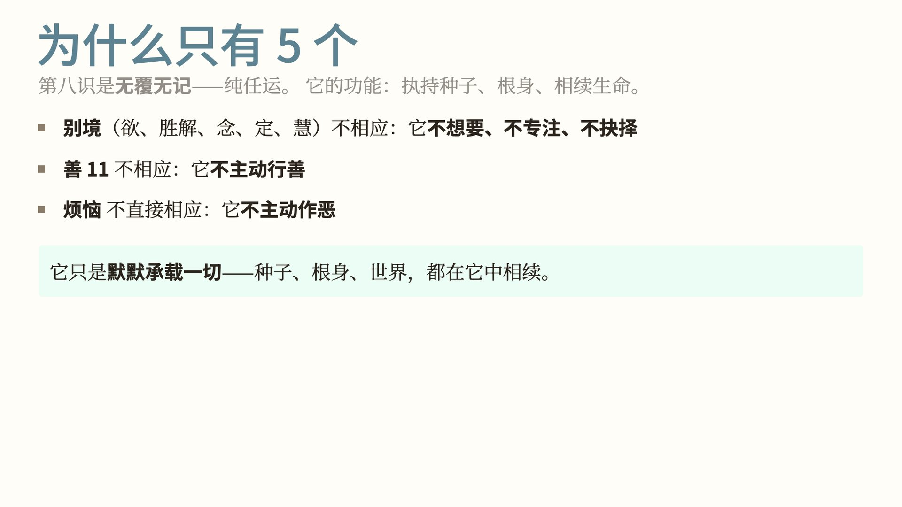

为什么只有 5 个？因为第八识是无覆无记，纯是任运。

它的作用是执持种子、根身，使生命相续；它不分别、不选择、不善不恶。所以：

- 别境不相应：它不希求什么、不专注什么、不抉择什么。
- 善 11 个不相应：它不主动行善。
- 烦恼也不直接相应：它不主动作恶。

它只是默默承载：种子、根身、世界，都在它当中相续。

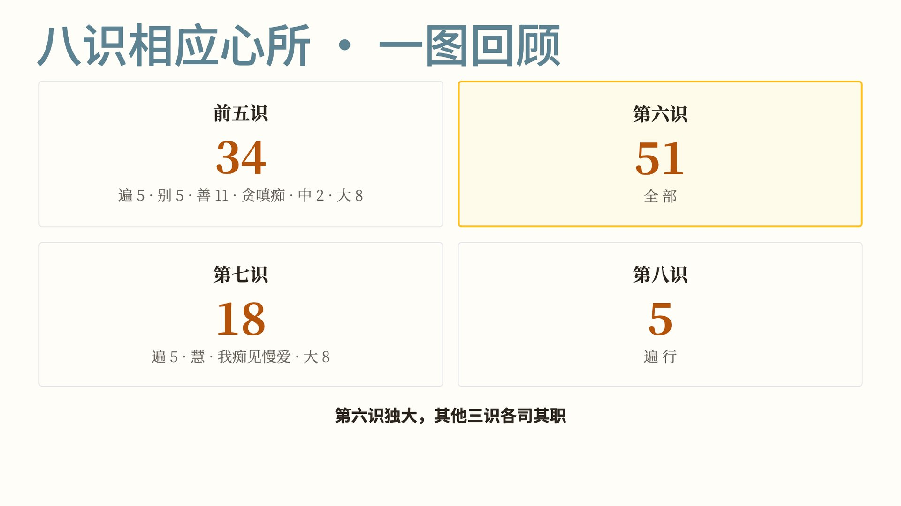

把凡夫八识的相应关系合起来看：

| 识 | 相应心所数 |
|---|---|
| 前五识 | 34 |
| 第六识 | 51（全部） |
| 第七识 | 18 |
| 第八识 | 5 |

第六识相应的心所最多，其余三组识各有各的分工。

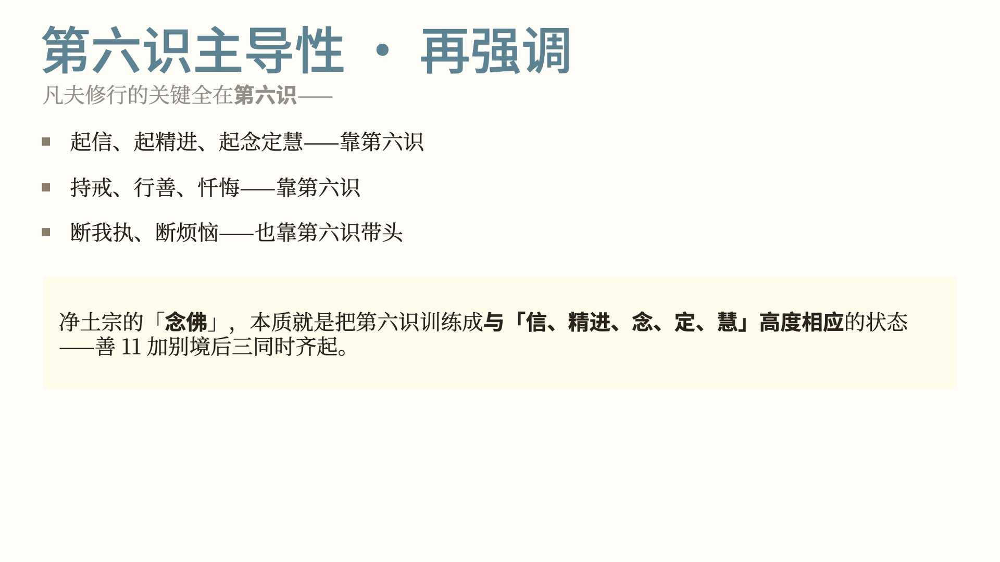

再回到第六识。凡夫修行，要在第六识上用功：

- 起信、起精进、起念定慧，靠第六识。
- 持戒、行善、忏悔，靠第六识。
- 断我执、断烦恼，也是第六识带头。

净土宗的念佛，就是把第六识训练成与信、精进、念、定、慧同时相应的状态，也就是善心所和别境里的念、定、慧一齐生起。

最后一节：成佛之后会发生什么。

成佛之后：

- 前五识转为成所作智。
- 第六识转为妙观察智。
- 第七识转为平等性智。
- 第八识转为大圆镜智。

八识并没有消失，而是转变了作用：从有漏染污，转为无漏清净。

转识成智的同时，染污的心所也全部断除：

- 根本烦恼 6 个全断。
- 随烦恼 20 个全断。
- 不定 4 个也全都不相应：睡眠、恶作、寻、伺，佛位都没有。

剩下的是遍行 5 + 别境 5 + 善 11 = 21 个清净心所。遍行和别境，也从凡夫位的「通三性」，转为纯清净的心所。

八识全部清净，烦恼不再生起，八识都与这 21 个清净心所相应。

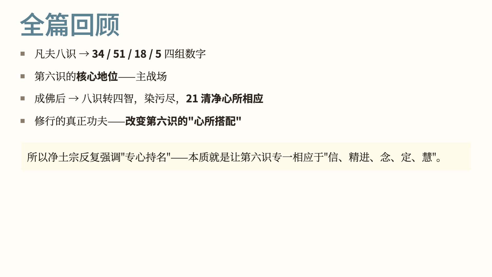

全篇回顾：

- 凡夫八识相应的心所，是 34、51、18、5 四组数字。
- 第六识是凡夫修行用功的主要所在。
- 成佛后八识转为四智，染污断尽，与 21 个清净心所相应。
- 修行的功夫，在于改变第六识的「心所搭配」。

净土宗反复讲「专心持名」，就是让第六识专一地与信、精进、念、定、慧相应。

这一讲讲的是心王和心所的相应关系。

下一讲是《百法》与五蕴、十二处、十八界的对照。

我的微信公众号、视频号都叫「愚千一」，视频版可以在那里看。

愿以此功德，普及于一切；我等与众生，皆共成佛道。

---

**参考**

- 《大乘百法明门论》，天亲菩萨造，唐·玄奘译，《大正藏》第 31 册 No. 1614
- 《八识规矩颂》，颂文见明·普泰《八识规矩补注》，《大正藏》第 45 册 No. 1865（「性境现量通三性」「遍行别境善十一，中二大八贪瞋痴」「相应心所五十一，善恶临时别配之」「八大遍行别境慧，贪痴我见慢相随」「性唯无覆五遍行」）
- 《成唯识论》卷六（「五识唯三，谓贪瞋痴，无分别故，由称量等起慢等故」）

—— 整理：愚千一
