这是《大乘百法明门论》（下称《百法》）系列的第三讲，根据视频讲稿整理成文。

第一讲讲百法的基本含义，第二讲讲八识和心所的相应关系。这一讲换三个角度——五蕴、十二处、十八界——回看百法，同时和《俱舍论》的七十五法做对照。

前面几讲的位置：

- 第一讲：百法的基本含义。
- 第二讲：八识和心所的相应关系。
- 本讲：从「三科」三个角度回看百法，并与俱舍七十五法对照。

对一般读者来说，五蕴、十二处、十八界这套名相比「百法」更常听到。所以拿三科来对照百法，反过来也能把三科本身弄得更准确。

本讲回答五个问题：

1. 三科是什么？佛教为什么反复用三套不同的分类？
2. 百法和五蕴、十二处、十八界怎样对应？
3. 俱舍七十五法和三科又怎样对应？
4. 为什么百法包含五蕴，五蕴却不包含百法？
5. 百法和七十五法差在哪里？

## 一、三科是什么

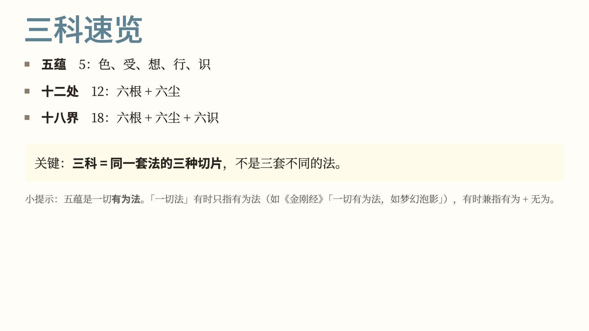

三科就是五蕴、十二处、十八界，是佛教对一切法的三种基础归纳。

- 五蕴，5 个：色、受、想、行、识。
- 十二处，12 个：六根加六尘。
- 十八界，18 个：六根、六尘，再加六识。

三科不是三套不同的法，而是把同一套法切成三种不同的块。

补充一点：五蕴所摄的是有为法。经论里说「一切法」，有时只指有为法，例如《金刚经》「一切有为法，如梦幻泡影」；有时兼指有为法和无为法，要看上下文。

五蕴回答的问题是：这一切法是什么。

- 色：物质，包括身体和外境。
- 受：感受，分苦受、乐受、舍受。
- 想：概念，给事物安立名字、贴上标签。
- 行：造作，也就是意志活动。
- 识：了别，认识本身。

《俱舍论》和唐代圆晖的《俱舍论颂疏》里有一个「做饭」的比喻，智敏上师的《俱舍论颂疏讲记》又展开讲过：

色蕴是厨房和厨具，受蕴是食材，想蕴是调料，行蕴是厨师，识蕴是吃饭的人。

五个合在一起，一次认识活动才能完成。

十二处回答的问题是：认识怎样发生。

- 内六处，就是六根：眼、耳、鼻、舌、身、意。
- 外六处，就是六尘：色、声、香、味、触、法。

「处」的本义是心、心所生起的地方，也就是认识活动得以发生的接触点。

十八界比十二处多出六识，从「根 + 境」扩展到「根 + 境 + 识」。

六根、六尘、六识，合起来十八界。认识活动的要素都列在里面，分得最细。

所以在三科里，五蕴分得最粗，十二处居中，十八界最细。

## 二、俱舍七十五法

讲完三科，先简单看一下俱舍七十五法。它可以看作百法的前身。

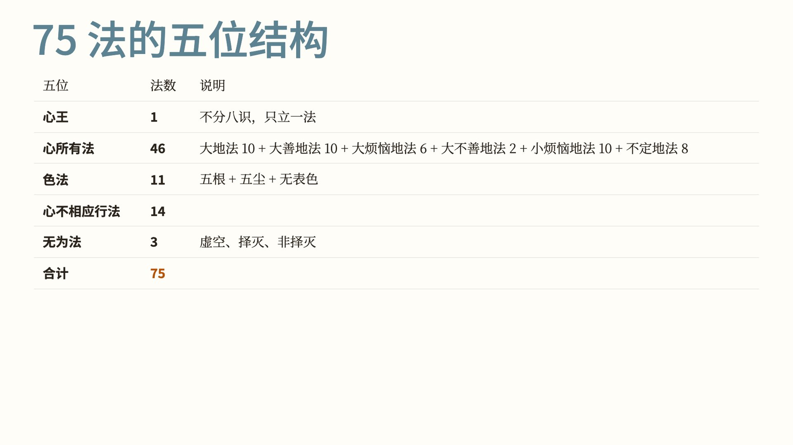

俱舍七十五法的结构：

- 心王，1 个：不分八识，只立一法。
- 心所有法，46 个：大地法 10、大善地法 10、大烦恼地法 6、大不善地法 2、小烦恼地法 10、不定地法 8，共六类。
- 色法，11 个：五根、五尘，加无表色。
- 心不相应行法，14 个。
- 无为法，3 个：虚空、择灭、非择灭。

合起来 75 法。

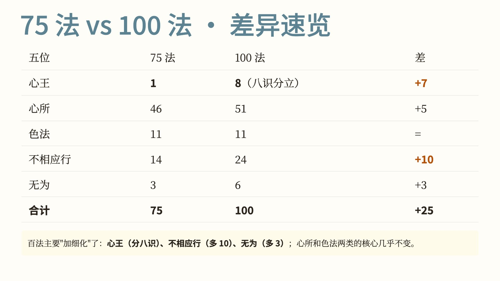

百法和七十五法逐类比较：

| 类别 | 俱舍七十五法 | 百法 | 差数 |
|---|---|---|---|
| 心王 | 1 | 8 | 多 7（百法分出八识） |
| 心所 | 46 | 51 | 多 5 |
| 色法 | 11 | 11 | 相同 |
| 不相应行 | 14 | 24 | 多 10 |
| 无为 | 3 | 6 | 多 3 |
| 合计 | 75 | 100 | 多 25 |

百法分得更细的主要是三处：心王分成八识，不相应行多 10 个，无为多 3 个。心所只多 5 个，色法数目相同。

## 三、对照五蕴

下面进入对照。第一种切法：对照五蕴。

五蕴的对照有一首摄颂。这首颂不是《俱舍论》本论的原颂，而是后人按百法的数目整理出来的：

> 色摄十一全，受想各当一，七十三行蕴，八王识蕴收，无为无积聚，不向蕴门摄。

颂文逐句说出百法怎样落入五蕴：色蕴摄十一个色法，受蕴、想蕴各摄一个心所，行蕴摄七十三法，识蕴摄八个心王，无为法没有积聚义，不归入蕴。

对应俱舍七十五法的版本写作「行五十八种、一心识蕴摄」，数字不同，道理相同。

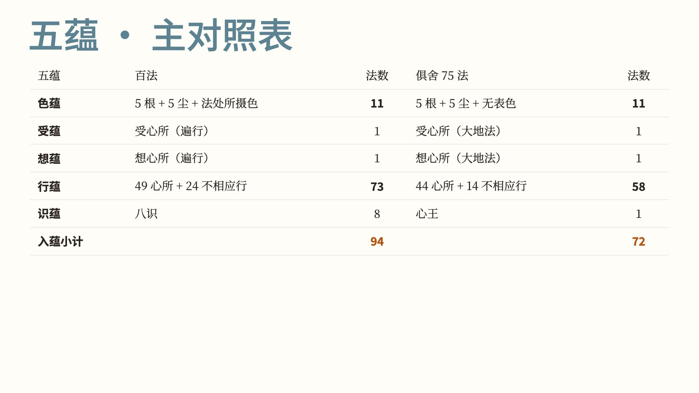

对照表：

| 五蕴 | 百法 | 俱舍七十五法 |
|---|---|---|
| 色蕴 | 色法 11（5 根 + 5 尘 + 法处所摄色） | 色法 11（5 根 + 5 尘 + 无表色） |
| 受蕴 | 受心所 1 | 受心所 1 |
| 想蕴 | 想心所 1 | 想心所 1 |
| 行蕴 | 49 心所 + 24 不相应行 = 73 | 44 心所 + 14 不相应行 = 58 |
| 识蕴 | 八识 8 | 心王 1 |
| 入蕴小计 | 94 | 72 |

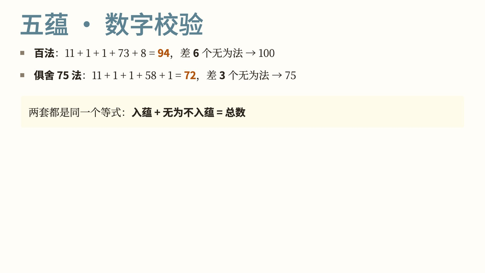

核对数字：

- 百法：11 + 1 + 1 + 73 + 8 = 94，再加不入蕴的 6 个无为法，正好 100。
- 俱舍七十五法：11 + 1 + 1 + 58 + 1 = 72，再加不入蕴的 3 个无为法，正好 75。

两套都满足同一个等式：入蕴的法 + 不入蕴的无为法 = 总数。

无为法为什么不入蕴？

要看「蕴」字的本义：积聚、聚集。

只有有为法才能聚集，有增减、有起灭、有和合。无为法（虚空、择灭、非择灭、真如等）没有生灭，不增不减，谈不上聚集。

《大毗婆沙论》也讨论过蕴与无为的关系，结论相同：五蕴不摄无为法。

## 四、对照十二处

第二种切法：对照十二处。

十二处也有一首按百法数目整理的摄颂：

> 根尘各五处，十色随自名，八王意处收，八十二皆法。

颂文分四段：前五根、前五尘、意处、法处。

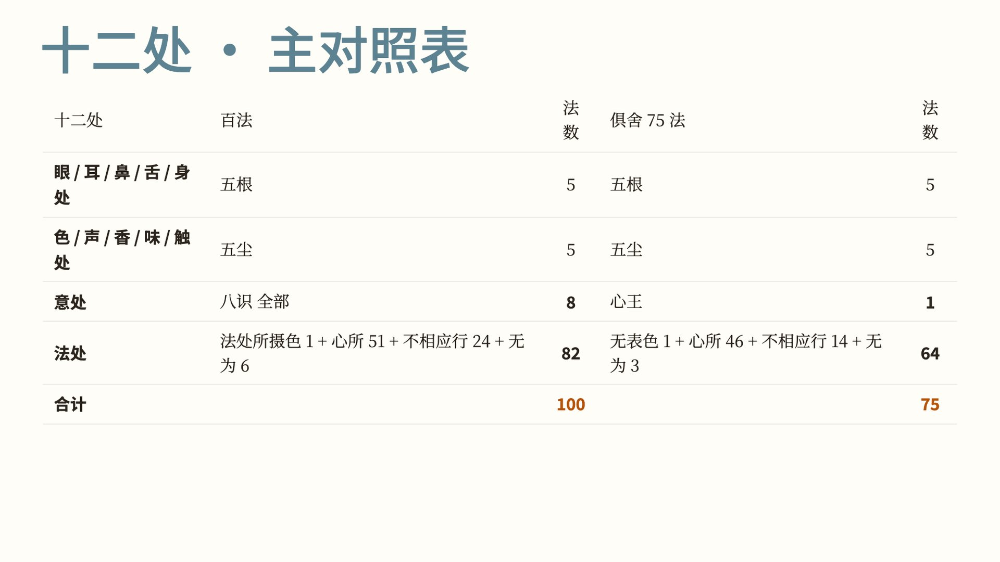

对照表：

| 十二处 | 百法 | 俱舍七十五法 |
|---|---|---|
| 眼、耳、鼻、舌、身处 | 五根 5 | 五根 5 |
| 色、声、香、味、触处 | 五尘 5 | 五尘 5 |
| 意处 | 八识 8 | 心王 1 |
| 法处 | 法处所摄色 1 + 心所 51 + 不相应行 24 + 无为 6 = 82 | 无表色 1 + 心所 46 + 不相应行 14 + 无为 3 = 64 |
| 合计 | 100 | 75 |

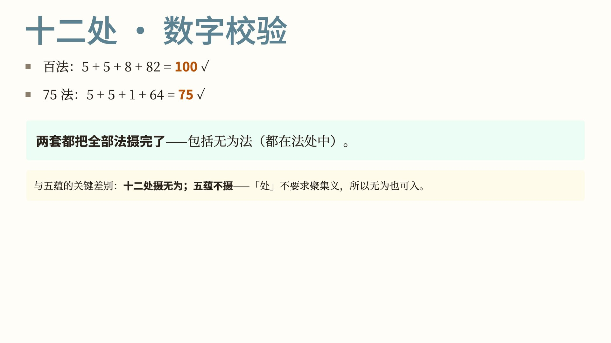

核对数字：

- 百法：5 + 5 + 8 + 82 = 100。
- 俱舍七十五法：5 + 5 + 1 + 64 = 75。

两套都把全部的法摄尽了，无为法也在其中，都归在法处。

这是十二处和五蕴的差别：十二处摄无为法，五蕴不摄。因为「处」没有聚集的意思，无为法也可以归入。

## 五、对照十八界

第三种切法：对照十八界。

十八界的摄颂：

> 根尘各五处，十色随自名，八王归七心，八十二皆法。

和十二处的颂只差一句「八王归七心」。

这一句是说，把百法的八个识归到七个心识界里：前五识各占一界，意识占一界，末那识和阿赖耶识合占意界。

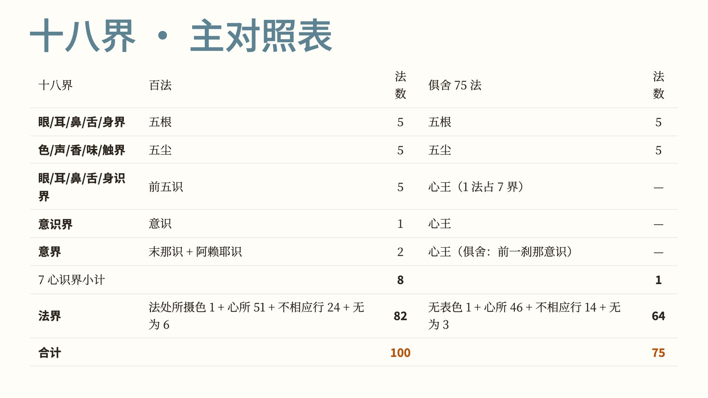

对照表：

| 十八界 | 百法 | 俱舍七十五法 |
|---|---|---|
| 眼、耳、鼻、舌、身界 | 五根 5 | 五根 5 |
| 色、声、香、味、触界 | 五尘 5 | 五尘 5 |
| 眼、耳、鼻、舌、身识界 | 前五识 5 | 心王（一个法占七界） |
| 意识界 | 意识 1 | 同上 |
| 意界 | 末那识 + 阿赖耶识 = 2 | 同上（俱舍说意界是前一刹那的意识） |
| 七心识界小计 | 8 个法 | 1 个法占 7 界 |
| 法界 | 82（与法处相同） | 64（与法处相同） |
| 合计 | 100 | 75 |

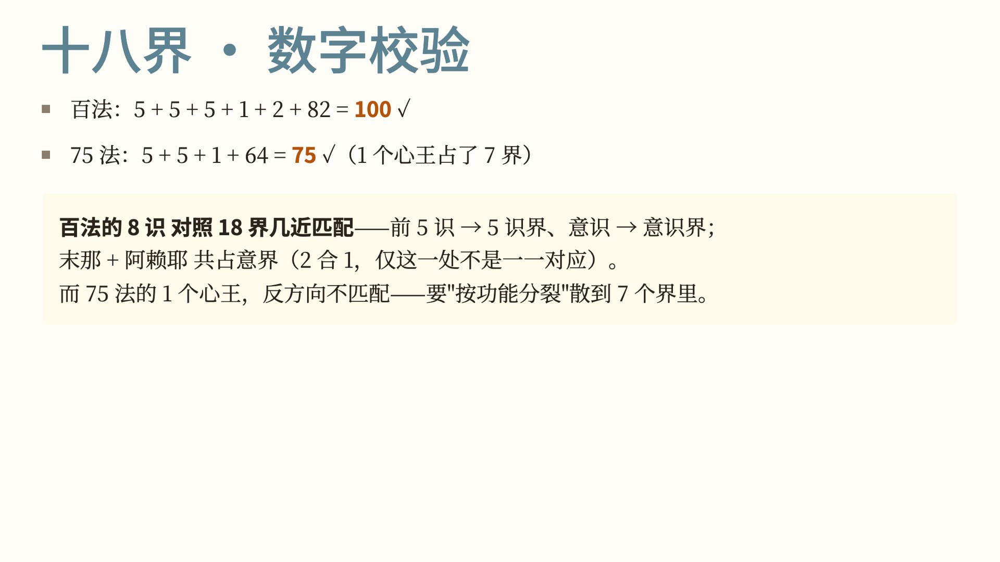

核对数字：

- 百法：5 + 5 + 5 + 1 + 2 + 82 = 100。
- 俱舍七十五法：5 + 5 + 1 + 64 = 75（1 个心王占了 7 界）。

再看分得粗细是否对得上：

百法的八识和十八界差不多一一对应——前五识对五识界，意识对意识界；只有末那识和阿赖耶识两个合占一个意界，这一处是二对一。

俱舍七十五法的一个心王则相反，要按作用拆开，分散到七个界里。

## 六、三科之间的对照

讲完百法和三科的对照，再看三科彼此之间怎样对应。

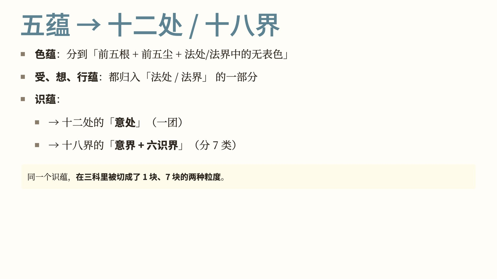

五蕴怎样落入十二处和十八界：

- 色蕴：分到前五根、前五尘，以及法处（法界）中的无表色。
- 受蕴、想蕴、行蕴：都归入法处（法界）的一部分。
- 识蕴：在十二处里只对应意处，是一整块；在十八界里对应意界加六识界，分成七块。

同一个识蕴，在十二处里是一块，在十八界里是七块。

几种归纳切分心法的粗细，由粗到细排：

| 体系 | 心王怎样切分 | 粗细 |
|---|---|---|
| 俱舍七十五法 | 1 法 | 最粗 |
| 十二处 | 1 处（意处） | 最粗，与七十五法相同 |
| 十八界 | 7 类（五识界 + 意识界 + 意界） | 居中 |
| 百法 | 8 识 | 最细 |

十八界的七个心识界比百法的八识少一类，因为末那识和阿赖耶识在十八界里合并到意界。

几种切法粗细不同，各有用处，相互参照着看，理解才不会只停在一个角度。

## 七、几个常见疑问

**问：心所有 51 个（俱舍是 46 个），为什么只把受和想单独立为一蕴？**

圆晖《俱舍论颂疏》和智敏上师《讲记》讲到这里，列出四条理由：

1. 相粗：受、想的行相粗显，在行蕴诸法里最容易觉察，粗显程度仅次于色。
2. 生染：受、想能引生染污。乐受引起贪，苦受引起嗔；想安立名字、起分别，由此分出染和净。
3. 类食同助：受像食材，想像调料，和色蕴、行蕴、识蕴一起，才完成「做饭」这一次认识活动。
4. 二界中强：色界里受的作用强，无色界里想的作用强。

所以受、想不并在行蕴里，而是各自单立为蕴。

**问：五蕴为什么按色、受、想、行、识这个顺序排？**

按由粗到细排：色最粗，识最细。

做饭比喻的全套是：

- 色蕴：厨房和厨具，是所依。
- 受蕴：食材，决定是损是益。
- 想蕴：调料，由亲、怨等想生起苦受、乐受。
- 行蕴：厨师，造业，引出果报。
- 识蕴：吃饭的人，领受果报。

这套比喻出自《俱舍论颂疏》（圆晖），智敏上师《讲记》里又作了展开。

**问：意根、意界到底是什么？**

两套体系说法不同：

- 百法：意根是第七识，即末那识。
- 俱舍七十五法：意根是前一刹那的意识。

智敏上师《俱舍论颂疏讲记》解释俱舍的说法：「意识了别之后的下一刹那，就变成了意根。」

这两种说法，当作知识点记住就可以。阿罗汉如果没有听佛说过，也不知道有第七识、第八识，也就无从分辨意根是第七识还是前一刹那的意识。一般人记住一种说法就够用。

本系列沿用百法的解释：意根是末那识。

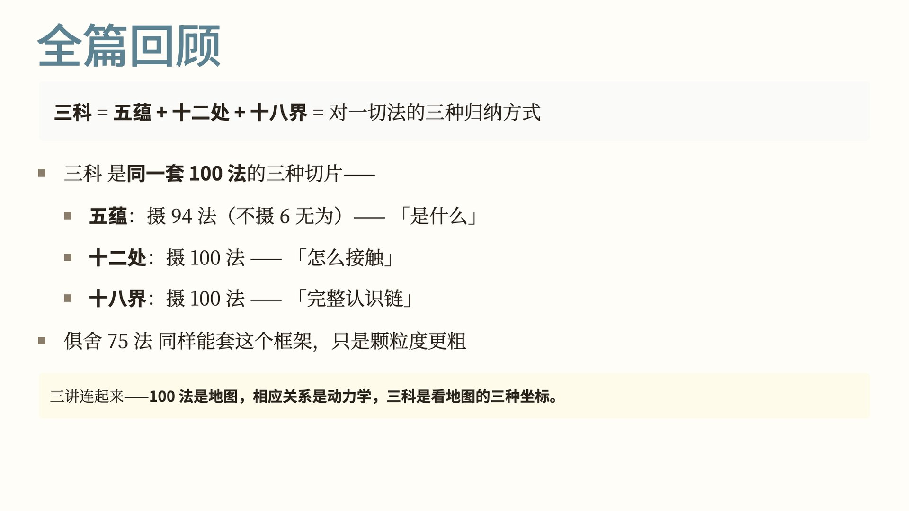

## 八、小结

三科就是五蕴、十二处、十八界，是对一切法的三种归纳方式，也是同一套百法的三种切法：

- 五蕴：摄 94 法，不摄 6 个无为法，回答「是什么」。
- 十二处：摄全部百法，回答「怎样接触」。
- 十八界：摄全部百法，列出认识活动的全部要素。

俱舍七十五法同样能放进这个框架，只是分得更粗。

把前三讲连起来看：百法是一张地图，心王心所的相应关系讲这张地图上的法怎样一起运作，三科是看这张地图的三种坐标。

这一讲对照了《百法》、俱舍七十五法和五蕴、十二处、十八界。

下一讲是《百法》与三十七道品，把百法落到修证的次第上。

视频版在我的微信公众号和视频号「愚千一」。

愿以此功德，普及于一切；我等与众生，皆共成佛道。

---

**参考**

- 《大乘百法明门论》，天亲菩萨造，唐·玄奘译，《大正藏》第 31 册 No. 1614
- 《阿毗达磨俱舍论》，世亲菩萨造，唐·玄奘译，《大正藏》第 29 册 No. 1558（七十五法、五蕴次第、意根为前一刹那意识）
- 唐·圆晖《俱舍论颂疏》（做饭比喻，受、想单立为蕴的理由）
- 智敏上师《俱舍论颂疏讲记》
- 《阿毗达磨大毗婆沙论》，唐·玄奘译，《大正藏》第 27 册 No. 1545
- 《金刚般若波罗蜜经》，姚秦·鸠摩罗什译，《大正藏》第 8 册 No. 235

—— 整理：愚千一
