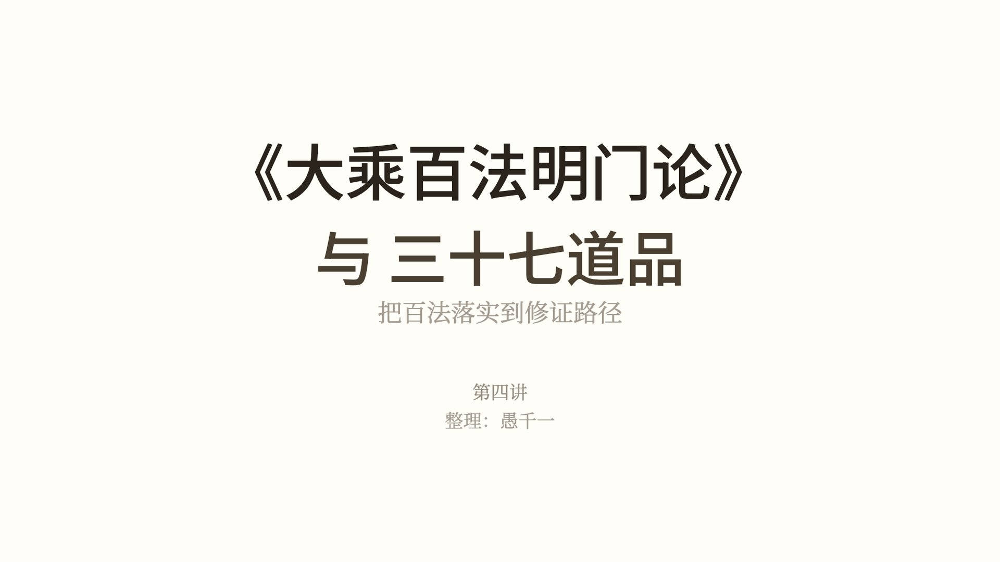

这是《大乘百法明门论》系列的第四讲：《百法》与三十七道品。本文根据视频整理，副标题是：把百法落实到修证路径。

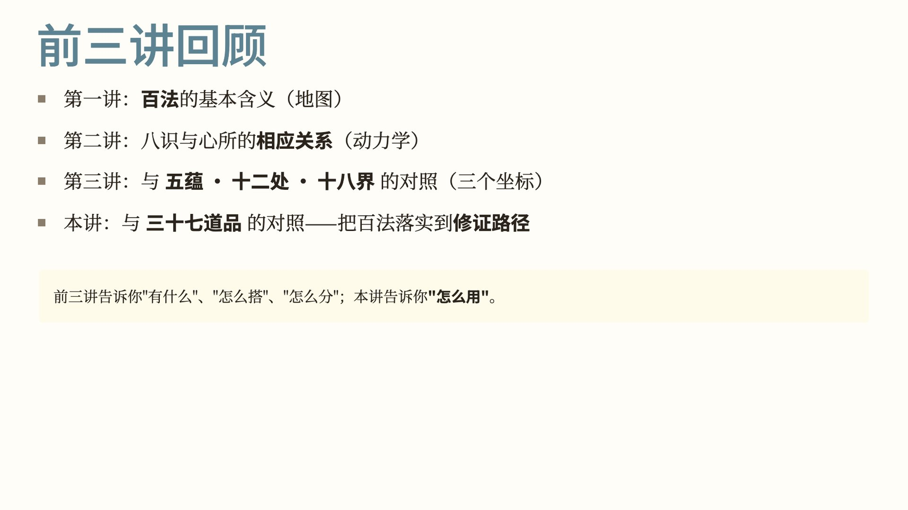

先回顾前三讲：

- 第一讲讲百法的基本含义，相当于一张地图。
- 第二讲讲八识与心所的相应关系，相当于一套动力学。
- 第三讲讲百法与五蕴、十二处、十八界这三科的对照，相当于三种坐标。

这一讲把百法和声闻乘修证的总纲三十七道品做对照。前三讲讲的是「有什么」「怎么搭」「怎么分」，这一讲讲「怎么用」。

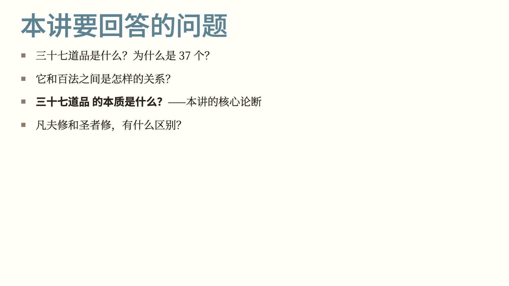

这一讲围绕四个问题：

1. 三十七道品是什么？为什么是三十七个？
2. 它和百法是什么关系？
3. 用百法来看，三十七道品由哪些法构成？这是本讲的主要论点。
4. 凡夫修和圣者修，有什么区别？

第一部分，三十七道品速览。三十七道品是声闻乘修证的总纲。

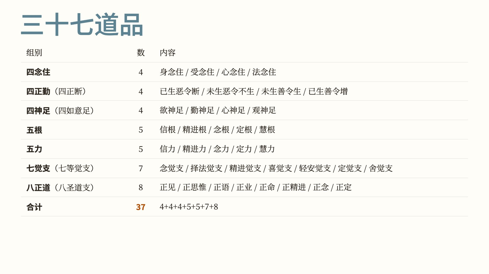

三十七道品分成七组：

| 组 | 别名 | 数目 | 各支 |
|---|---|---|---|
| 四念住 | | 4 | 身念住、受念住、心念住、法念住 |
| 四正勤 | 四正断 | 4 | 已生恶令断、未生恶令不生、未生善令生、已生善令增 |
| 四神足 | 四如意足 | 4 | 欲神足、勤神足、心神足、观神足 |
| 五根 | | 5 | 信根、精进根、念根、定根、慧根 |
| 五力 | | 5 | 信力、精进力、念力、定力、慧力 |
| 七觉支 | 七等觉支 | 7 | 念、择法、精进、喜、轻安、定、舍觉支 |
| 八正道 | 八圣道支 | 8 | 正见、正思惟、正语、正业、正命、正精进、正念、正定 |

四加四加四加五加五加七加八，等于三十七，所以叫三十七道品。

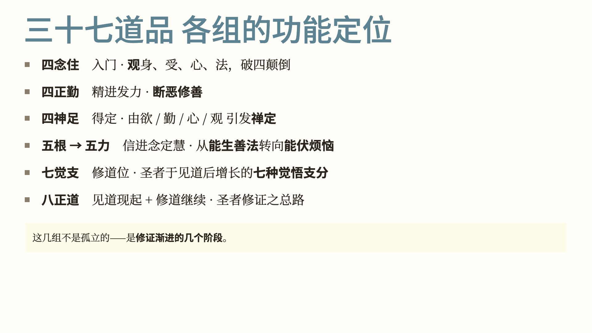

这七组各有功能：

- 四念住是入门。观身、受、心、法四类对象，破四种颠倒。
- 四正勤是精进发力，断恶修善。
- 四神足是得定。由欲、勤、心、观四种助伴引发禅定。
- 五根、五力是同一套信、精进、念、定、慧，从「能生善法」的角度转到「能伏烦恼」的角度。五根和五力不是力量大小的两个阶段，后面专门讲。
- 七觉支是修道位，圣者见道之后增长的七种觉悟支分。
- 八正道是见道时现起、修道时继续，是圣者修证的总路。

这几组不是孤立的，是修证渐进的几个阶段。

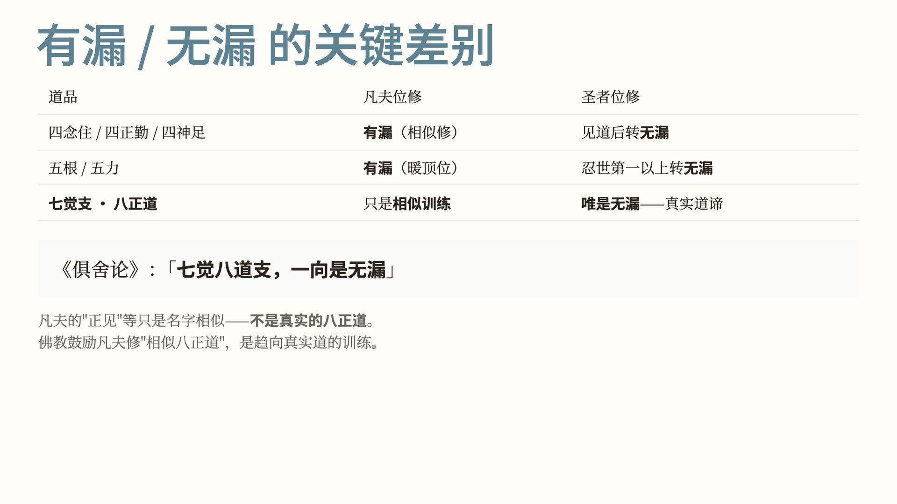

这七组在凡夫位修和在圣者位修，有一个差别：

- 四念住、四正勤、四神足：凡夫位修的是有漏的「相似修」，见道之后才转成无漏。
- 五根、五力：凡夫在加行位的暖、顶两位还是有漏，到忍位、世第一法位以上才转无漏。
- 七觉支、八正道：《俱舍论》的颂文说「七觉八道支，一向是无漏」，这两组只在见道以上真实成就。凡夫说的「正见」「正念」，只是名字相似，不是真实的八正道。

不过佛教也鼓励凡夫修「相似八正道」，作为趋向真实道的训练。

第二部分，用百法来看三十七道品。本讲的论点是：三十七道品是反复使用几个心所。

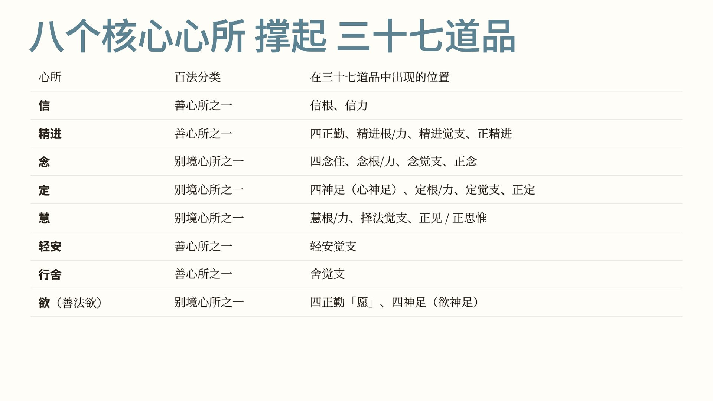

三十七道品里反复出现的，是这八个心所：

| 心所 | 百法归类 | 出现在 |
|---|---|---|
| 信 | 善心所 | 信根、信力 |
| 精进 | 善心所 | 四正勤、精进根、精进力、精进觉支、正精进 |
| 念 | 别境心所 | 四念住、念根、念力、念觉支、正念 |
| 定 | 别境心所 | 心神足、定根、定力、定觉支、正定 |
| 慧 | 别境心所 | 慧根、慧力、择法觉支、正见、正思惟 |
| 轻安 | 善心所 | 轻安觉支 |
| 行舍 | 善心所 | 舍觉支 |
| 欲（特指善法欲） | 别境心所 | 四正勤的「愿」、欲神足 |

《成唯识论》归类八识相应的心所时，把信、精进、轻安、行舍放在「善十一」里，把欲、念、定、慧放在「别境五」里。三十七道品就是由这八个心所搭起来的。

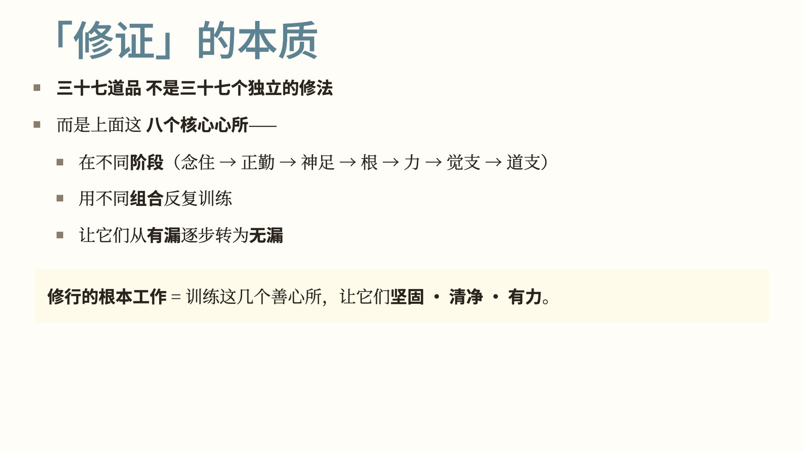

所以三十七道品不是三十七个独立的修法，而是上面这八个心所：

- 在不同的阶段：从念住，到正勤、神足、根、力、觉支、道支；
- 用不同的组合反复训练；
- 让它们从有漏逐步转为无漏。

修行要做的工作，就是训练这几个心所，让它们坚固、清净、有力。

第三部分，四念住：身念住、受念住、心念住、法念住。

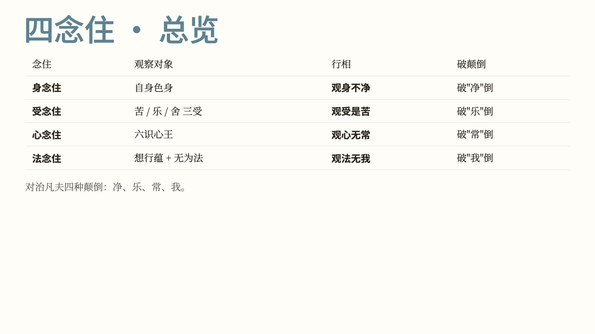

四念住有四个观察对象，分别对治四种颠倒：

| 念住 | 所观 | 行相 | 对治 |
|---|---|---|---|
| 身念住 | 自身色身 | 观身不净 | 破「净」倒 |
| 受念住 | 苦受、乐受、舍受 | 观受是苦 | 破「乐」倒 |
| 心念住 | 六识心王 | 观心无常 | 破「常」倒 |
| 法念住 | 想心所、行蕴中其他心所、不相应行、无为法 | 观法无我 | 破「我」倒 |

凡夫的四种颠倒是：净、乐、常、我。

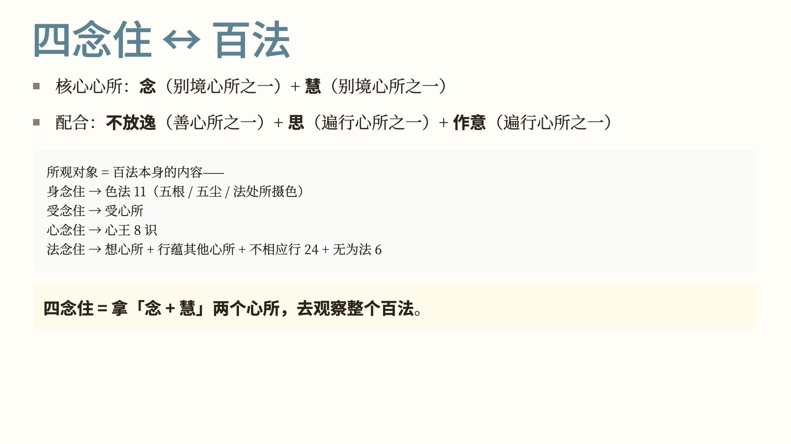

四念住对到百法上：

主要的心所是别境里的「念」和「慧」。严格说，《俱舍论》卷二十三讲四念住以慧为体，由念的力量让这个观察持续安住，所以叫念住。观察的本体是慧，念让观察相续不断。念和慧两个心所都少不了。

配合的还有善心所里的「不放逸」，遍行里的「思」和「作意」。

所观的对象就是百法本身：

- 身念住，观色法十一个，包括五根、五尘、法处所摄色；
- 受念住，观受心所；
- 心念住，观八识心王；
- 法念住，观想心所、行蕴里其他心所、不相应行二十四个、无为法六个。

四念住就是拿「念」和「慧」两个心所，去观察整个百法。

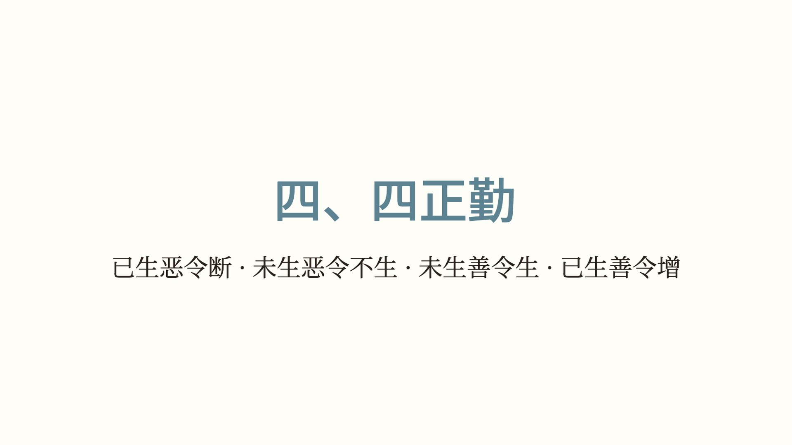

第四部分，四正勤：已生恶令断、未生恶令不生、未生善令生、已生善令增。

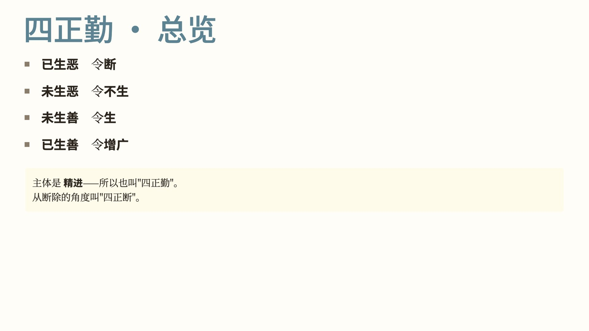

四正勤分四项：

1. 已经生起的恶，令它断除；
2. 没有生起的恶，令它不生；
3. 没有生起的善，令它生起；
4. 已经生起的善，令它增长广大。

主体是「精进」，所以叫四正勤；从断除的角度看，也叫四正断。

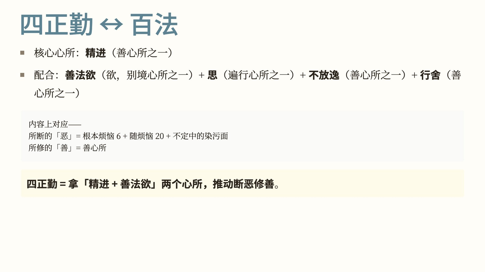

四正勤对到百法上：

主要的心所是善心所里的「精进」。《俱舍论》卷二十五说四正勤以精进为体。

配合的有别境里的「善法欲」、遍行里的「思」、善心所里的「不放逸」和「行舍」。

内容上：

- 要断除的「恶」，是百法里的根本烦恼六个、随烦恼二十个，加上不定心所的染污一面；
- 要修持的「善」，是善心所这一组。

四正勤就是拿「精进」和「善法欲」两个心所，推动断恶修善。

第五部分，四神足：欲神足、勤神足、心神足、观神足。

四神足又叫四如意足，体性是「定」。《俱舍论》卷二十五说四神足以定为体。

有四种助伴让定生起：

- 欲神足：由「善法欲」推动定；
- 勤神足：由不懈的「精进」推动定；
- 心神足：由「心一境性」的专注推动定；
- 观神足：由「如理思惟」推动定。

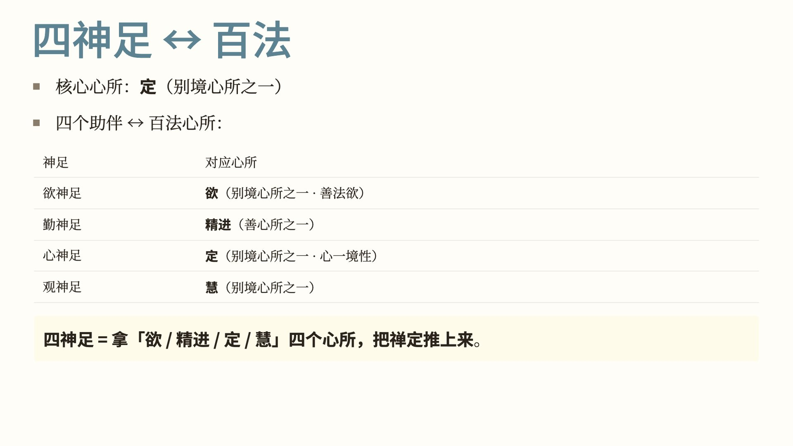

四神足对到百法上，主要的心所是别境里的「定」。四个助伴对应的心所是：

- 欲神足：别境里的「欲」，特指善法欲；
- 勤神足：善心所里的「精进」；
- 心神足：别境里的「定」，表现为心一境性；
- 观神足：别境里的「慧」。

四神足就是拿欲、精进、定、慧四个心所，把禅定修起来。

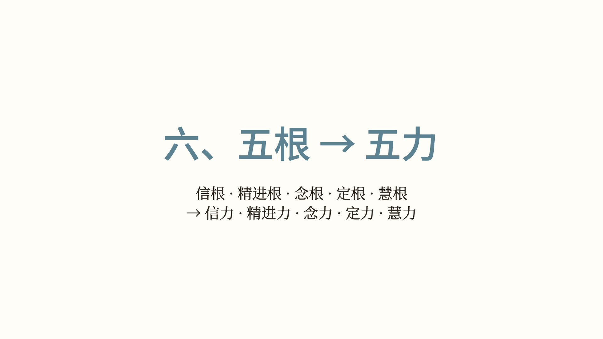

第六部分，五根和五力：信根、精进根、念根、定根、慧根；信力、精进力、念力、定力、慧力。

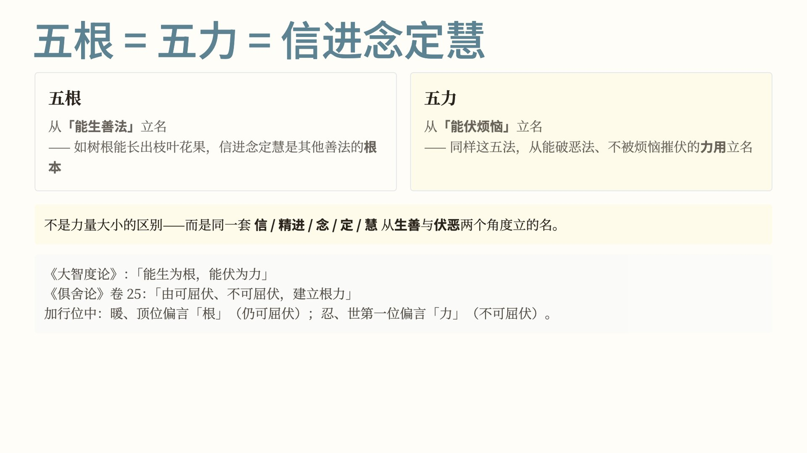

五根和五力的体性是同一套：信、精进、念、定、慧。两者的区别不在力量大小，而是从两个角度立的名：

- 五根，从「能生善法」立名。树根能长出枝叶花果，信、精进、念、定、慧是其他善法生起的根本。
- 五力，从「能伏烦恼」立名。同样这五个心所，从能破恶法、不被烦恼摧伏的力用上立名。

经论依据：

- 《大智度论》从「能生」和「能伏」两方面解释根与力。
- 《俱舍论》卷二十五从「可屈伏」和「不可屈伏」来建立根与力的差别。

在加行位中也有阶段上的对应：暖位、顶位偏说「根」，因为还会被烦恼屈伏；忍位、世第一法位以上偏说「力」，因为不再被屈伏。这是「生善」与「伏恶」两种角度在阶段上的体现，不是根和力区分的根本。

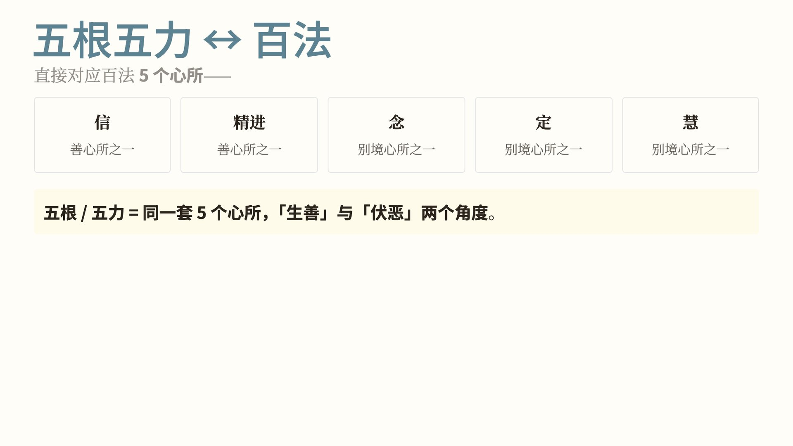

五根、五力直接对应百法里的五个心所：

- 信，善心所；
- 精进，善心所；
- 念，别境心所；
- 定，别境心所；
- 慧，别境心所。

五根、五力是同一组五个心所，分别从「生善」和「伏恶」两个角度来说。

第七部分，七觉支：念觉支、择法觉支、精进觉支、喜觉支、轻安觉支、定觉支、舍觉支。

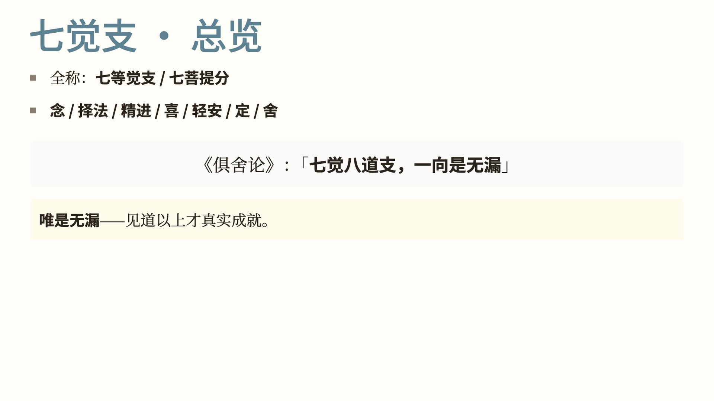

七觉支，全称七等觉支，又叫七菩提分。七个是：念、择法、精进、喜、轻安、定、舍。

《俱舍论》卷二十五说「七觉八道支，一向是无漏」，七觉支只是无漏，只在见道以上真实成就。

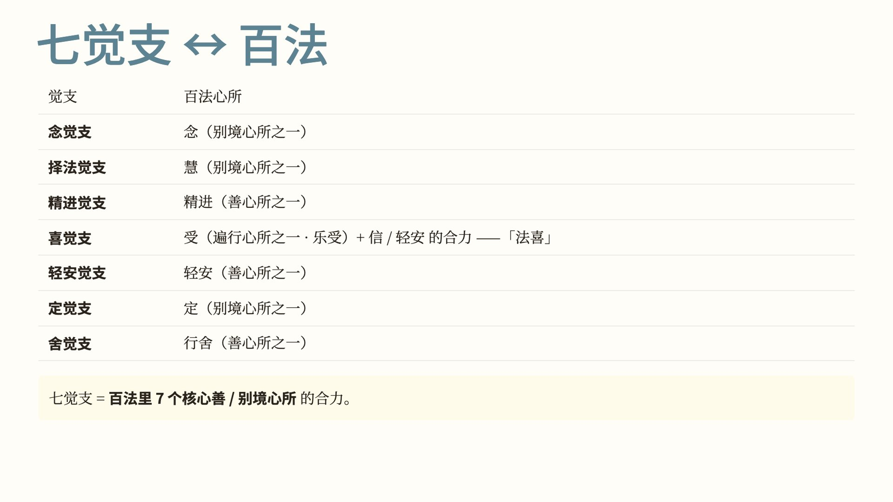

七觉支对到百法上：

- 念觉支：别境里的「念」；
- 择法觉支：别境里的「慧」；
- 精进觉支：善心所里的「精进」；
- 喜觉支：按《俱舍论》卷二十五的说法，体性是「喜」，也就是受心所中的喜乐之受；另一种解释说它伴随信和轻安的合力，就是所谓「法喜」。所以喜觉支是受心所的乐受，加上信、轻安几个心所合起来的作用；
- 轻安觉支：善心所里的「轻安」；
- 定觉支：别境里的「定」；
- 舍觉支：善心所里的「行舍」。

七觉支就是百法里几个善心所和别境心所合起来的作用。

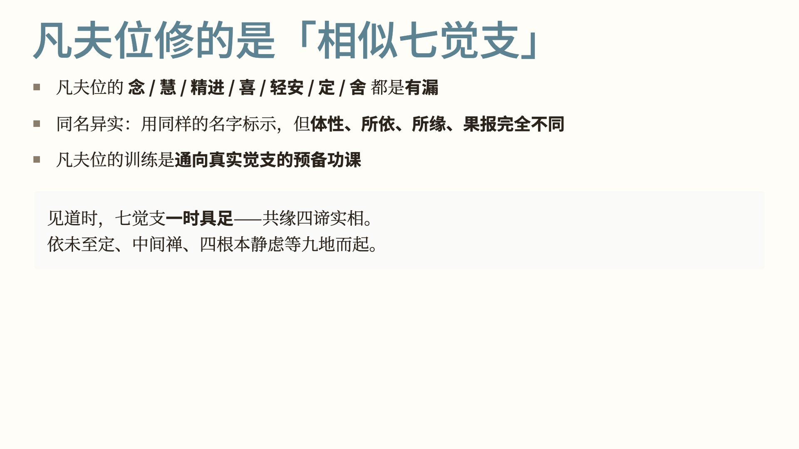

要提醒一点：凡夫位修的，不是真正的七觉支。

凡夫位的念、慧、精进、喜、轻安、定、舍，都是有漏的。它们和圣者位的七觉支只是名字相似，体性、所依、所缘、果报都不同，这叫「同名异实」。凡夫位的训练，是通向真实觉支的预备功课。

见道时，七觉支一时具足，共同缘四谛的实相。它依未至定、中间禅、四根本静虑等地而起。

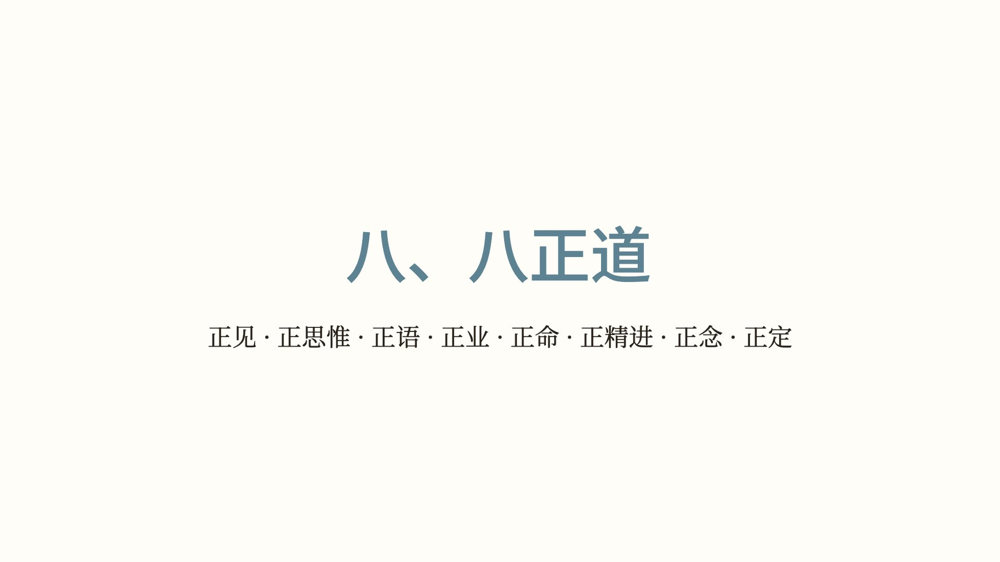

第八部分，八正道：正见、正思惟、正语、正业、正命、正精进、正念、正定。

八正道分八支：正见、正思惟、正语、正业、正命、正精进、正念、正定。它在圣者见道时现起，修道时继续，是圣者修证的总路。

《俱舍论》同样说「七觉八道支，一向是无漏」，所以凡夫修的是相似八正道。

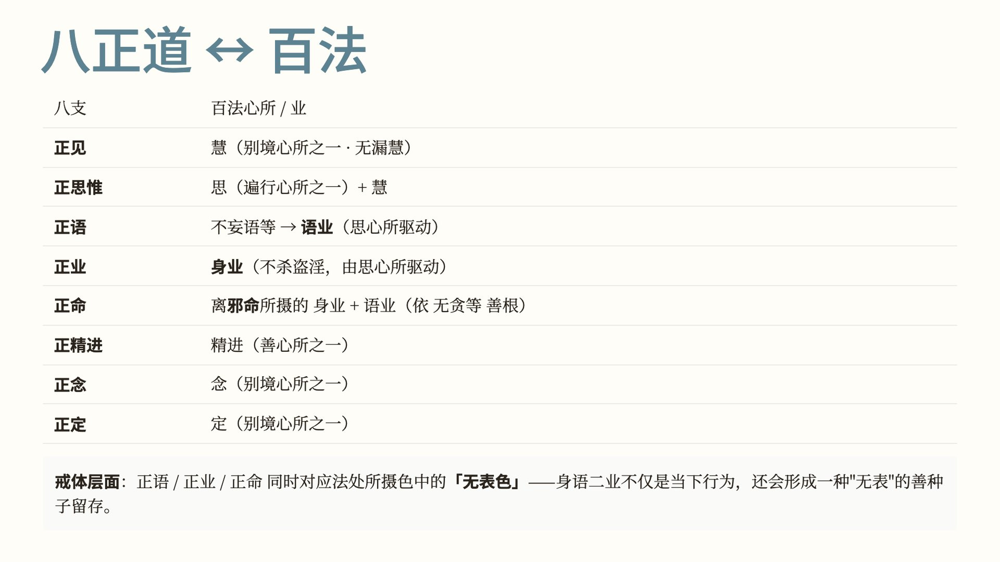

八正道对到百法上：

- 正见：别境里的「慧」，具体说是无漏的慧。
- 正思惟：按《俱舍论》卷二十五，体是不定心所里的「寻」；按《成唯识论》，寻以思和慧的一分为体，所以也可以说是思与慧合起来的作用。两种说法可以互相印证。
- 正语：不妄语等，属于语业，由「思」心所驱动。
- 正业：不杀、不盗、不淫，属于身业，也由「思」心所驱动。
- 正命：体也是身业和语业，专门对治「邪命」，比如用算命、咒术、邪求衣食等不正当方式谋生。正命的内在动力，是百法善心所里的无贪、无嗔、无痴三善根，以无染的心起身语二业。《俱舍论》卷二十五的意思是，邪命这类身语业难以对治，所以从正语、正业之外单独立出正命一支。
- 正精进：善心所里的「精进」。
- 正念：别境里的「念」。
- 正定：别境里的「定」。

还有戒体层面要补充：正语、正业、正命三支，同时对应法处所摄色里的「无表色」。身业和语业不只是当下的行为，还会留存一种「无表」，这就是戒体。这是《俱舍论》业品所立的；《成唯识论》用思的种子来解释，同样承认有这种善种子留存。

《八识规矩颂》讲第六识时说：「动身发语独为最，引满能招业力牵。」身业和语业由第六意识加思心所发动，对应八正道里的正语、正业、正命。

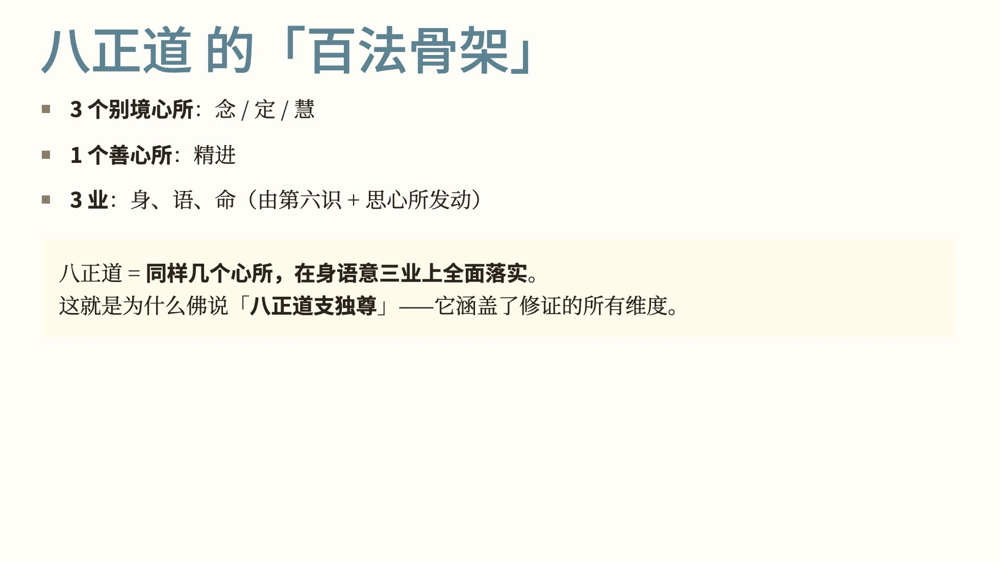

用百法的框架来看八正道：

- 三个别境心所：念、定、慧；
- 一个善心所：精进；
- 三业：身业、语业、命，都由第六意识加「思」心所发动。

八正道就是同样几个心所，在身、语、意三业上全面落实，修证的各个方面都包括在里面。

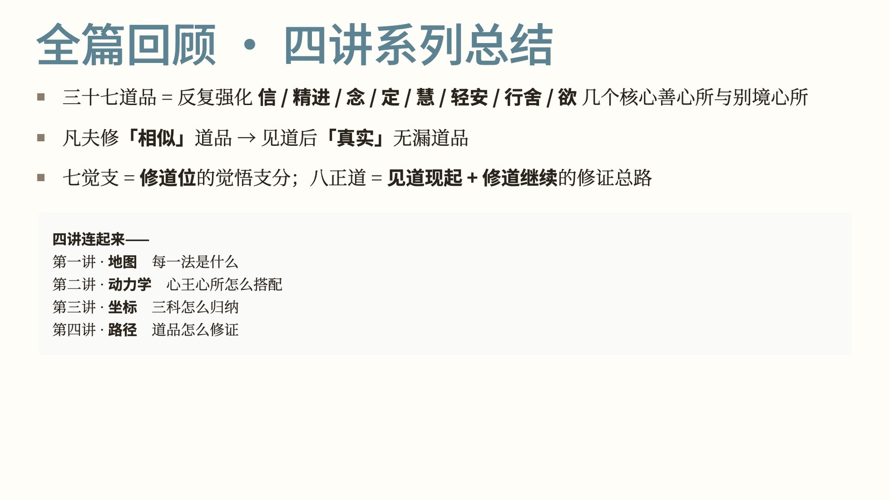

全篇回顾，本讲的论点有三条：

1. 三十七道品是反复强化信、精进、念、定、慧、轻安、行舍、欲这几个善心所和别境心所。
2. 凡夫修的是「相似」道品，见道之后才转成「真实」的无漏道品。
3. 七觉支偏重修道位的觉悟支分；八正道偏重见道现起、修道继续的修证总路。

把《百法》四讲连起来看：

- 第一讲是「地图」，讲每一法是什么；
- 第二讲是「动力学」，讲心王和心所怎么搭配；
- 第三讲是「坐标」，讲三科怎么归纳；
- 第四讲是「路径」，讲道品怎么修证。

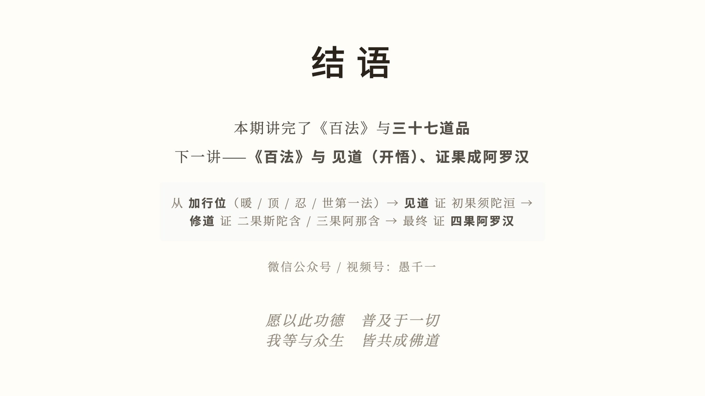

《百法》与三十七道品就讲到这里。

下一讲是《百法》与见道（开悟）、证果成阿罗汉。从加行位的暖、顶、忍、世第一法四个阶位讲起，到见道证初果须陀洹，再修道证二果斯陀含、三果阿那含，最后证四果阿罗汉，把百法和声闻乘的整个证果次第对应起来。

我的微信公众号、视频号都叫「愚千一」，视频版可以在那里看。

愿以此功德，普及于一切；我等与众生，皆共成佛道。

---

**参考**

- 天亲（世亲）菩萨造、唐·玄奘译《大乘百法明门论》，《大正藏》第 31 册 No. 1614
- 《阿毗达磨俱舍论》卷二十三（四念住）、卷二十五（三十七菩提分法的体性、根与力、「七觉八道支，一向是无漏」）；业品（无表色）
- 《成唯识论》（善十一、别境五；寻伺的体性；以思种子解释戒体）
- 《大智度论》（五根与五力）
- 《八识规矩颂》第六识颂

—— 整理：愚千一
