这是《大乘百法明门论》系列的第五讲，也是最后一讲：《百法》与见道、证果成阿罗汉。本文由视频讲稿整理而成。

这一讲要回答的问题是：从凡夫到阿罗汉，百法里的什么变了？

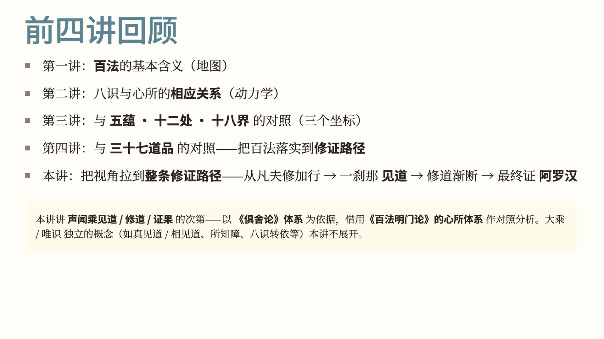

先回顾前四讲：

- 第一讲，讲百法的基本含义，相当于一张地图。
- 第二讲，讲八识和心所之间的相应关系，相当于一套动力学。
- 第三讲，讲百法和五蕴、十二处、十八界三科的对照，相当于三种坐标。
- 第四讲，讲百法和三十七道品的对照，把百法落实到修证路径上。

这一讲看整条修证路径：从凡夫修加行，到一刹那见道，再到修道渐断，最后证阿罗汉。

先交代立场。这一讲讲的是声闻乘的见道、修道和证果次第，体系上以《俱舍论》为依据，借用《百法明门论》的心所体系作为分析工具。大乘、唯识独有的概念，比如真见道、所知障、第七识和第八识的转依，这一讲不展开。

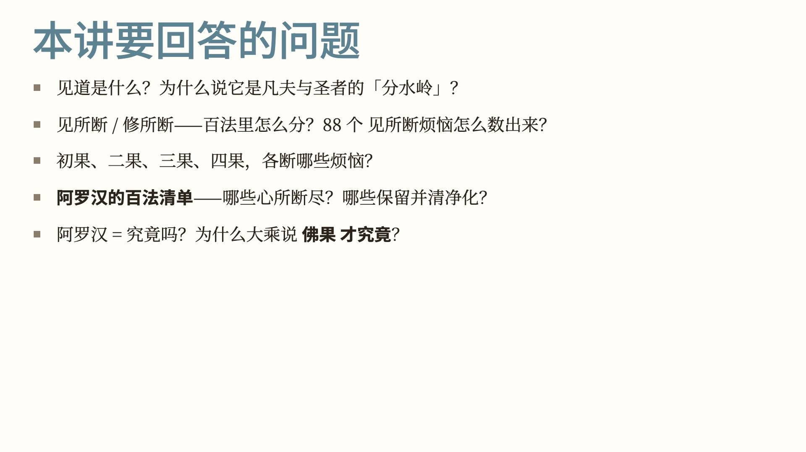

这一讲围绕五个问题：

1. 见道是什么？为什么说它是凡夫到圣者的分水岭？
2. 见所断、修所断在百法里怎么分？八十八个见所断烦恼是怎么数出来的？
3. 初果、二果、三果、四果，各断哪些烦恼？
4. 阿罗汉的「百法清单」：哪些心所断尽，哪些保留下来并且清净化？
5. 阿罗汉就是究竟吗？为什么大乘说佛果才是究竟？

第一部分是修证地图：资粮、加行、见道、修道、无学，五个位次。

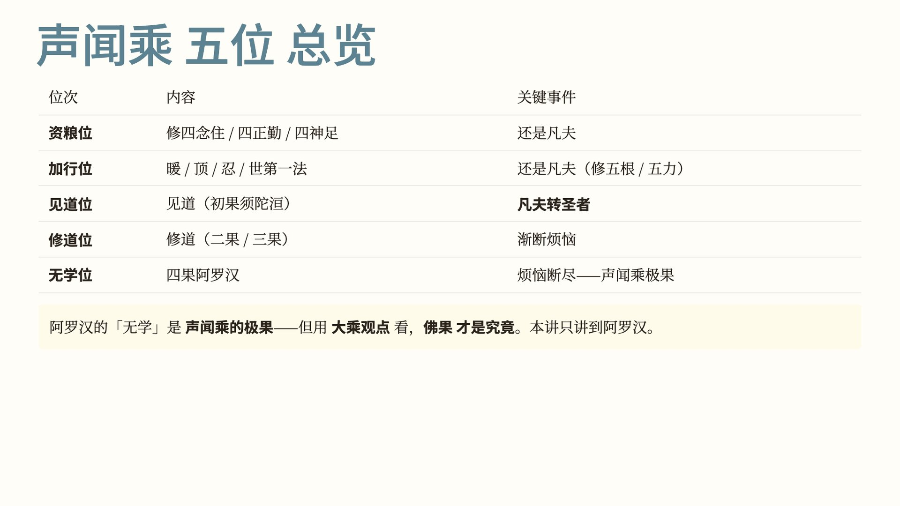

声闻乘的修证次第分五位：

| 位次 | 内容 |
|---|---|
| 资粮位 | 积累闻思修。声闻修四念住、四正勤、四神足 |
| 加行位 | 修暖、顶、忍、世第一法四个阶位 |
| 见道位 | 证初果须陀洹。凡夫在这一步转为圣者，这是分水岭 |
| 修道位 | 证二果斯陀含、三果阿那含 |
| 无学位 | 证四果阿罗汉，烦恼断尽 |

阿罗汉是声闻乘的极果。不过按大乘的观点，佛果才是真正的究竟。这一讲只讲到阿罗汉位。

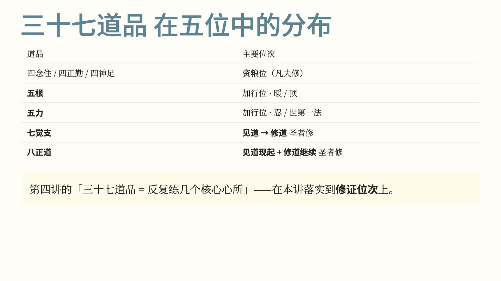

上一讲说过，三十七道品是在反复练几个心所。这一讲把三十七道品落到位次上：

- 四念住、四正勤、四神足：主要是资粮位的凡夫修。
- 五根：加行位的暖、顶两位。
- 五力：加行位的忍、世第一法两位。
- 七觉支：见道之后到修道位，圣者修。
- 八正道：见道时现起，修道时继续修，是圣者修证的总路。

可见三十七道品本身就标出了修证由浅到深的次第。

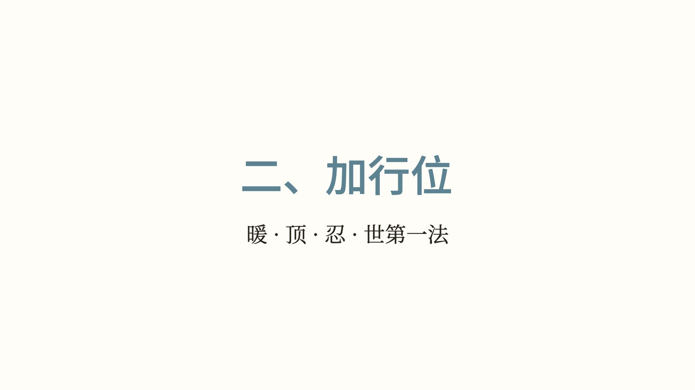

第二部分是加行位：暖、顶、忍、世第一法，四个阶位。

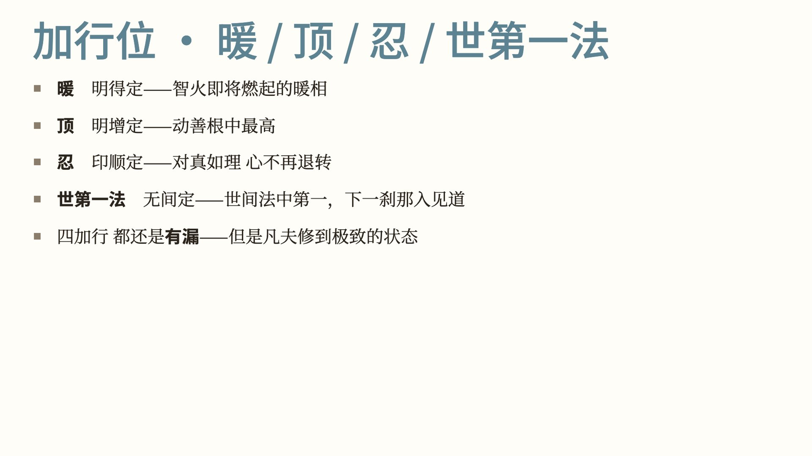

加行位的四个阶位：

- **暖位**，得明得定。智慧之火将要燃起，先现出「暖相」，所以叫暖。
- **顶位**，得明增定。这是凡夫善根里最高的，所以叫顶。
- **忍位**，得印顺定。心对真如的道理已经不再退转，所以叫忍。
- **世第一法**，得无间定。在世间法里最高，下一刹那就入见道，所以叫世第一。

这四个阶位都还是有漏的，但已经是凡夫能修到的最高状态。

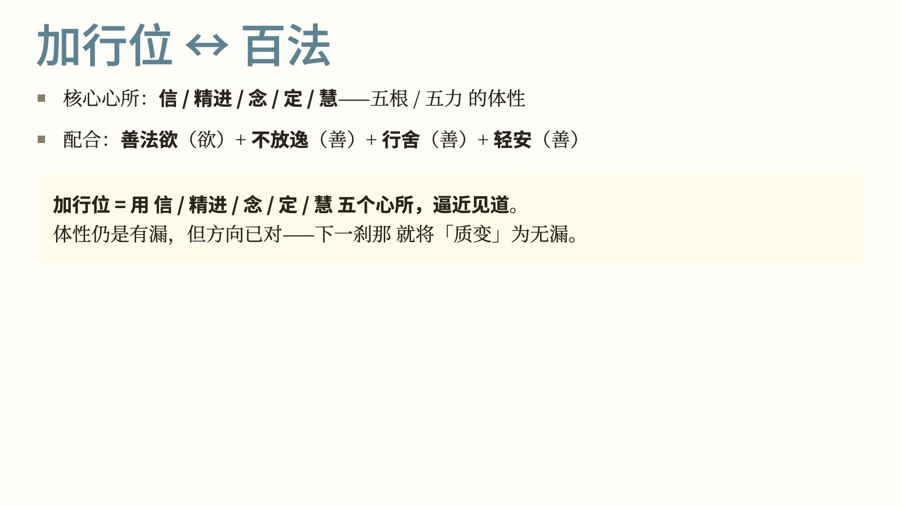

把加行位对到百法上：

- 主要是五个心所：信、精进、念、定、慧。这五个就是五根、五力的体性。
- 配合的心所有：别境里的善法欲，善心所里的不放逸、行舍、轻安。

加行位就是用信、精进、念、定、慧这五个心所去逼近见道。体性还是有漏的，方向已经对了，下一刹那就要从有漏转成无漏。

第三部分是见道，凡夫到圣者的分水岭。

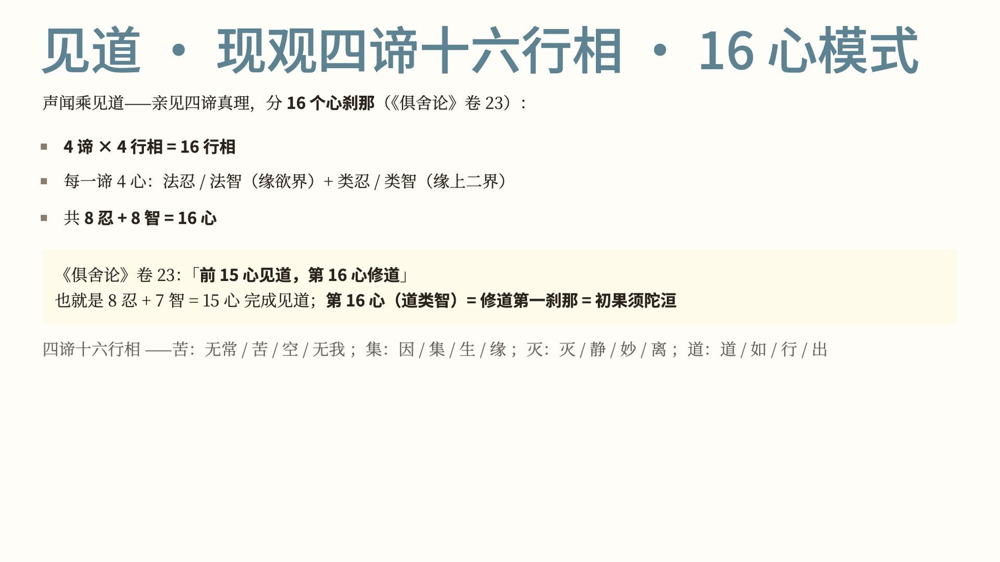

声闻乘的见道，是现观四谛十六行相，分十六个心刹那。

四谛每一谛配四个行相：

| 四谛 | 四行相 |
|---|---|
| 苦谛 | 无常、苦、空、无我 |
| 集谛 | 因、集、生、缘 |
| 灭谛 | 灭、静、妙、离 |
| 道谛 | 道、如、行、出 |

四谛各四相，合起来是十六行相。

每一谛又配四个心：法忍、法智、类忍、类智。「法」缘欲界，「类」缘色界和无色界这两个上界。四谛各四心，共十六心，其中八个是「忍」，八个是「智」。

《俱舍论》卷二十三讲，前十五心是见道，第十六心属修道。也就是说，八忍加七智共十五心，完成见道；第十六心是道类智，已经进入修道，也就是初果须陀洹的第一刹那。

所以见道的过程共十六刹那，分水岭在第十五心和第十六心之间。

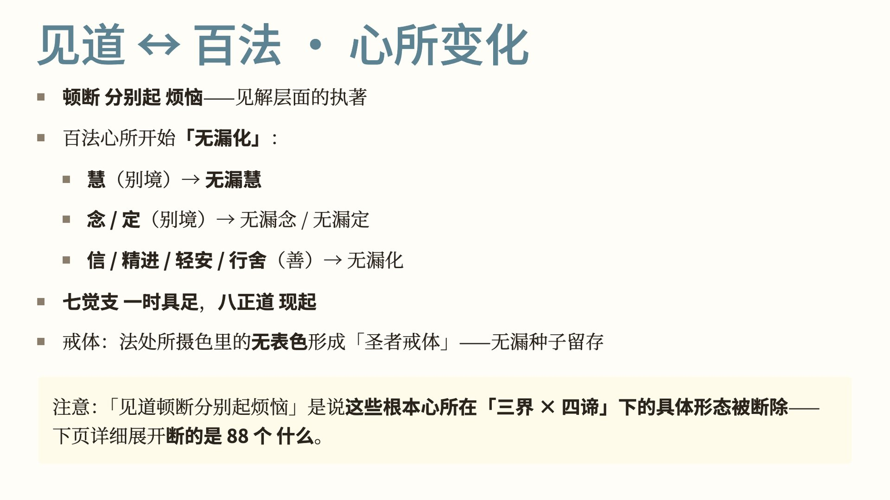

见道时，百法里的心所有这些变化：

第一，顿断「分别起」的烦恼。分别起，是说这些烦恼由错误的见解引起。

第二，百法里的几个主要心所开始无漏化：

- 别境里的慧，转成无漏慧。
- 别境里的念和定，转成无漏念、无漏定。
- 善心所里的信、精进、轻安、行舍，也跟着无漏化。

第三，三十七道品里的七觉支一时具足，八正道现起。《俱舍论》说「七觉八道支，一向是无漏」，这两组道品真正生起，就在见道这一刻。

第四，戒体。在百法里，戒体对应法处所摄色里的无表色。见道时形成的是圣者戒体，也就是无漏的善种子留存下来。

还要说明一点：「见道顿断分别起烦恼」，是说这些根本烦恼心所在「三界加四谛」下的具体形态被断除。具体断的是哪八十八个、怎么数出来，下面详细看。

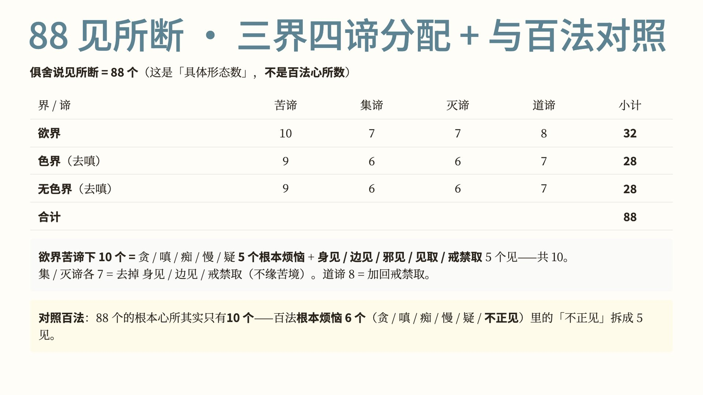

这一部分容易混淆，要把几个数分开。

先记住：八十八不是百法心所的数目，而是烦恼心所在「三界加四谛」下的具体形态数。

《俱舍论》的八十八个是这样数出来的。

**欲界三十二个：**

- 苦谛下十个：五个根本烦恼贪、嗔、痴、慢、疑，加上五个见：身见（也叫萨迦耶见）、边见、邪见、见取、戒禁取。
- 集谛下七个：集谛不缘苦境，所以去掉身见、边见、戒禁取三个见，剩下贪、嗔、痴、慢、疑、邪见、见取。
- 灭谛下七个：和集谛相同，贪、嗔、痴、慢、疑、邪见、见取。
- 道谛下八个：比集谛、灭谛多一个戒禁取，因为道谛涉及戒。即贪、嗔、痴、慢、疑、邪见、见取、戒禁取。

欲界合计 10 + 7 + 7 + 8 = 32。

**色界二十八个：** 比欲界少四个，因为色界没有嗔。上二界是禅定境界，不起嗔心，所以每一谛都比欲界少一个嗔：苦谛九个，集谛六个，灭谛六个，道谛七个，共二十八。

**无色界二十八个：** 和色界一样，也没有嗔。

三界合计 32 + 28 + 28 = 88。

再把这八十八个和百法对照：

- 八十八个的根本心所只有十个，就是五个根本烦恼加五个见。
- 百法的根本烦恼是六个：贪、嗔、痴、慢、疑、不正见。比十个少四个，是因为百法把五个见合并成一个「不正见」心所，展开来就是十个。

所以八十八是具体形态数，十是根本心所数，六是百法归类的根本烦恼数，三个数各指一层。

第四部分是初果须陀洹：入流，不堕恶趣。

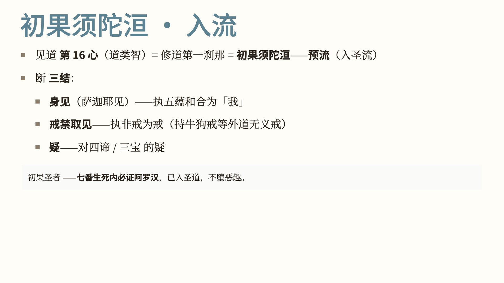

初果叫须陀洹，也叫「预流」，意思是预入圣流。

见道第十六心道类智，就是修道的第一刹那，也就是初果。

初果断三结：

1. **身见**，也叫萨迦耶见：把五蕴和合的身心当作「我」。
2. **戒禁取见**：把不是戒的当作戒。比如古印度有人学牛、学狗来持戒，以为这样修可以解脱，这就是戒禁取。
3. **疑**：对四谛、对三宝的疑惑。

初果圣者的功德是：七番生死之内必证阿罗汉。最多在天道和人道之间往返七次就一定解脱，因为已经入了圣道，永远不再堕三恶趣。

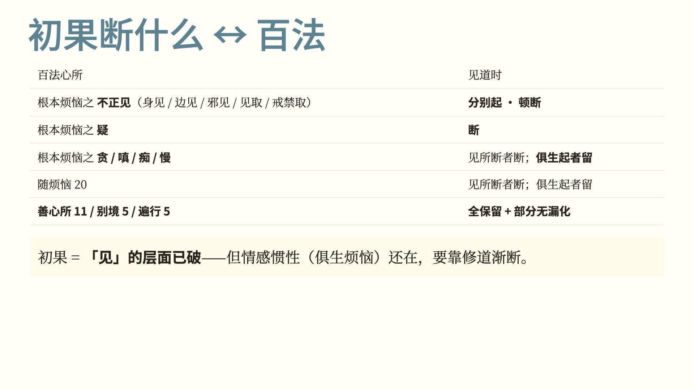

初果断什么，对到百法上有五行：

| 百法心所 | 初果时 |
|---|---|
| 根本烦恼里的不正见（身见、边见、邪见、见取、戒禁取） | 分别起的部分顿断 |
| 根本烦恼里的疑 | 属见所断，直接断 |
| 根本烦恼里的贪、嗔、痴、慢 | 见所断的部分断；俱生起的部分留下，要靠修道继续断 |
| 随烦恼二十个 | 见所断的部分断；俱生起的部分留下 |
| 善心所十一个、别境五个、遍行五个 | 全部保留，并且部分无漏化 |

总结起来，初果在「见」的层面已经破了，但俱生的情感惯性还在，要靠修道慢慢断。

第五部分是修道：渐断俱生烦恼，从一来到不还。

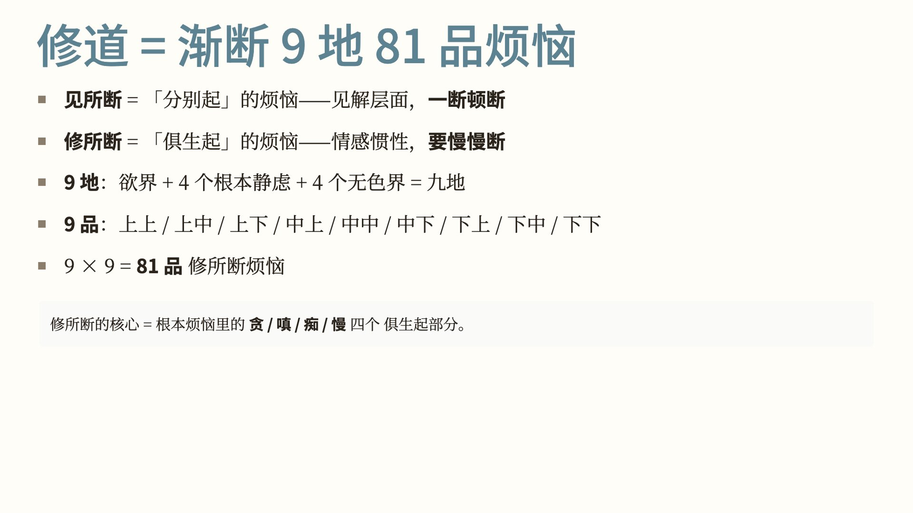

修道，是渐断九地八十一品修所断烦恼。

先分清两类烦恼：

- **见所断**，就是分别起的烦恼，属于见解、错误观念的层面，可以一刹那顿断。
- **修所断**，就是俱生起的烦恼，属于情感、惯性的层面，要慢慢断。

九地是：欲界，加上四个根本静虑，再加上四个无色界，共九地。

九品是把每一地的烦恼按强弱分成九等：上上品、上中品、上下品、中上品、中中品、中下品、下上品、下中品、下下品。

九地乘九品，等于八十一品修所断烦恼。这八十一品主要是百法根本烦恼里贪、嗔、痴、慢四个的俱生起部分。

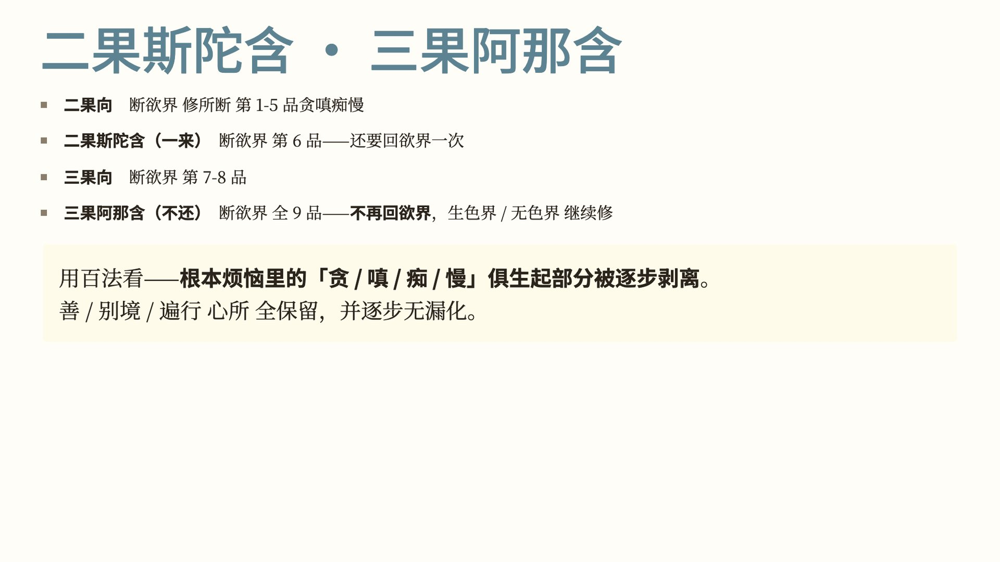

修道的次第：

| 果位 | 所断 |
|---|---|
| 二果向 | 断欲界修所断第一品到第五品的贪、嗔、痴、慢 |
| 二果斯陀含（一来） | 断欲界第六品，还要回欲界一次 |
| 三果向 | 断欲界第七品和第八品 |
| 三果阿那含（不还） | 断尽欲界九品，从此不再回欲界，生在色界或无色界继续修行 |

用百法来看，这个过程就是根本烦恼里贪、嗔、痴、慢的俱生起部分被一点点剥离。善心所、别境心所、遍行心所全部保留，并且继续无漏化。

第六部分是四果阿罗汉：烦恼断尽，无学位。

唯识和俱舍在这一部分的差异最大。

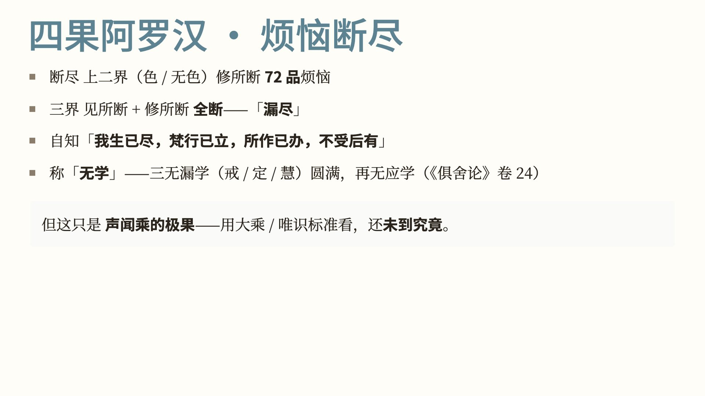

证三果以后继续修，断尽上二界（色界和无色界）的修所断烦恼，共七十二品。

合起来，三界的见所断和修所断全部断尽，这叫「漏尽」。

阿罗汉自己知道：「我生已尽，梵行已立，所作已办，不受后有。」这是阿含经里常见的标准表述。

所以阿罗汉又叫「无学」。按《俱舍论》的说法，无学是戒、定、慧三种无漏学已经圆满，再没有需要修学的了。

但这只是声闻乘的极果。按大乘、唯识的标准，还没有到究竟，后面会讲到。

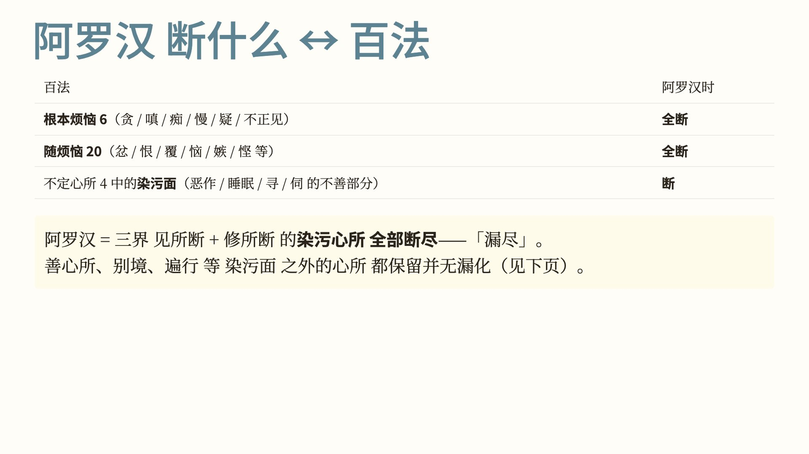

阿罗汉断了什么，对照百法看：

- **根本烦恼六个**：贪、嗔、痴、慢、疑、不正见，全断。
- **随烦恼二十个**：忿、恨、覆、恼、嫉、悭等，全断。
- **不定心所四个里的染污面**：比如恶作、睡眠的不善部分，寻、伺的染污作用，都断。

三界见所断、修所断的染污心所全部断尽，这叫「漏尽」。

染污面之外的善心所、别境心所、遍行心所，全部保留下来，并且无漏化。

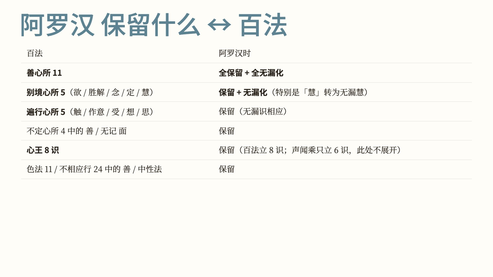

阿罗汉保留了什么，对照百法看：

- **善心所十一个**：全部保留，并且全部无漏化。
- **别境心所五个**：欲、胜解、念、定、慧，保留并无漏化。其中慧转成无漏慧。
- **遍行心所五个**：触、作意、受、想、思，保留，和无漏识相应。
- **不定心所四个里的善面和无记面**：保留。
- **心王八识**：保留。这里顺带说明：百法立八识，声闻乘体系只立六识，这一讲不展开第七、第八两个识。
- **色法十一个、不相应行法二十四个里的善法和中性法**：保留。

百法一百个法里，断尽的只是染污面。善法和中性法大部分都保留下来，并且清净化了。

所以从百法看修证，不是「消灭心所」，而是「净化心所」。

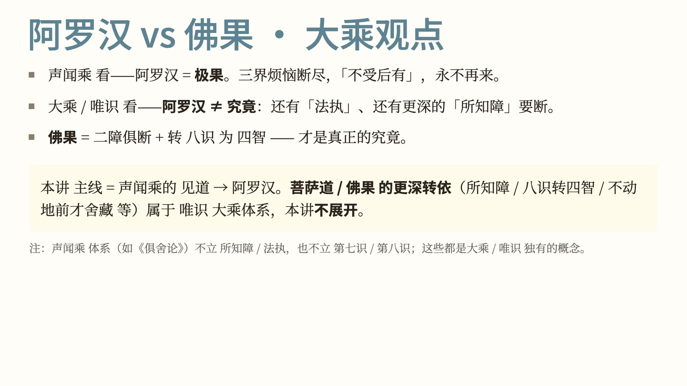

最后说阿罗汉和佛果的关系。

从声闻乘体系看，阿罗汉就是极果：三界烦恼断尽，「不受后有」，永远不再来轮回。

从大乘、唯识的体系看，阿罗汉还不是究竟。大乘认为，除了我执引起的烦恼，还有法执引起的更深一层障碍，叫「所知障」。阿罗汉只断了烦恼障，所知障还在。

大乘的佛果，要断二障、转八识成四智，才是真正的究竟。

这些都属于唯识大乘体系的内容，比如真见道、所知障、第七识染污末那的转依、第八识舍去阿赖耶之名等，这一讲不展开。

还要补充一点：声闻乘体系，比如《俱舍论》，不立所知障，不立法执，也不立第七识、第八识。这些都是大乘、唯识独有的概念。所以严格说，「阿罗汉与佛果」的差距，是在大乘视角下才能看出的判教。

这一讲把视角收回到声闻乘：阿罗汉是声闻乘的极果，就讲到这里。

第七部分，从百法看修证全程：心所的三阶段净化，以及二障双断。

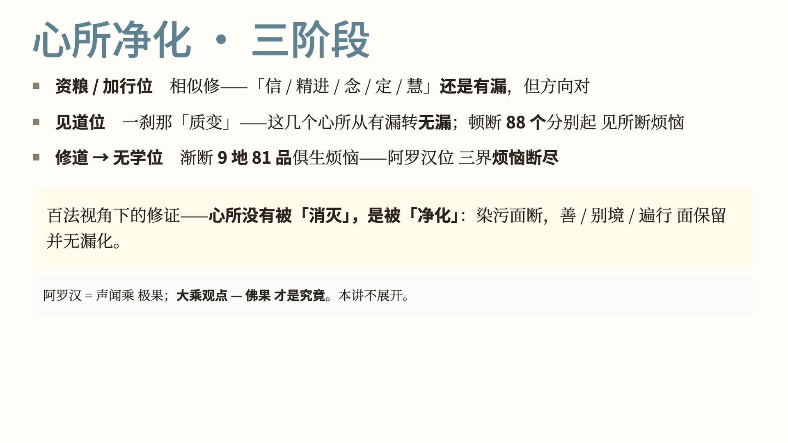

心所净化分三个阶段：

1. **资粮位和加行位**：「相似修」。信、精进、念、定、慧这几个心所还是有漏，方向已经对了。
2. **见道位**：一刹那间从有漏转为无漏，顿断八十八个分别起的见所断烦恼。
3. **修道位到无学位**：渐断九地八十一品俱生烦恼，到阿罗汉位三界烦恼断尽。

从百法看，修证不是把心所消灭，而是把心所净化：染污面断除，善心所、别境、遍行都保留下来，并且无漏化。

阿罗汉是声闻乘的极果；按大乘观点，佛果才是究竟，这一讲不展开。

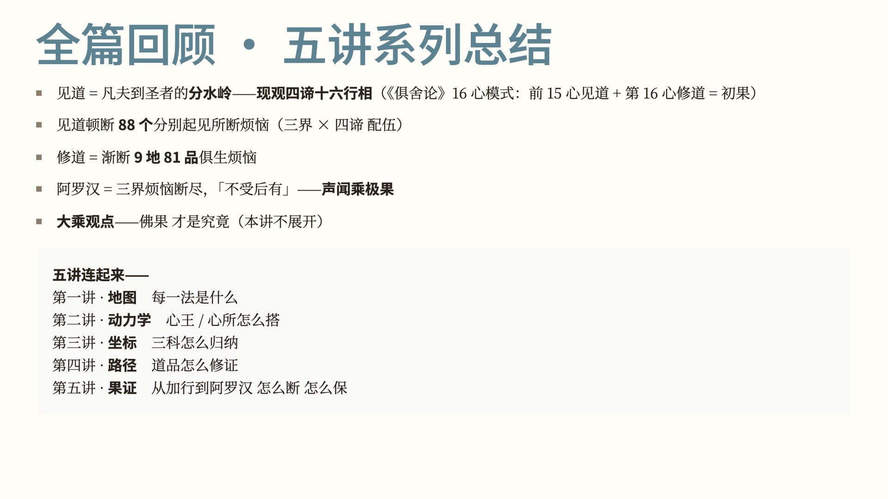

全篇回顾，这一讲讲了五点：

1. 见道是凡夫到圣者的分水岭：现观四谛十六行相，按十六心来分，前十五心是见道，第十六心道类智是修道的第一刹那，也就是初果。
2. 见道顿断八十八个分别起的见所断烦恼，这是烦恼在三界和四谛下的具体形态。
3. 修道是渐断九地八十一品俱生烦恼。
4. 阿罗汉三界烦恼断尽，「不受后有」，是声闻乘的极果。
5. 按大乘观点，佛果才是究竟，这一讲不展开。

把《百法》五讲连起来看：

- 第一讲是「地图」，讲每一法是什么。
- 第二讲是「动力学」，讲心王和心所怎么相应。
- 第三讲是「坐标」，讲三科怎么归纳百法。
- 第四讲是「路径」，讲三十七道品怎么修证。
- 第五讲是「果证」，讲从凡夫到阿罗汉，断了什么、保留了什么。

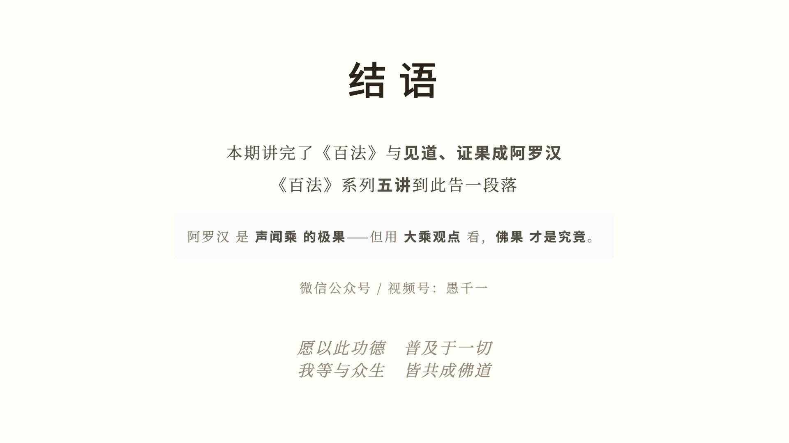

《百法》与见道、证果成阿罗汉就讲到这里，《百法》系列五讲也到此告一段落。

再说一遍：阿罗汉是声闻乘的极果，按大乘观点，佛果才是真正的究竟。

我的微信公众号、视频号都叫「愚千一」，视频版可以在那里看。

愿以此功德，普及于一切；我等与众生，皆共成佛道。

---

**参考**

- 《大乘百法明门论》，世亲造，玄奘译，《大正藏》第 31 册 No. 1614
- 《阿毗达磨俱舍论》，世亲造，玄奘译，《大正藏》第 29 册 No. 1558：卷二十三（见道十六心，前十五心见道、第十六心道类智属修道）、分别贤圣品（四果、无学）、「七觉八道支，一向是无漏」
- 阿含经中的阿罗汉证果表述「我生已尽，梵行已立，所作已办，不受后有」，见《杂阿含经》多处

—— 整理：愚千一
