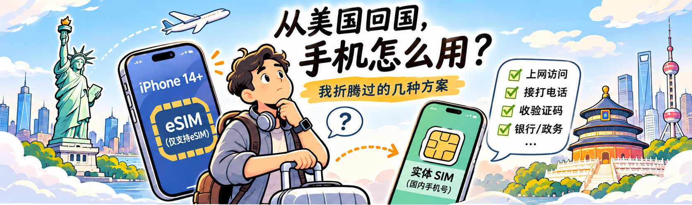
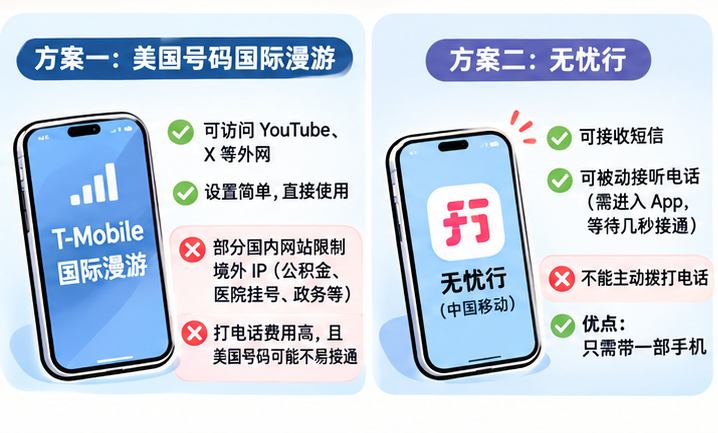
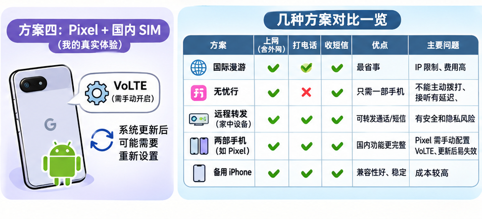

每次从美国回国，手机都是一个让人头疼的问题。

从 iPhone 14 开始，美国销售的 iPhone 就取消了实体 SIM 卡槽，只支持 eSIM。对于长期生活在美国、又需要经常回国的人来说，这带来了不少麻烦。

美国的手机号需要保留，国内的手机号也不能丢。平时要上网、用微信、叫车、点外卖，偶尔还得接银行电话、收验证码、登录国内的政务网站。

看起来只是一个 SIM 卡的问题，实际用起来却牵扯到网络、通话、短信、App 兼容性等一堆事情。这几年，我尝试过好几种方案，但到现在也没有找到一个特别完美的解决办法。

## 方案一：美国号码直接开国际漫游

这是最省事的方案。

我用的是 T-Mobile 一个比较贵的套餐，包含每月 5GB 的国际高速漫游流量。回国之后，基本不需要做什么额外设置，就可以直接使用手机。

这个方案最大的优点，是访问美国的互联网服务很方便。YouTube、X（原 Twitter）之类的网站，通常可以直接访问，不需要额外安装其他软件。

但问题也很明显。

**第一个问题是 IP 地址。**

部分国内网站会限制境外 IP，比如一些公积金查询、医院挂号和政务系统。使用美国运营商的国际漫游时，数据流量可能经由境外网络出口访问互联网，因此有时会被这些系统拒绝。

这就很尴尬：国外网站能访问，回到国内却有些国内网站上不去。

**第二个问题是打电话。**

国际漫游的语音通话通常需要额外收费。而且使用美国号码拨打国内电话，对方看到的是一个境外号码，有些人可能不愿意接，某些服务电话也可能存在拨打限制。

虽然现在大部分事情都可以通过微信或者 App 解决，但偶尔还是免不了要打电话，尤其是银行和一些公共服务机构。

所以，国际漫游虽然方便，却无法完全替代一个国内手机号。

## 方案二：中国移动的「无忧行」

我之前把国内手机号从联通转到了移动，一个主要原因，就是想使用中国移动的「无忧行」App。

它的吸引力在于：即使国内 SIM 卡没有安装在当前手机里，也可以通过相关的号码托管服务，接收部分来电和短信。

这样一来，理论上就可以只带一部美国 iPhone 回国。

但实际用下来，也有不少限制。

首先，按照我使用时的情况，托管服务只能被动接听电话，不能直接通过这个 App 主动拨打电话。

其次，接电话的体验并不好。

当有人打电话进来时，手机通常只是收到一个通知。我需要点开通知，进入无忧行 App，然后再等几秒钟，直到 App 建立好通信连接，才能真正接听。

如果对方挂得比较快，这个电话可能就错过了。

不过，这个方案仍然有一个很大的优点：**不用额外带一部手机。**

如果只是偶尔接一下国内电话、收收短信，平时主要依赖微信和其他 App，它还是有一定实用价值的。

## 方案三：把国内 SIM 卡留在家里，远程转发

网上还有一些比较特殊的硬件方案。

简单来说，就是把一台设备放在国内家里，插入实体 SIM 卡，然后通过网络把电话和短信转发到人在国外使用的手机上。

我没有亲自试过这种方案。

从技术角度看，它应该能够解决一部分问题。不过，我对它的安全性有一些顾虑。

比如，短信验证码可能会经过中转设备或者相关服务。如果设备、账号或者中转服务被入侵，验证码就有泄露的风险。

另外，通话记录、短信内容以及设备管理权限，究竟由谁控制？数据是否经过第三方服务器？这些问题也值得考虑。

当然，不同产品的实现方式可能不同，不能一概而论。

但至少对我来说，如果只是偶尔接收普通短信，也许还可以考虑。要是涉及银行、金融账户和身份验证，我就不太愿意依赖一个自己不完全了解的中转系统了。

## 方案四：带两部手机，Pixel 却让我折腾了很久

既然一部手机很难解决所有问题，那就只能考虑带两部手机。

我最开始专门买过一部 Google Pixel，打算回国时插入国内 SIM 卡使用。

本来以为这会是个比较简单的方案，结果发现麻烦也不少。

主要问题出在 VoLTE 上。

我使用的 Pixel 在国内运营商网络下，不能直接正常使用所需要的 VoLTE 功能，需要借助第三方工具调整设置。

我当时使用过类似 Pixel IMS 这样的工具，配合 Shizuku 来开启相关功能。

操作过程并不算简单，而且每次系统更新之后，都可能需要重新设置一遍。

偏偏 Google Pixel 的系统更新还挺频繁。

原本只想准备一部备用手机，最后却变成了每次回国之前，还要先检查一下系统和 VoLTE 是否正常。

当然，这并不意味着所有 Pixel 手机在国内都会遇到同样的问题。具体情况可能取决于机型、系统版本和运营商。

但从我自己的使用经历来说，这个方案实在有点折腾。

## 方案五：再准备一部 iPhone

如果希望少一些兼容性问题，另一个办法就是专门准备一部支持国内实体 SIM 卡的 iPhone。

iPhone 的优势是系统熟悉，通常也不需要像 Pixel 那样额外折腾 VoLTE 配置。

不过，这又带来了一个成本问题。

如果一年只回国一两次，专门买一部 iPhone 作为备用机，似乎又有点浪费。

尤其是现在手机越来越贵，仅仅为了解决国内电话和短信的问题，再买一部 iPhone，总觉得不太划算。

当然，也不一定非得买最新款，找一部兼容国内运营商的旧 iPhone，也是一种选择。

## 还有一个问题：虚拟电话 App 不一定能操作银行的语音系统

除了以上几种方案，我还尝试过一些可以通过互联网拨打电话的 App。我们公司内部也有类似的工具。

普通电话有时可以正常拨打，但我遇到过一个很奇怪的问题：

**给银行打电话时，如果银行的自动语音系统要求输入密码，无论我怎么按数字键，对方系统都无法正确识别。**

我至今也不确定具体原因。

一种可能是这些 App 对电话按键音（DTMF）的传输或兼容性不够好，导致银行的语音系统接收不到正确的输入。

另一种可能是银行系统对电话线路或输入方式有某些特殊要求。

无论原因是什么，这个经历让我意识到：能够拨通电话，并不代表它就能完成所有电话业务。

特别是银行、信用卡和其他需要在电话中输入密码或验证码的场景，虚拟电话服务未必可靠。

这也让我担心，即使未来无忧行之类的 App 支持主动拨打电话，是否就一定能通过银行的电话验证？恐怕还是要实际测试才知道。

## 目前我的选择

折腾了一圈之后，我现在更倾向于根据回国的时间和需求，组合使用不同方案。

- **美国号码继续使用国际漫游。** 日常上网、访问海外服务都比较方便。
- **国内号码通过无忧行保持基本联系。** 主要用来接收短信和偶尔接听电话。
- **必要时再带一部备用手机。** 如果需要频繁拨打国内电话，或者操作银行、政务类业务，还是直接使用国内实体 SIM 卡比较省心。

备用手机可以是一部兼容国内网络的安卓手机，也可以是一部支持实体 SIM 卡的旧 iPhone。

如果特别希望只用一部手机，那选择就比较有限了。

一种办法是使用仍然支持实体 SIM 卡、同时也支持美国 eSIM 的手机。

另外一个值得关注的新选择，是中国大陆版本的 iPhone Air。它支持 eSIM，符合条件时也可在境外添加其他运营商的 eSIM。不过，境内外的开通规则不同，购买前还是需要仔细确认。

## 最希望的，还是国内 eSIM 能更开放一些

从技术上看，eSIM 本来就是为了让手机号码和实体 SIM 卡解耦，让用户更方便地切换运营商和设备。

但对经常往返中美两国的人来说，目前不同国家、运营商和手机型号之间的限制，反而让事情变得更加复杂。

如果未来国内运营商能够允许更多符合技术要求的 eSIM 手机直接开通国内号码，特别是让海外购买的 iPhone 也能正常使用国内 eSIM，那么很多问题就迎刃而解了。

到那个时候，我们就不需要为了一个国内手机号，专门准备第二部手机；也不需要在国际漫游、电话托管、第三方工具之间来回折腾。

希望这一天能够早点到来。

毕竟，回国已经有很多事情要准备了，手机本来不应该是其中最麻烦的一件。
