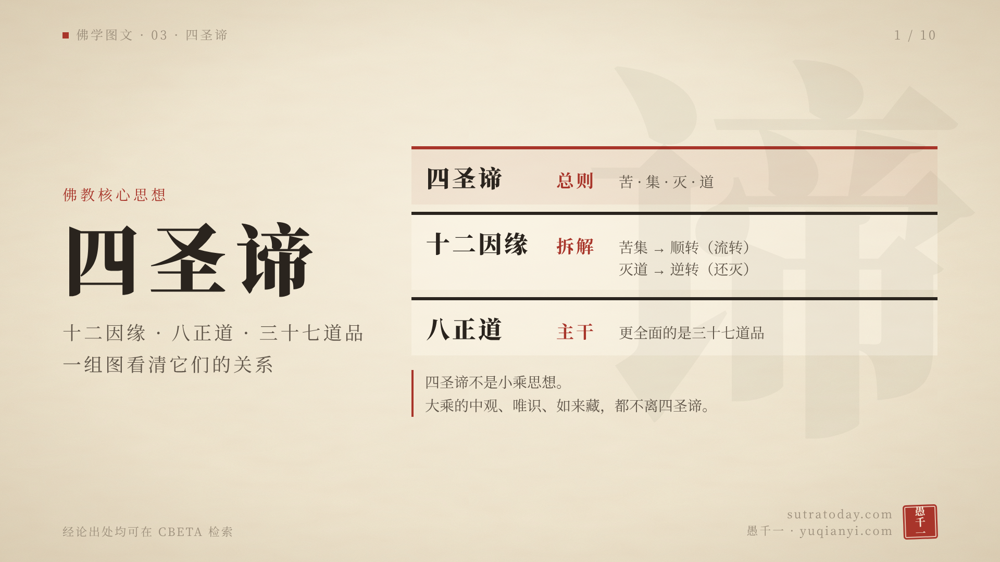
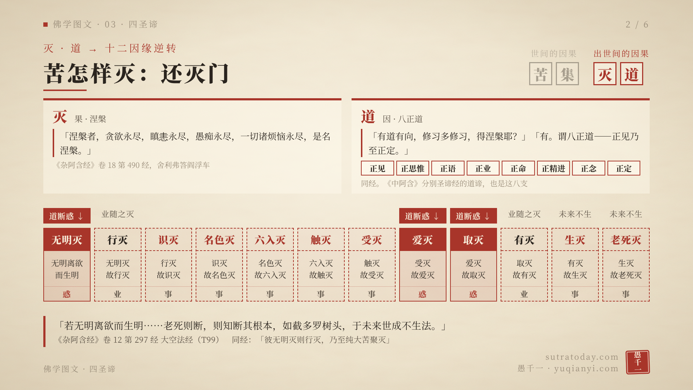
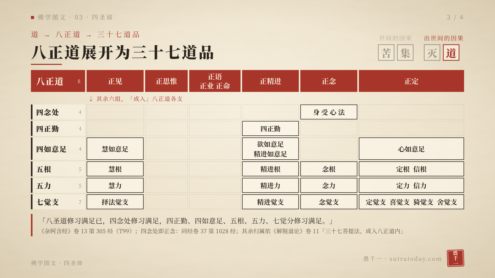
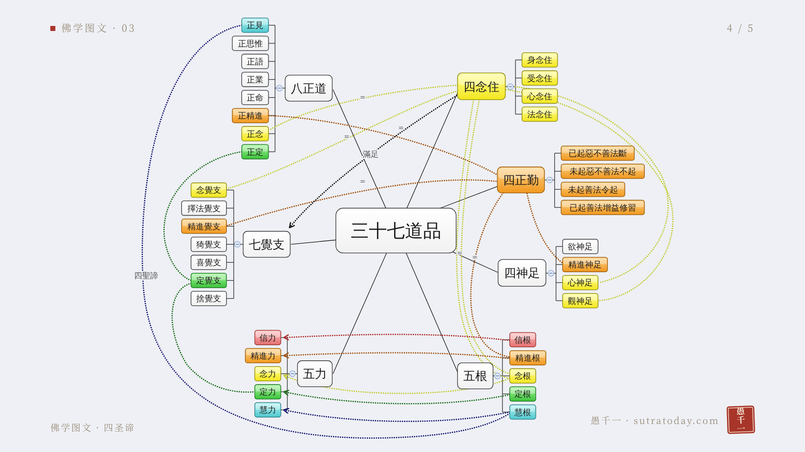
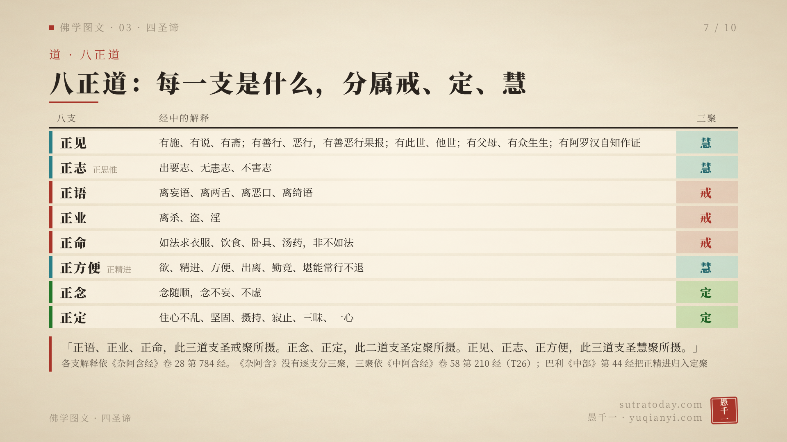
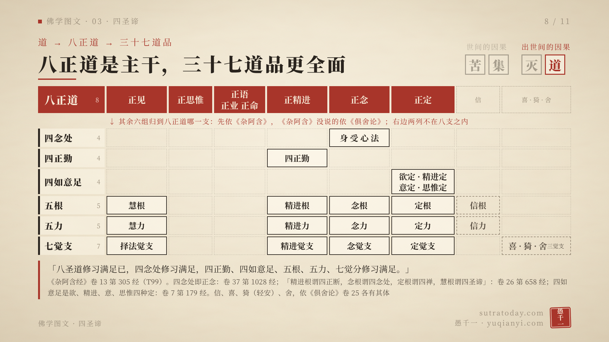
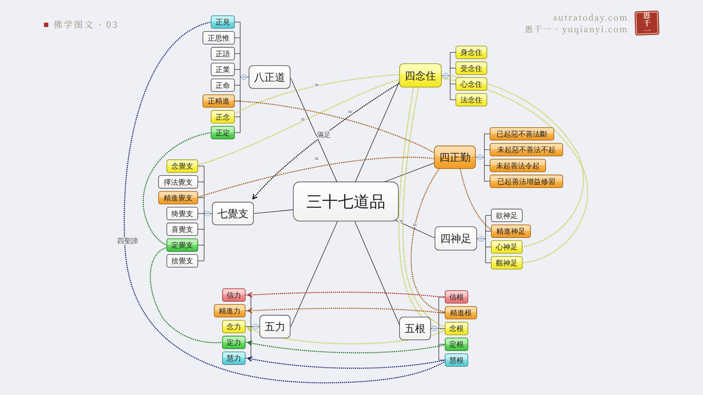
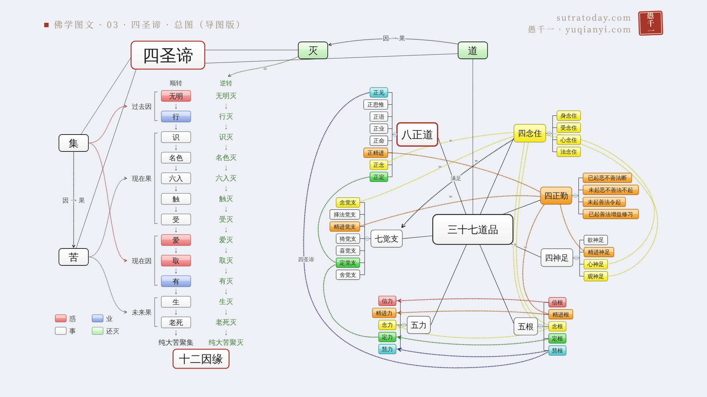

# 佛学图文 03 · 四圣谛 — 视频口播稿

> 由 notes/01.txt..10.txt 拼成，便于通读。改稿请改 notes/ 里的文件，每张卡片一个文件，与 out/card-N.png 一一对应。

## 读音提示（合成时加入 scripts/synth.py 的 PRONUNCIATION_FIXES）

| 词 | 读音 |
|---|---|
| 我是愚千一 | 替换为「我是 愚千一」 |
| 空（空义） | kōng，TTS 时换成「崆」，与上一期一致 |
| 阿耨多罗三藐三菩提 | ā nòu duō luó sān miǎo sān pú tí |
| 波罗奈 | bō luó nài（原文作「波罗㮈」，㮈 TTS 可能读不出，口播稿已写作「奈」） |
| 舍梨子 / 舍利弗 | shè lí zǐ / shè lì fú |
| 胜鬘经 | shèng mán |
| 俱舍论 | jù shè，TTS 换成「俱社」，与上一期一致 |
| 如来藏 / 烦恼藏 | zàng |
| 瞋恚 | chēn huì |
| 绮语 | qǐ yǔ |
| 摩诃拘絺罗 | mó hē jū chī luó |
| 须陀洹 / 斯陀含 / 阿那含 | xū tuó huán / sī tuó hán / ā nà hán |
| 辟支佛 | bì zhī fó |
| 毗舍佉 | pí shè qū |
| 猗觉分 | yī |
| 有斋 | zhāi |
| 正尽苦 | jìn |
| 阎浮车 | yán fú chē |
| 多罗树 | duō luó |
| 第二九八经等编号 | 按上一期写法读作「二九八」；如要读成「二百九十八」，合成前统一替换 |

## 第 1 张

这是「佛学图文」系列，今天讲四圣谛。  
我是 愚千一。  
  
这一期开始，讲佛教的核心思想：四圣谛、十二因缘、八正道。  
这三者的关系，我这样分：四圣谛是总则，十二因缘是拆解，八正道是主干。  
十二因缘，讲的是苦怎样一支一支生起，又怎样一支一支灭掉。苦、集两谛，展开来是十二因缘的顺转；灭、道两谛，展开来是十二因缘的逆转。  
八正道，讲的是怎样修；更全面的修法，是三十七道品。  
先说明一点：四圣谛不是小乘思想。大乘的中观、唯识、如来藏，都不离四圣谛。我们直接看藏经原文。  

## 第 2 张

先说，为什么说四圣谛是佛教的核心。  
第一个理由：佛成道以后第一次说法，讲的就是四圣谛。  
《杂阿含经》卷十五第三七九经，佛在波罗奈鹿野苑，为五比丘说四圣谛。佛说：「我已于四圣谛三转十二行生眼、智、明、觉，故于诸天、魔、梵、沙门、婆罗门闻法众中，得出、得脱，自证得成阿耨多罗三藐三菩提。」  
佛自己说，他是对四圣谛三转十二行，生起了眼、智、明、觉，才自证成就无上正等正觉。  
第二个理由：从初果到成佛，都是知四圣谛。  
《杂阿含经》卷十五第三九三经，佛在鹿野苑告诉比丘们：「若善男子正信非家，出家学道，彼一切所应当知四圣谛法。」  
接着一层一层往上说：证须陀洹的，一切当知四圣谛；证斯陀含的，「彼一切皆于四圣谛如实知故」；阿那含、阿罗汉，也是一切知四圣谛；「若得辟支佛道证，彼一切知四圣谛故」；最后是「若得无上等正觉，彼一切知四圣谛故」。  
从出家学道，到证初果，到成佛，经里说的都是知四圣谛。  

## 第 3 张

有人会说，四圣谛是小乘法，大乘讲的是空、是唯识、是如来藏。我们分别看大乘三系的经论，是怎么说的。  
先看中观。《中论》卷四观四谛品，一开头就是别人的质疑：「若一切皆空，无生亦无灭，如是则无有，四圣谛之法。」意思是：你说一切都空，那就没有四圣谛了。  
龙树菩萨的回答是：「以有空义故，一切法得成；若无空义者，一切则不成。」因为有空义，一切法才能成立。  
品末又说：「若见因缘法，则为能见佛，见苦集灭道。」见到缘起法，就能见到苦集灭道。中观讲空，是用来成立四圣谛的，不是用来否定四圣谛的。  
再看唯识。《成唯识论》卷九讲菩萨的见道。见道里面的相见道，「缘安立谛有十六心」：在苦谛上，有苦法智忍、苦法智、苦类智忍、苦类智四种心；集、灭、道三谛，也各有四种心。菩萨见道，观的就是四谛。  
再看如来藏。《胜鬘经》讲「无作四圣谛」，说圆满地知苦、断集、证灭、修道，「唯如来、应、等正觉事究竟」。接着经文说：「所言苦灭者……如来法身不离烦恼藏，名如来藏。」如来藏，是从灭谛讲出来的。  
所以，离开四圣谛，大乘的见道、修道就无从说起。四圣谛不是小乘思想，是佛教的核心思想。  

## 第 4 张

那么，四圣谛是什么？  
《杂阿含经》卷十四第三四四经，摩诃拘絺罗问舍利弗，舍利弗把四圣谛，一条一条解释了。  
苦：生苦、老苦、病苦、死苦、恩爱别苦、怨憎会苦、所欲不得苦，「如是略说五受阴苦，是名为苦」。这就是常说的八苦。  
苦集：「当来有爱，喜、贪俱，彼彼集著，是名苦集。」对未来的存在有爱，和喜、贪一起，处处执著，这就是苦的集起。  
苦灭：这个爱「无余断，乃至息、没，是名苦灭」。爱断尽了，苦就灭了。  
苦灭道迹：「谓八圣道」，正见、正志、正语、正业、正命、正方便、正念、正定，也就是八正道。  
苦和集，是世间的因果：集是因，苦是果。灭和道，是出世间的因果：道是因，灭是果。  
再看图的下半部分。佛初转法轮的时候，对每一谛说了三遍，叫三转十二行。  
第一转是示转，指出这是什么：此是苦，此是集，此是灭，此是道。  
第二转是劝转，说应当怎样：苦当知，集当断，灭当作证，道当修。  
第三转是证转，说已经做到：苦已知，集已断，灭已作证，道已修。  
四谛各三转，一共十二行。  

## 第 5 张

接下来，从苦、集两谛，展开十二因缘的顺转。  
苦是从哪里来的？十二因缘一支一支讲出来：无明、行、识、名色、六入、触、受、爱、取、有、生、老死。  
《杂阿含经》卷十二第二九八经说：「此有故彼有，此起故彼起，谓缘无明行，乃至纯大苦聚集。」  
同一部经，把十二支一支一支解释了。看图上每一格：  
无明，是不知前际、不知后际，不知苦集灭道；行，是身行、口行、意行；识，是六识身；名色，名是受想行识四阴，色是四大和四大所造色；六入，是眼耳鼻舌身意六内入处；触，是六触身；受，是苦受、乐受、不苦不乐受；爱，是欲爱、色爱、无色爱；取，是欲取、见取、戒取、我取；有，是欲有、色有、无色有；生，是得阴、得界、得入处、得命根；老死，是发白皮缓，乃至身坏、寿尽、命灭。  
十二支和苦、集怎么对应？《俱舍论》卷九说：「三烦恼二业，七事亦名果。」  
无明、爱、取三支，是烦恼，也叫惑，图上是红色；行、有两支，是业，图上是黑色；其余七支，是事，也就是果。惑和业，是苦的因，就是集；七事是果，就是苦。  
《俱舍论》同一卷还说：「十二支三际，前后际各二，中八据圆满。」  
看图上方这一排：无明、行，是过去的因；识、名色、六入、触、受，是现在的果；爱、取、有，是现在的因；生、老死，是未来的果。  
因就是集，果就是苦。在三世里，集和苦出现了两次，所以叫三世两重因果。  

## 第 6 张

再从灭、道两谛，展开十二因缘的逆转。  
灭，就是涅槃。《杂阿含经》卷十八第四九〇经，外道阎浮车问舍利弗，什么是涅槃。  
舍利弗说：「涅槃者，贪欲永尽，瞋恚永尽，愚痴永尽，一切诸烦恼永尽，是名涅槃。」  
阎浮车又问，有没有道路，能得涅槃。舍利弗说：「有。谓八正道——正见乃至正定。」这一段经文，灭和道都说到了。  
逆转是怎样的？《杂阿含经》卷十二第二九七经，大空法经说：「若比丘无明离欲而生明，彼无明灭则行灭，乃至纯大苦聚灭。」  
看图：无明灭了，行就灭；行灭了，识就灭；一路灭下去，到老死灭，纯大苦聚灭。  
八正道从哪里下手？看图上方的红色标记：从惑下手。无明、爱、取是惑，修道断了惑，行、有这些业，也就随着灭了，未来的生、老死，也就不再生起。  
经里打了一个比方：「老死则断，则知断其根本，如截多罗树头，于未来世成不生法。」像砍断了多罗树的树头，这棵树以后，就不会再长了。  

## 第 7 张

道，就是八正道。八正道每一支是什么？《杂阿含经》卷二十八第七八四经，佛一支一支解释了。  
正见：有施、有说、有斋，有善行、有恶行，有善恶行的果报，有此世、有他世，有父母、有众生生，有阿罗汉能自知作证。正见，是相信有布施、有善恶业的果报、有此世他世，也相信有人能证得阿罗汉。  
正志，也就是正思惟：出要志、无恚志、不害志。出离的心，不瞋恚的心，不伤害众生的心。  
正语：离妄语、离两舌、离恶口、离绮语。  
正业：离杀、盗、淫。  
正命：如法求衣服、饮食、卧具、汤药，不是不如法地求。  
正方便，也就是正精进：欲、精进、方便、出离、勤竞、堪能常行不退。  
正念：念随顺，念不妄、不虚。  
正定：住心不乱、坚固、摄持、寂止、三昧、一心。  
紧接着的第七八五经，又把每一支分成两种：一种是世俗的、有漏的，能让人转向善趣；一种是圣的、出世间的、无漏的，能让人正尽苦，转向苦边。  
看图的右边一列：八支，又可以归成戒、定、慧三聚。《杂阿含》没有逐支说三聚，《中阿含经》卷五十八第二一〇经有：法乐比丘尼回答毗舍佉优婆夷说：「正语、正业、正命，此三道支圣戒聚所摄。正念、正定，此二道支圣定聚所摄。正见、正志、正方便，此三道支圣慧聚所摄。」  
这里，正方便归在慧聚。巴利《中部》第四十四经，把正精进归在定聚。两处说法不同，图上也注明了。  

## 第 8 张

八正道是道的主干，更全面的修法，是三十七道品。  
《杂阿含经》卷十三第三〇五经说：「八圣道修习满足已，四念处修习满足，四正勤、四如意足、五根、五力、七觉分修习满足。」八正道修满了，其余六组道品，也就随着修满了。  
经文说的是随着修满，并没有说其余六组都包在八正道里面。《俱舍论》卷二十五说，这三十七法都是趣向菩提的，所以都叫菩提分法。八正道，是其中的一组。  
三十七道品是：四念处、四正勤、四如意足、五根、五力、七觉支、八正道。四加四加四，加五加五，加七加八，一共三十七。  
其余六组，怎么归入八正道？看这张图：最上面一行是八正道，下面六组，各自归到八正道的某一支下面；右边虚线的两列，不在八支里，后面会讲。  
四念处归正念，这在《杂阿含》里有明文。卷三十七第一〇二八经，佛对生病的比丘说：「云何为正念？谓比丘内身身观念处，精勤方便，正念正智，调伏世间贪忧。」佛是用四念处，来解释正念的。  
其余各项，也先看《杂阿含》。卷二十六第六五八经解释五根：「精进根谓四正断，念根谓四念处，定根谓四禅，慧根谓四圣谛。」四如意足，卷七第一七九经叫欲定、精进定、意定、思惟定，四种都是定。  
依这些经文，再参考《俱舍论》卷二十五，可以这样归：  
慧根、慧力、择法觉支，归正见；  
四正勤、精进根、精进力、精进觉支，归正精进；  
四念处、念根、念力、念觉支，归正念；  
四如意足、定根、定力、定觉支，归正定。  
还剩下信根、信力，和喜、猗、舍三个觉支。《杂阿含》没有把它们配到八支里，《俱舍论》说它们各有其体：信以信为体，喜以喜为体，猗也就是轻安，以轻安为体，舍以行舍为体。所以图上把它们放在八正道之外的两列。  
《俱舍论》把四念处归入慧，和《杂阿含》第一〇二八经用四念处解释正念不同。这里，依《杂阿含》。  

## 第 9 张

三十七道品之间的关系，可以再看这张思维导图。这张图，是依一张流传的三十七道品思维导图重绘的，保留了原图的繁体字和画法。  
图中同一种颜色，是同一类：青色是慧，黄色是念，橙色是精进，绿色是定，红色是信。  
点线，把同一类的道品连起来。比如四念住，连到正念、念觉支、念根；四正勤，连到正精进、精进觉支、精进根。五根和五力之间的箭头，是从根到力。  
四念住到七觉支的那条线，标的是「满足」。《杂阿含经》卷二十九第八一〇经说：「四念处满足已，七觉分满足；七觉分满足已，明、解脱满足。」  
正见到慧根的那条线，标的是「四圣谛」。《杂阿含经》第六五八经说，慧根就是四圣谛；第七八五经说，出世间的正见，是苦苦思惟，集、灭、道道思惟。  

## 第 10 张

最后，用一张图，把四圣谛、十二因缘、八正道和三十七道品的关系画出来。  
左上角是四圣谛，分出苦、集、灭、道。  
中间这一列，是十二因缘。框和向下的箭头，是顺转，从无明一路到老死，纯大苦聚集；旁边绿色的一列，是逆转，无明灭，一路灭到老死灭，纯大苦聚灭。  
左边是苦和集，用十二因缘来说：按三世两重因果分成四段，过去因、现在因，是集；现在果、未来果，是苦。集是因，苦是果，这是世间的因果。  
右边是灭和道。灭，就是逆转那一列。道，下面挂的是前面那张三十七道品的导图：八正道是主干，三十七道品更全面。道是因，灭是果，这是出世间的因果。  
四圣谛是总则，十二因缘是拆解，八正道是主干。三者放在一起看：苦从哪里来，怎样灭，用什么方法灭，都在这一张图里了。  
文中的经论，都可以在 CBETA 检索。  
好，今天就讲到这里。  
我的微信公众号、视频号，都叫「愚千一」。  
最后——愿以此功德，普及于一切；我等与众生，皆共成佛道。  
